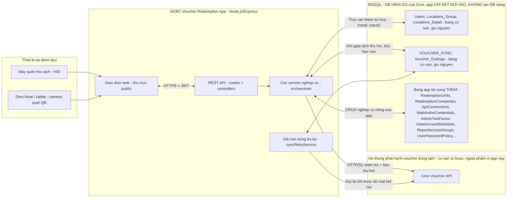
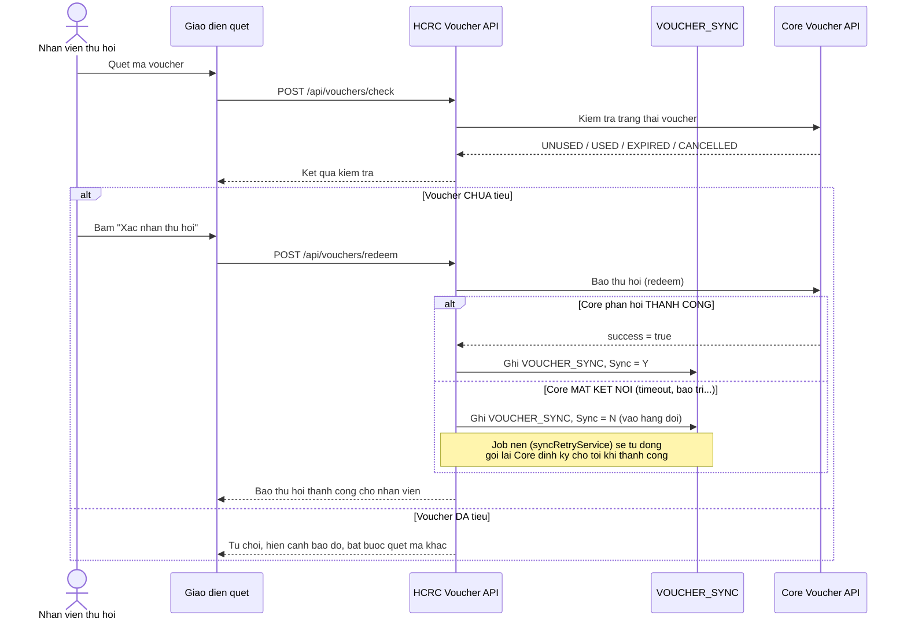

# HCRC Voucher Redemption App

Ung dung web (khong phai POS) cap cho **cac don vi doi tac** de **quet va thu hoi (redeem)
voucher tai quay**, doi chieu ngay lap tuc voi he thong phat hanh trung tam
(**Core Voucher API**), roi **bao cao lai theo tung cong ty/diem tieu** cho HCRC quan ly.

## Mo ta nghiep vu

**Nguyen tac quan trong nhat: DB nghiep vu (Users, Locations_*, VOUCHER_SYNC, Voucher_Exelogs)
la DB HIEN CO cua he thong Core — app nay KHONG tao DB rieng, chi KET NOI VAO va KE THUA toan
bo du lieu/tai khoan dang co san.** App chi bo sung THEM cac bang moi cho nghiep vu cua rieng
no (xem muc 2), tuyet doi khong sua cau truc hay xoa du lieu tren cac bang cu.

Luong nghiep vu chinh:

1. Nhan vien tai diem tieu **dang nhap** (tai khoan da co san trong `Users`, hoac tai khoan moi
   duoc admin tao/gan them — xem muc 3a, 12, 13).
2. **Quet ma voucher** bang may quet ma vach HID (cam vao PC/tablet nhu ban phim) hoac camera
   dien thoai (quet QR) — khong cho go tay de tranh do/doan ma (muc 8).
3. App goi **Core Voucher API** de **kiem tra** (`checkVoucher`) — hoi Core "voucher nay con
   dung duoc khong". Day la buoc CHI DOC, khong lam thay doi trang thai voucher.
4. Neu Core tra ve **CHUA tieu**: hien menh gia/han dung/ngay cap, cho phep nhan vien bam
   **"Xac nhan thu hoi"** → app goi tiep **`redeemVoucher`** de **bao Core** la voucher nay vua
   duoc tieu tai diem nay, dong thoi **ghi 1 dong vao `VOUCHER_SYNC`** (bang co san, dung dung
   nghiep vu cu) de phuc vu bao cao/doi soat cua rieng HCRC (vi 1 minh Core API khong biet duoc
   giao dich nay thuoc **cong ty/diem tieu nao** cua HCRC — xem muc 12).
5. Neu Core tra ve **DA tieu**: canh bao do, khong cho thu hoi, bat buoc quet ma khac.
6. **Neu mat ket noi toi Core dung luc bao thu hoi** (sau khi vua xac nhan CHUA tieu vai giay
   truoc): app **van cho thu hoi thanh cong tai quay** (khong lam gian doan khach hang dang cho),
   dua vao "hang doi dong bo" (`VOUCHER_SYNC.Sync='N'`) va co job nen tu dong gui lai cho Core
   sau — xem muc 4c.
7. Admin xem **bao cao doi soat theo ngay** (muc 5/6) va **bao cao tong hop theo khoang ngay,
   cong don theo Cong ty → Diem tieu** (muc 12) — moi tai khoan **mac dinh chi thay du lieu cong
   ty cua chinh minh**, tru khi duoc cap quyen xem cheo/xem toan bo (muc 13).
8. Cac lop bao mat bao quanh toan bo luong tren: khoa tam khi go sai lien tuc (muc 8), xac thuc
   hai yeu to bat buoc cho quan tri (muc 10), dang nhap van tay/Face ID qua PWA (muc 9), bat
   buoc doi mat khau lan dau (muc 14), gioi han thoi han su dung tai khoan (muc 11).

Stack: **Node.js (Express) + MSSQL** (ket noi vao DB hien co, khong tao DB moi).

---

## 1. Kien truc & So do ket noi he thong



**Doc so do:** app **khong bao gio thay the** Core Voucher API — Core van la **nguon su that
duy nhat** ve trang thai "da tieu/chua tieu" cua voucher. App chi dong vai tro **giao dien thu
hoi tai quay + lop bao cao theo cong ty/diem tieu** rieng cho HCRC, va **dung chung** khoi DB
nghiep vu cot loi (`Users`/`Locations_*`/`VOUCHER_SYNC`) voi he thong Core hien co thay vi tach
rieng — tranh 2 noi du lieu lech nhau.

### 1a. Luong quet - thu hoi (chi tiet xu ly khi Core mat ket noi)



**Nguyen tac kien truc:**

- App **khong tu quan ly** trang thai "da tieu/chua tieu" — do la trach nhiem cua Core Voucher
  API (nguon su that duy nhat), tranh 2 he thong lech nhau.
- Moi lan quet, app goi `checkVoucher()` sang Core API truoc, roi moi cho phep nguoi dung bam
  "Xac nhan thu hoi" (goi `redeemVoucher()`).
- Khi thu hoi thanh cong, app ghi 1 dong vao bang `VOUCHER_SYNC` (bang co san, ke thua) de dung
  lai cho bao cao doi soat/dong bo hien tai — khong tao bang moi song song lam phan manh du lieu.
- **Neu Core API mat ket noi dung luc goi bao thu hoi** (sau khi da xac nhan UNUSED it giay
  truoc do): app **van cho thu hoi thanh cong tai cho** (khong lam gian doan giao dich voi
  khach hang), ghi vao `VOUCHER_SYNC` voi `Sync='N'` nhu 1 "hang doi cho dong bo", roi 1 job
  chay dinh ky se tu dong gui lai — xem muc 4c.
- Moi lan quet (ca thanh cong lan that bai) duoc ghi vao bang moi `VoucherScanLogs` (**log thao
  tac nguoi dung**) de phuc vu tra soat, chong gian lan, debug khieu nai tu doi tac. Moi lan job
  dong bo chay (thanh cong/that bai) duoc ghi vao bang co san `Voucher_Exelogs` (**log he
  thong**), dung dung y goc cua bang nay trong schema ban gui.

## 2. Cac bang du lieu

### Da co san (khong thay doi cau truc)
- `Users`, `Locations_Group`, `Locations_Detail`: dang nhap, quan ly dia diem.
- `VOUCHER_SYNC`: noi luu ban ghi thu hoi thanh cong (app ghi vao day).

### Bo sung (xem thu muc `sql/`)
- `RedemptionUnits` (001): thong tin nghiep vu chi tiet cua **don vi thu hoi** — ma doi tac, ten, nguoi lien he, dia chi, MST, tai khoan ngan hang, han muc/ngay... Lien ket 1-1 voi `Locations_Detail` qua `LocationDetailId`, khong dung cham bang cu.
- `VoucherScanLogs` (002): log toan bo luot quet/kiem tra (ca CHECK va REDEEM), phuc vu doi soat va dieu tra khi co tranh chap.
- Cac index ho tro (003) tren `VOUCHER_SYNC` de truy van bao cao nhanh hon.
- `ApiConnections` + `ApiConnectionTestLogs` (004): luu cau hinh ket noi Core Voucher API do
  admin tu khai bao qua UI (secret duoc ma hoa) va log lich su cac lan bam nut "Test" tren
  man hinh cau hinh.
- `Voucher_Exelogs` (005, chi tao neu **CHUA** co san — moi truong that cua ban da co bang nay):
  dung lai dung muc dich goc de ghi log he thong cua job dong bo lai voucher loi — xem muc 4c.
- `WebAuthnCredentials` (006): luu **khoa cong khai** cua tung passkey (van tay/Face ID) da dang
  ky cho tung tai khoan — khong luu du lieu sinh trac hoc that (van tay/khuon mat khong bao gio
  roi khoi thiet bi cua nguoi dung) — xem muc 9.
- `AdminTwoFactor` (007): luu secret TOTP (**da ma hoa** AES-256-GCM) cua tung tai khoan quan tri
  — **bat buoc** doi voi `Users.status = 1`, khong ap dung cho nhan vien thu hoi thuong — xem muc 10.
- `UserAccountSchedule` (008): moc `ActiveFrom`/`ActiveUntil` (tuy chon) cho **tung tai khoan** —
  cho phep cap tai khoan co thoi han, tu dong kich hoat/het han dung theo 2 moc nay ma khong can
  job nen — xem muc 11.
- `RedemptionCompanies` (009) + cot `CompanyId` tren `RedemptionUnits` (010): them cap **"Cong
  ty"** phia tren tung diem tieu — 1 cong ty co the gan **nhieu diem tieu** (vd chuoi nhieu chi
  nhanh cua cung 1 doi tac). Thong tin lien he/thue/ngan hang chung cua ca cong ty nam o day,
  tach khoi tung diem — xem muc 12.
- `ReportAccessGroups`, `ReportAccessGroupCompanies`, `UserReportAccess` (011): nhom quyen xem
  bao cao cheo/toan bo cong ty, gan theo tung tai khoan — xem muc 13.
- `UserPasswordPolicy` (012): danh dau tai khoan nao **da doi mat khau** qua app nay, dung de
  bat buoc doi mat khau lan dang nhap dau tien — xem muc 14.
- `WebAuthnChallenges` (013): luu TAM challenge dang ky/dang nhap van tay-Face ID trong DB thay
  vi bo nho — de dung duoc khi chay nhieu worker (`CLUSTER_WORKERS > 1`) — xem muc 3e, 9b.
- `VoucherAppPermissions` (014): quyen theo TUNG TINH NANG (thu hoi/doi soat/tong hop/voucher
  da dung) cho tai khoan nhan vien — xem muc 15b.
- `AdminAuditLog` (015): nhat ky thao tac quan tri (tao tai khoan, doi quyen, go 2FA nguoi
  khac...) — xem muc 15c.
- Them cot `IsDeleted`/`DeletedDate` vao `UserAccountSchedule` (016): "xoa mem" tai khoan (nut
  "Xoa"/"Khoi phuc" o man hinh Tai khoan) — an khoi danh sach mac dinh va chan dang nhap, khong
  mat du lieu, khoi phuc lai duoc bat ky luc nao — xem muc 11.
- Them cot `LastUsedCounter` vao `AdminTwoFactor` (017): chong dung lai (replay) 1 ma TOTP con
  hop le trong cua so ±30 giay — xem muc 10.
- Them rang buoc UNIQUE tren `ReportAccessGroups.GroupName` (018): chong tao trung ten nhom
  quyen do bam nham 2 lan (chi ap dung neu HIEN CHUA co ten nao trung san).
- Xoa bang `PartnerApiKeys` neu co (020): don dep 1 tinh nang da xay SAI CHIEU roi go bo ngay
  sau do (migration 019 tung tao bang nay, xem lich su commit) — an toan chay du 019 co tung
  duoc ap dung hay chua.
- Them cot `CanViewBusinessGuide`/`CanViewSystemGuide` vao `VoucherAppPermissions` (021): 2
  quyen moi cho module "Huong dan" trong app — xem muc 16.

Chay migration:

```bash
npm run migrate
```

(script doc va thuc thi tuan tu cac file `.sql` trong `sql/`, an toan chay lai nhieu lan nho `IF NOT EXISTS`).

## 3. Trien khai ung dung (Deployment)

> **Doc truoc khi lam**: app nay **KHONG di kem DB rieng** — no **ket noi vao DB MSSQL hien co**
> cua he thong Core (qua 4 bien `DB_SERVER/DB_PORT/DB_NAME/DB_USER/DB_PASSWORD` trong `.env`) va
> **ke thua nguyen ven** du lieu/tai khoan dang co (`Users`, `Locations_Group`,
> `Locations_Detail`, `VOUCHER_SYNC`, `Voucher_Exelogs`). Buoc migrate (`npm run migrate`) **chi
> them bang moi cho nghiep vu rieng cua app**, khong bao gio `ALTER`/`DROP` hay sua du lieu tren
> cac bang cu — an toan chay tren DB dang production, khong can tao DB/schema moi.

**Lam theo dung thu tu sau, tu tren xuong duoi** (moi buoc deu can buoc truoc do):

| Buoc | Noi dung | Bat buoc? |
|---|---|---|
| 3a | Ket noi ke thua DB hien co + tao tai khoan admin dau tien | Bat buoc |
| 3b | Chay thu tren may local | Tuy chon (bo qua neu da quen app) |
| 3c | Cau hinh domain that cho PWA/van tay | Bat buoc neu dung tren dien thoai/tablet |
| 3d | Tao 1 tai khoan he thong rieng de chay app (khong dung tai khoan ca nhan) | Khuyen nghi manh |
| 3e | Chay that o production — chon PM2 hoac systemd, co the bat nhieu worker | Bat buoc |
| 3f | Dat Nginx phia truoc de co HTTPS | Bat buoc neu dung tren dien thoai/tablet |
| 3g | Checklist xac nhan lai truoc khi ban giao | Bat buoc |
| 3h | Quy trinh cap nhat code sau nay | Tham khao khi can |

### 3a. Ket noi ke thua DB hien co (KHONG tao DB rieng cho app nay)

App **dung chung** 100% du lieu nghiep vu cot loi voi he thong Core hien co — khong tach ra 1
DB moi, khong di chuyen/sao chep du lieu cu sang noi khac:

| Bang | Vai tro trong app moi |
|---|---|
| `Users` | Dang nhap — **giu nguyen tai khoan cu**, app chi doc/so sanh mat khau va (khi can) ghi de lai `Password` khi doi mat khau (muc 14). |
| `Locations_Group`, `Locations_Detail` | Danh muc dia diem — app chi **doc** `Locations_Group`. Voi `Locations_Detail`, ngoai doc con cho phep **them dong moi** (tao dia diem chua tung co, muc 12a) va **doi ten** (`LocationName`) qua man hinh "Don vi thu hoi" (chi admin) — dung cho truong hop trien khai he thong moi, chua dong bo tu Core; KHONG sua cau truc bang, van dung chung du lieu cu da co san. |
| `VOUCHER_SYNC` | App **ghi them dong moi** moi khi thu hoi thanh cong (giu nguyen dung y goc: noi luu ban ghi da tieu de doi soat). |
| `Voucher_Exelogs` | App **ghi them dong moi** moi lan job dong bo chay (dung y goc: log he thong). |

> **Luu y ve mui gio:** cac bao cao loc theo ngay (Bao cao doi soat, Bao cao tong hop, Voucher da
> su dung) so sanh truc tiep ngay nguoi dung chon voi cot `Created_Date` (duoc SQL Server ghi qua
> `GETDATE()` - tra ve gio dia phuong cua **may chu CSDL**, khong phai UTC). App **khong tu ep**
> lai mui gio nay o tang code. Vi vay bat buoc may chu SQL Server phai dat dung mui gio Viet Nam
> (UTC+7) - neu deploy len cloud/VM moi thuong mac dinh UTC, giao dich cuoi ngay se bi tinh nham
> sang bao cao cua ngay hom sau. Kiem tra bang `SELECT GETDATE()` va so sanh voi gio VN thuc te.
>
> **Rieng gia tri GIO:PHUT:GIAY hien thi** (khac voi viec LOC theo ngay o tren, da dung tu truoc) -
> xem loi da sua o v3.89 ngay duoi day: driver `mssql`/`tedious` mac dinh hieu nham gia tri
> `GETDATE()` (gio dia phuong may chu) la gio UTC luc doc ve, lam LECH 7 GIO khi hien ra man
> hinh/Excel du gia tri luu trong CSDL van dung. Da sua o tang truy van (khong anh huong cach
> loc ngay), nhung neu sau nay THEM 1 cot gio moi can hien ra man hinh (vd 1 bao cao/nhat ky moi),
> phai ap dung lai dung kieu `DATEADD(HOUR, -7, <cot>) AS <cot>` trong SELECT - xem vi du o
> `scanLogService.js`.

**Cac buoc:**

```bash
# 1) Cai dependency
npm install

# 2) Tao file cau hinh tu mau, roi SUA 5 bien DB_* tro dung DB THAT dang chay (khong phai DB test)
cp .env.example .env
```

Mo `.env`, sua **dung** thong tin ket noi cua DB that:

```ini
DB_SERVER=<ip-hoac-hostname-cua-may-chu-sql-that>
DB_PORT=1433
DB_NAME=<ten-database-hien-co-cua-Core>
DB_USER=<user-co-quyen-doc/ghi-db-nay>
DB_PASSWORD=<mat-khau>
DB_ENCRYPT=true                 # giu true neu SQL Server co cau hinh SSL (khuyen nghi)
DB_TRUST_SERVER_CERT=true       # CANH BAO: true = TAT xac thuc chung chi TLS khi ket noi DB, de
                                 # trien khai duoc ngay voi cert noi bo/tu ky pho bien o SQL Server
                                 # noi bo. Neu may chu SQL da co chung chi tu 1 CA hop le (kha
                                 # thi neu host tren cloud/co ha tang PKI rieng), DOI SANG false -
                                 # giu true vinh vien tren 1 he thong co the truy cap tu ben ngoai
                                 # mang noi bo se de lo ket noi DB truoc tan cong xen giua (MITM).
DB_POOL_MAX=20                  # so ket noi toi da trong pool DB - xem ghi chu ve khoa thu hoi ben duoi
```

> **Vi sao `DB_POOL_MAX` quan trong hon truoc**: de chan 2 nguoi quet trung 1 ma voucher gan nhu
> cung luc (xem muc "Nghiep vu thu hoi voucher"), app giu 1 khoa CSDL (`sp_getapplock`) XUYEN
> SUOT ca thoi gian cho Core API phan hoi khi thu hoi, khong chi buoc ghi DB nhanh nhu truoc -
> nghia la 1 ket noi trong pool nay bi "chiem" trong toi da vai giay moi luot thu hoi (gioi han
> boi Timeout cua tung ket noi Core, toi da 10 giay - xem man hinh "Ket noi API"). Neu nhieu quay
> thu hoi dong thoi vuot qua `DB_POOL_MAX`, cac request khac (bao cao, dang nhap...) se phai cho
> toi khi co ket noi ranh. Mac dinh 20 du dung cho vai chuc quay thu hoi dong thoi; tang len neu
> trien khai quy mo lon hon.

> **Luu y**: tai khoan `DB_USER` toi thieu can quyen `SELECT` tren `Users`/`Locations_Group`/
> `Locations_Detail`, va `SELECT/INSERT/UPDATE` tren `VOUCHER_SYNC`/`Voucher_Exelogs`, cong them
> quyen `CREATE TABLE` (mot lan, luc chay migrate) de tao cac bang bo sung o muc 2. Neu chinh
> sach bao mat noi bo khong cho phep 1 user co quyen `CREATE TABLE` truc tiep tren DB production,
> nho DBA chay `npm run migrate` (hoac copy noi dung tung file trong `sql/` chay thu cong theo
> **dung thu tu ten file, tu 001 den file so lon nhat hien co trong thu muc `sql/`** - danh sach
> nay tang dan theo thoi gian, xem `ls sql/` de biet chinh xac file moi nhat) bang 1 tai khoan co
> quyen cao hon **1 lan duy nhat**, sau do
> tra lai quyen han che cho `DB_USER` dung hang ngay.

```bash
# 3) Backup DB TRUOC KHI migrate lan dau tren production (buoc bat buoc, khong duoc bo qua)
#    - Day la thao tac them bang (IF NOT EXISTS) nen rui ro rat thap, nhung backup truoc van la
#      nguyen tac an toan bat buoc voi moi thay doi tren DB dang phuc vu that.

# 4) Chay migrate - tao THEM cac bang rieng cua app (KHONG dung den bang cu)
npm run migrate
```

`npm run migrate` doc va chay tuan tu toan bo file `.sql` trong `sql/` theo thu tu ten file
(xem `ls sql/` de biet danh sach hien tai - moi ban phat hanh moi co the them file moi), moi file boc trong `IF NOT EXISTS (...)` nen
**chay lai bao nhieu lan cung an toan** (khong tao trung, khong mat du lieu) — dung dung 1 lenh
nay cho ca lan dau tien va cho moi lan sau nay code co them migration moi.

**Tai khoan cu (co san trong `Users`) dang nhap duoc ngay**, khong can thao tac gi them — mien
la cot `Password` cua ho dang la mat khau **plaintext cu** hoac **da hash bang bcrypt**
(`authService.js` ho tro doc ca 2 dang, xem muc 8). Luu y 2 rang buoc **rieng cua app** ap dung
ngay tu lan dang nhap dau (khong doi/xoa du lieu cu, chi la buoc bo sung khi dang nhap):
tai khoan `status = 1` (quan tri) bat buoc thiet lap 2FA (muc 10), va **moi tai khoan** bat buoc
doi mat khau neu chua tung doi qua app nay (muc 14).

Neu DB that **chua co san tai khoan `status = 1`** nao de dang nhap lan dau (vi du DB chi co san
tai khoan nhan vien thuong), tao 1 tai khoan quan tri moi bang script co san — **khong can vao
thang SQL Server Management Studio tu tay dieu chinh**:

```bash
npm run create-admin -- --username=admin_moi --password="MatKhauManhToiThieu8KyTu" --fullName="Ten quan tri"
```

Script `scripts/create-admin.js` se **bam mat khau bang bcrypt** (khong bao gio luu plaintext)
roi tao/cap nhat 1 dong trong `dbo.Users` voi `status = 1`. Neu `--username` da ton tai (vi du
mot tai khoan nhan vien cu), script se **cap nhat lai mat khau + nang cap tai khoan do thanh
quan tri** thay vi tao trung dong moi; co the them `--locationsGroup=...`/
`--locationsDetail=...` neu muon gan san tai khoan quan tri vao 1 dia diem cu the (thuong khong
can, vi `status = 1` mac dinh da xem/thao tac duoc toan bo he thong — muc 13). Dang nhap lan dau
bang tai khoan nay se lan luot di qua: **doi mat khau (muc 14) → thiet lap 2FA (muc 10)** truoc
khi vao duoc trang chinh.

### 3b. Chay thu tren may local (tuy chon, dung de kiem tra truoc khi len that)

```bash
npm run dev             # server dev, tu dong reload khi sua code
```

Mo trinh duyet: `http://localhost:3000` (may quet ma vach cam vao PC/tablet qua cong USB, con
dien thoai dung camera co san — camera **chi hoat dong tren `localhost` hoac HTTPS**, xem 3c).

### 3c. Cau hinh domain that cho PWA + dang nhap van tay/Face ID (WebAuthn)

App co the **cai dat nhu 1 ung dung (PWA)** va ho tro **dang nhap bang van tay/Face ID** — xem
muc 9. Ca 2 tinh nang nay **rang buoc chat voi domain that**, nen phai khai bao dung **truoc khi
dua cho nguoi dung that su dung** (doi domain sau khi da co nguoi dang ky van tay se lam **mat
het** du lieu passkey da dang ky, phai dang ky lai tu dau):

```ini
WEBAUTHN_RP_NAME=HCRC Voucher Redemption
WEBAUTHN_RP_ID=voucher.hcrc.vn            # DUNG domain that se dung lau dai, khong dat tam
WEBAUTHN_ORIGIN=https://voucher.hcrc.vn   # URL day du, BAT BUOC https:// (tru localhost khi dev)
```

> **Luu y**: `WEBAUTHN_RP_ID` phai la **domain thuan tuy** (khong co `https://`, khong co dau
> `/` hay cong o cuoi), con `WEBAUTHN_ORIGIN` phai la **URL day du** khop **chinh xac** (ca
> scheme lan domain) voi dia chi nguoi dung go tren trinh duyet — sai 1 trong 2 se lam trinh
> duyet **tu choi tham lang** hop thoai van tay/Face ID (khong bao loi ro rang), rat kho debug
> neu khong biet truoc dieu nay.

### 3d. Tao 1 tai khoan he thong rieng de chay app

`.env` chua **plaintext** `DB_PASSWORD`, `JWT_SECRET`, `ENCRYPTION_KEY`... — day la cach lam
**binh thuong va du dung** cho quy mo 1 server nhu app nay (khong can ma hoa noi dung file nay:
neu ma hoa ma chia khoa giai ma van nam tren cung server, ke tan cong chiem duoc server se lay
duoc ca 2 cung luc, khong tang them bao ve thuc su). Lop phong thu dung thuc su la **gioi han
ai/tien trinh nao doc duoc file nay** — bang cach cho app chay duoi 1 tai khoan he thong RIENG,
KHONG dung chung voi tai khoan ca nhan hang ngay cua admin:

```bash
# 1) Tao 1 user he thong RIENG cho app - KHONG the dang nhap/SSH truc tiep bang user nay
sudo useradd --system --no-create-home --shell /usr/sbin/nologin hcrcapp

# 2) Chuyen quyen so huu toan bo thu muc app (dac biet la .env) cho dung user nay
sudo chown -R hcrcapp:hcrcapp /duong-dan/toi/hcrc-voucher

# 3) Khoa .env chi minh chu so huu (hcrcapp) moi doc/ghi duoc
sudo chmod 600 /duong-dan/toi/hcrc-voucher/.env
```

> **Vi sao lam vay**: neu app chay bang chinh tai khoan SSH ca nhan hang ngay cua admin, ai do
> sau nay chiem duoc quyen dang nhap tai khoan do (do mat khau SSH, lo SSH key...) se **tu dong**
> doc duoc `.env` luon. Tach ra 1 service account rieng, **khong co mat khau/khong dang nhap
> duoc**, thu hep con duong doc file nay lai chi con: (1) chiem duoc chinh tien trinh app dang
> chay (lo hong trong code), hoac (2) co san quyen `root`/`sudo` — ca 2 deu nghiem trong hon
> nhieu so voi "do duoc 1 mat khau SSH thuong". Luu y `root` luon doc duoc moi file bat ke
> `chmod` gi — 600 khong chong duoc ke da co quyen root, no chong cac user **khac** khong co
> quyen root tren cung may chu.

Muc 3e ben duoi se cho app **chay bang dung user `hcrcapp` nay**, dung ca cho PM2 lan systemd.

**Sau nay moi lan can sua `.env`** (vi du doi mat khau DB, xoay `JWT_SECRET`...): **khong dang
nhap bang `root` hay bang `hcrcapp`** (ca 2 von khong cho dang nhap truc tiep) — admin van dung
tai khoan ca nhan cua minh SSH vao server (can nam trong nhom `sudo`), roi chon 1 trong 2 cach:

```bash
# Cach 1 - sua bang quyen root (root luon doc/ghi duoc moi file, bat ke chmod gi):
sudo nano /duong-dan/toi/hcrc-voucher/.env
# Sau khi luu, KIEM TRA/DAT LAI quyen so huu (mot so trinh soan thao xoa-tao lai file khi luu,
# co the vo tinh doi chu so huu ve root khien app khong con doc duoc .env nua):
sudo chown hcrcapp:hcrcapp /duong-dan/toi/hcrc-voucher/.env
sudo chmod 600 /duong-dan/toi/hcrc-voucher/.env

# Cach 2 (khuyen nghi, sach hon) - chay thang trinh soan thao DUOI danh tinh hcrcapp, khong can
# nho buoc chown lai vi file van do dung chu so huu tao ra:
sudo -u hcrcapp nano /duong-dan/toi/hcrc-voucher/.env
```

> `sudo -u hcrcapp <lenh>` chi la "muon quyen tam thoi de chay 1 lenh", khong phai dang nhap mo
> phien lam viec cua `hcrcapp` — nen van chay duoc binh thuong du user nay khai bao
> `--shell /usr/sbin/nologin` (chi chan mo shell tuong tac/SSH, khong chan `sudo -u` goi thang
> 1 chuong trinh cu the).

### 3e. Chay that o production: 2 cach + cluster nhieu worker

`npm run dev`/`npm start` chi phu hop dev/demo — khi chay that can 1 **process manager** de:
(1) tu dong khoi dong lai app neu crash, (2) tu dong chay lai app khi server reboot, (3) quan ly
log gon gang. Chon **1 trong 2 cach** duoi day (khong can lam ca 2) — ca 2 deu chay app bang
user `hcrcapp` da tao o muc 3d, va ca 2 deu ho tro **chay nhieu worker song song** theo cach
giong het nhau (xem phan "Chay nhieu worker" ngay ben duoi).

#### Cach 1: Chay bang PM2 (don gian, quen thuoc voi nguoi hay dung Node.js)

```bash
# 1) Cai PM2 (chi 1 lan, cai global cho toan he thong)
sudo npm install -g pm2

# 2) Khoi dong app BANG DUNG USER hcrcapp (khong dung tai khoan ca nhan cua admin) - luu y PM2
#    quan ly danh sach tien trinh RIENG cho tung user, nen tu day ve sau moi lenh pm2 lien quan
#    toi app nay deu phai chay kem "sudo -u hcrcapp" nhu duoi day.
sudo -u hcrcapp pm2 start src/server.js --name hcrc-voucher --cwd /duong-dan/toi/hcrc-voucher

# 3) Luu lai danh sach tien trinh hien tai cua user hcrcapp
sudo -u hcrcapp pm2 save

# 4) Dang ky PM2 tu khoi dong lai cung he dieu hanh sau khi reboot server - lenh nay se IN RA
#    1 dong lenh "sudo env PATH=... pm2 startup systemd -u hcrcapp --hp ..." - COPY va chay
#    dung dong do (khong tu doan, moi may in ra duong dan khac nhau)
sudo -u hcrcapp pm2 startup
```

**Cac lenh thuong dung sau khi da chay** (luon nho kem `sudo -u hcrcapp` vi app chay duoi user do):

```bash
sudo -u hcrcapp pm2 list                    # xem trang thai (online/stopped), uptime, so lan restart
sudo -u hcrcapp pm2 logs hcrc-voucher       # xem log truc tiep (Ctrl+C de thoat, khong dung app)
sudo -u hcrcapp pm2 restart hcrc-voucher    # khoi dong lai (vd sau khi sua .env hoac cap nhat code)
sudo -u hcrcapp pm2 stop hcrc-voucher       # dung han (khong tu bat lai cho toi khi restart)
```

> **Quan trong — KHONG dung ca `pm2 -i` lan `CLUSTER_WORKERS` cung luc**: PM2 co san 1 co che
> cluster rieng qua co `-i <so-tien-trinh>`, nhung app nay da tu lam cluster BEN TRONG
> `src/server.js` (xem phan "Chay nhieu worker" ngay duoi) de dung duoc voi ca systemd chu
> khong chi PM2. Neu bat ca 2 cung luc (`pm2 start ... -i 4` VA `CLUSTER_WORKERS=4` trong
> `.env`), ban se vo tinh chay **4 tien trinh PM2, moi tien trinh lai tu fork them 4 worker con
> = 16 tien trinh** thay vi 4 nhu mong muon. Voi PM2, luon de **mac dinh (khong dung `-i`)**, chi
> dieu chinh so worker qua `CLUSTER_WORKERS` trong `.env`.

> **Kiem tra dang chay dung version nao sau khi cap nhat code:** cot "Version" trong
> `pm2 list`/`pm2 status` CHI doc dung neu tien trinh duoc dang ky DUNG CACH nhu buoc 2 o tren
> (`pm2 start src/server.js --cwd <duong-dan-that-toi-thu-muc-app>`) - neu tung dang ky qua cach
> khac (vd `pm2 start npm -- start`) thi cot nay se hien "N/A" mai mai cho toi khi xoa dang ky
> cu va lam lai dung cach (`pm2 delete hcrc-voucher` roi chay lai buoc 2). Cach kiem tra CHAC
> CHAN dung version dang chay, khong phu thuoc pm2 co hien dung hay khong:
> - Xem dong dau tien trong log luc khoi dong: `sudo -u hcrcapp pm2 logs hcrc-voucher --lines 50`
>   se co dong "HCRC Voucher Redemption App v<version> ... dang chay tai ...".
> - Hoac goi `curl http://localhost:3000/health` - tra ve JSON co san field `"version"`.
> - **Don gian nhat (khong can may chu, ai cung xem duoc):** tu ban v3.14, so version hien
>   ngay TREN GIAO DIEN WEB - o cuoi trang dang nhap (`/login.html`, chua can dang nhap) va o
>   goc phai topbar sau khi dang nhap (canh nut "Dang xuat"). Gia tri nay goi truc tiep
>   `/health` moi khi tai trang (khong luu cung file JS/HTML tinh) nen luon phan anh dung ban
>   dang thuc su chay tren server, ke ca khi trinh duyet dang cache file tinh cu.

#### Cach 2: Chay bang systemd service (khong can cai them goi nao, co san tren moi distro Linux hien dai)

```bash
# 1) Tao file dinh nghia service
sudo nano /etc/systemd/system/hcrc-voucher.service
```

Dan noi dung sau (sua duong dan cho dung voi noi ban da clone/giai nen code):

```ini
[Unit]
Description=HCRC Voucher Redemption App
After=network.target

[Service]
Type=simple
User=hcrcapp
Group=hcrcapp
WorkingDirectory=/duong-dan/toi/hcrc-voucher
ExecStart=/usr/bin/node src/server.js
Restart=on-failure
RestartSec=5

[Install]
WantedBy=multi-user.target
```

(App tu doc `.env` bang thu vien `dotenv` ngay khi khoi dong — chi can `WorkingDirectory` dung
chinh xac thu muc chua `.env` la du, khong can khai bao them `EnvironmentFile=` trong file nay.)

```bash
# 2) Bao systemd nap lai cau hinh (bat buoc moi lan tao/sua file .service)
sudo systemctl daemon-reload

# 3) Bat tu dong chay cung he dieu hanh sau khi reboot server
sudo systemctl enable hcrc-voucher

# 4) Khoi dong app ngay bay gio
sudo systemctl start hcrc-voucher
```

**Cac lenh thuong dung sau khi da chay:**

```bash
sudo systemctl status hcrc-voucher     # xem app dang chay hay loi, PID, thoi gian uptime
sudo journalctl -u hcrc-voucher -f     # xem log truc tiep (tuong duong pm2 logs, Ctrl+C de thoat)
sudo systemctl restart hcrc-voucher    # khoi dong lai (vd sau khi sua .env hoac cap nhat code)
sudo systemctl stop hcrc-voucher       # dung han
```

#### Nen chon PM2 hay systemd?

Ca 2 deu dam bao app tu khoi dong lai khi crash/reboot server va deu ho tro cluster nhu nhau
(vi cluster nam trong chinh code cua app, khong phu thuoc process manager nao) — khac biet chi
o trai nghiem quan tri:

| Tieu chi | PM2 | systemd |
|---|---|---|
| Can cai them goi ngoai | Co (`npm install -g pm2`) | Khong (co san tren Linux) |
| Xem log | `pm2 logs` | `journalctl -u ...` |
| Quen thuoc voi | Nguoi quen he sinh thai Node.js | Nguoi quen quan tri Linux server noi chung |
| Theo doi CPU/RAM tien trinh | Co san lenh `pm2 monit` | Can them cong cu ngoai (`systemctl status`, `htop`...) |

Neu khong chac chon gi, **PM2** thuong de bat dau hon voi nguoi quen viet code Node.js; **systemd**
phu hop hon neu server da co san quy trinh quan tri dich vu bang systemd cho cac app khac.

#### Chay nhieu worker (cluster) de tan dung nhieu nhan CPU

App dung san module `cluster` cua Node.js (`src/server.js`) de chay **nhieu tien trinh worker
song song**, tat ca cung lang nghe chung 1 cong — Node tu dong chia deu request cho cac worker,
khong can cau hinh gi them o Nginx hay process manager. Bat qua **1 bien duy nhat** trong `.env`:

```ini
CLUSTER_WORKERS=1      # mac dinh - 1 tien trinh duy nhat, giong het truoc khi co tinh nang nay
CLUSTER_WORKERS=4      # chay dung 4 worker xu ly HTTP song song
CLUSTER_WORKERS=max    # chay bang dung so nhan CPU cua may chu
```

Sau khi doi `CLUSTER_WORKERS`, khoi dong lai app (`pm2 restart hcrc-voucher` hoac
`systemctl restart hcrc-voucher`) de ap dung.

**Co che hoat dong** (khong can hieu de dung, chi de biet vi sao an toan): khi `CLUSTER_WORKERS
> 1`, tien trinh dau tien tu fork ra N tien trinh con de xu ly HTTP, ban than no **khong nhan
request nao ca** — chi giu 1 ket noi DB rieng de chay **DUY NHAT 1 lan** job nen dong bo voucher
loi (muc 4c). Neu de moi worker tu chay job nay se bi lap lai N lan song song, gay goi trung
Core API — app da tu xu ly de tranh dieu nay, khong can cau hinh gi them.

> **Luu y quan trong ve bao mat khi dung nhieu worker**: MOT SO co che phong ve dung `Map` trong
> **bo nho cua tung tien trinh** (khong chia se giua cac worker), nen voi N worker nguong thuc te
> co the long hon toi da khoang N lan so voi con so cong bo (1 nguoi lien tuc thao tac co the roi
> vao worker khac nhau moi lan, Node chia request theo kieu xoay vong). Danh sach cac co che nay
> (tat ca deu da tu ghi chu ro trong code, xem file tuong ung):
> - `loginGuard`/`guessGuard` (muc 8) — khoa tam dang nhap/quet ma sai nhieu lan.
> - `ipRateLimit.js` — gioi han so request dang nhap/2FA/webauthn that bai tu 1 dia chi IP.
> - `sessionRevalidation.js` — cache 30 giay trang thai tai khoan (dung de phat hien admin bi
>   khoa/xoa gan nhu ngay lap tuc, VA de tu choi token cap truoc lan doi mat khau gan nhat -
>   xem `PasswordVersion`/`passwordVersion` trong middleware/auth.js); `invalidate()` goi
>   luc khoa/xoa/doi mat khau CHI xoa cache o worker xu ly request do, cac worker khac van dung
>   cache cu toi da 30 giay nua (van nam trong nguong 30 giay da cong bo, khong bi noi rong them
>   boi so worker - khac voi 2 muc tren).
> - `captcha.js` — chong dung lai (replay) 1 ma xac thuc da giai dung.
>
> Day la danh doi da can nhac: voi vai worker (2-4), muc do long hon nay van con chap nhan duoc;
> neu can dem/chan chinh xac tuyet doi bat ke bao nhieu worker, phai chuyen cac bo dem nay sang
> luu o DB hoac Redis dung chung thay vi bo nho tien trinh (chua trien khai — lien he neu can).
> Rieng challenge dang nhap van tay/Face ID (WebAuthn) **da luu san trong DB**
> (`dbo.WebAuthnChallenges`, migration 013) nen KHONG bi anh huong boi so worker — dang ky/dang
> nhap van tay hoat dong binh thuong du chay bao nhieu worker.

### 3f. Reverse proxy Nginx + HTTPS

Dat Nginx phia truoc app de xu ly HTTPS bang chung chi that (vd Let's Encrypt) — app tu than
chi lang nghe HTTP thuan o cong noi bo, du dang chay 1 tien trinh hay nhieu worker (Nginx luon
chi tro vao **1 cong duy nhat**, khong doi gi khi ban tang/giam `CLUSTER_WORKERS`):

```nginx
server {
    listen 443 ssl http2;
    server_name voucher.hcrc.vn;               # PHAI trung voi WEBAUTHN_RP_ID o 3c

    ssl_certificate     /etc/letsencrypt/live/voucher.hcrc.vn/fullchain.pem;
    ssl_certificate_key /etc/letsencrypt/live/voucher.hcrc.vn/privkey.pem;

    location / {
        proxy_pass http://127.0.0.1:3000;      # cong noi bo app dang lang nghe
        proxy_set_header Host $host;
        proxy_set_header X-Real-IP $remote_addr;
        proxy_set_header X-Forwarded-For $proxy_add_x_forwarded_for;  # QUAN TRONG: de app biet dung IP nguoi dung that (chan brute-force/dang nhap theo IP, ghi log)
        proxy_set_header X-Forwarded-Proto $scheme;   # QUAN TRONG: giup app biet request goc la https
    }
}

server {
    listen 80;
    server_name voucher.hcrc.vn;
    return 301 https://$host$request_uri;      # ep toan bo HTTP chuyen sang HTTPS
}
```

> **Vi sao bat buoc HTTPS**: trinh duyet **chi cho phep** truy cap camera (quet QR tren dien
> thoai — muc 6) va API WebAuthn (van tay/Face ID — muc 9) tren nguon **an toan** (`https://`
> hoac rieng `localhost` khi dev). Thieu HTTPS o production, 2 tinh nang nay se **am tham khong
> hoat dong** tren dien thoai/tablet cua nhan vien (may quet HID qua USB thi khong bi anh huong,
> vi khong can quyen camera).

### 3g. Checklist xac nhan sau khi trien khai

- [ ] `npm run migrate` chay xong khong loi (xem log co dong "Migration complete"). Tu v3.62,
      **neu buoc nay bi bo sot** o lan cap nhat sau, app se **tu choi khoi dong** (xem muc 3h) thay
      vi chay roi gian doan am tham - nhung van nen chay dung thu tu (migrate TRUOC khi restart)
      de tranh ca khoang downtime cho den khi phat hien.
- [ ] Dang nhap thu **1 tai khoan nhan vien cu** co san trong `Users` — vao duoc, hien dung ho
      ten/dia diem cua ho.
- [ ] Dang nhap thu **tai khoan admin** (cu hoac vua tao qua `create-admin` o 3a) — di qua dung
      thu tu doi mat khau (neu lan dau) → thiet lap 2FA → vao duoc trang chinh.
- [ ] Quet thu **1 ma voucher that** (hoac ma test da biet truoc trang thai o Core) — kiem tra
      dung ket qua UNUSED/USED, xac nhan thu hoi thanh cong, kiem tra co ban ghi moi trong
      `VOUCHER_SYNC` (nguoi tieu, dia diem, so tien dung).
- [ ] Vao **"Ket noi API"** (muc 4) xac nhan dang tro dung Core API production (khong con tro
      sang moi truong test), bam **"Test kiem tra"** voi 1 ma that de chac chan mapping dung.
- [ ] Mo bang HTTPS tu **dien thoai that** (khong phai localhost) — thu quet camera va dang ky
      van tay/Face ID de xac nhan `WEBAUTHN_RP_ID`/`WEBAUTHN_ORIGIN` (3c) da cau hinh dung.
- [ ] Kiem tra job dong bo nen dang chay (log dinh ky theo `SYNC_RETRY_INTERVAL_MINUTES`, muc 4c).
- [ ] `JWT_SECRET` va `ENCRYPTION_KEY` trong `.env` la **chuoi ngau nhien du dai, rieng cho moi
      truong production** (khong dung lai gia tri mau/dev) — va da **luu tru an toan o noi khac**
      (vd trinh quan ly secret cua cong ty), vi mat `ENCRYPTION_KEY` sau khi da co du lieu that
      se **khong the giai ma lai** secret cua ket noi Core API/2FA da luu (xem muc 8).
- [ ] `.env` da duoc `chown` cho 1 service account rieng (khong dang nhap duoc) va `chmod 600`,
      process manager (PM2/systemd) chay bang dung user do — **khong** chay app bang tai khoan
      SSH ca nhan cua admin (xem muc 3d).
- [ ] Neu bat `CLUSTER_WORKERS > 1`: dang nhap/dang xuat thu vai lan, quet-thu-hoi thu vai
      voucher, dang ky + dang nhap thu van tay/Face ID — xac nhan moi thu hoat dong binh thuong
      du request co the roi vao worker khac nhau (xem luu y bao mat o muc 3e).

### 3h. Cap nhat len phien ban code moi sau nay

```bash
git pull                  # lay code moi
npm install                # cap nhat dependency neu package.json co thay doi
npm run migrate            # AN TOAN chay lai - chi ap dung migration MOI (file .sql chua ton tai)
pm2 restart hcrc-voucher   # (hoac lenh restart tuong ung voi process manager dang dung)
```

Vi moi migration deu la **cong bang moi, khong sua bang cu**, quy trinh cap nhat khong can
downtime bao lau va khong co buoc "rollback schema" phuc tap — truong hop can lui code ve
phien ban truoc, chi can `git checkout` lai commit cu va khoi dong lai process (cac bang moi
du con ton tai trong DB cung khong anh huong gi den code cu, vi code cu don gian la khong biet
den chung).

**An toan truoc truong hop QUEN buoc `npm run migrate` (v3.62):** doi khang sau 1 su co thuc te —
nhieu doan code (vd kiem tra quyen tinh nang, chay o MOI lan quet/thu hoi cua MOI tai khoan nhan
vien) doc VO DIEU KIEN cac cot duoc them boi migration moi nhat, du tai khoan do co lien quan toi
tinh nang moi hay khong — quen 1 buoc migrate duy nhat co the lam **gian doan hoan toan** chuc
nang quet/thu hoi cho moi nguoi ma khong ai de y kip. Tu ban nay, app **tu kiem tra** luc khoi
dong (truoc khi mo cong HTTP): neu CSDL con thieu bat ky file `sql/*.sql` nao so voi code dang
chay (doi chieu bang `dbo.SchemaMigrations`, duoc `npm run migrate` tu ghi lai sau moi lan chay
thanh cong), tien trinh **se tu DUNG ngay** kem thong bao liet ke chinh xac ten file con thieu,
thay vi chay "binh thuong" roi gian doan am tham khi co nguoi dung that gap loi. Xem
`src/utils/schemaCheck.js`.

> **Dung `root` (hoac tai khoan admin co `sudo`) de `git pull`/copy code co duoc khong?** —
> **Duoc**, khong lien quan gi den viec han che `hcrcapp` o muc 3d/3e (tach `hcrcapp` chi de
> gioi han **ai chay app va doc duoc `.env` luc app dang chay**, khong gioi han ai duoc quyen
> quan tri/cap nhat file). Chi can luu y: neu `git pull` bang `root` ngay trong thu muc app da
> `chown` cho `hcrcapp`, cac file moi se tam thoi thuoc so huu `root` — nen tra lai quyen so
> huu truoc khi khoi dong lai, de giu dung nguyen tac "ca thu muc thuoc ve 1 chu duy nhat" (muc
> 3d) va tranh loi ky la ve sau (vd `.git` bi lan quyen so huu giua 2 tai khoan):
>
> ```bash
> # Cach 1: pull/copy code bang root/sudo nhu binh thuong, roi tra lai quyen so huu:
> git pull
> sudo chown -R hcrcapp:hcrcapp /duong-dan/toi/hcrc-voucher
>
> # Cach 2 (sach hon, khoi phai nho buoc tren): pull ngay duoi danh tinh hcrcapp tu dau:
> sudo -u hcrcapp git pull
> ```
>
> Rieng file `.env` khong bi anh huong (file nay khong nam trong git, `git pull` khong dung toi).

## 4. Cau hinh ket noi Core Voucher API qua giao dien Admin (khuyen nghi)

Thay vi sua code, admin co the tu cau hinh + test ket noi Core API ngay tren web tai
**menu "Ket noi API"** (`/api-connection.html`, yeu cau tai khoan admin — `Users.status = 1`).

Man hinh cho phep khai bao truc quan, khong can biet lap trinh:

1. **Base URL + xac thuc**: Bearer token / API key theo header rieng / Basic Auth. Secret duoc
   **ma hoa AES-256-GCM** truoc khi luu vao DB (bang `ApiConnections`), khong bao gio tra ve
   plaintext cho trinh duyet sau khi luu (chi hien "da luu, de trong de giu nguyen") - **de
   trong O DO khi Sua (vd chi doi Ten/Base URL) se GIU NGUYEN secret cu, khong can go lai**
   (loi that da tung xay ra: de trong bi hieu nham thanh "xoa secret", khien ket noi bien mat
   khoi o chon he thong tren man Quet voucher - da sua, xem muc 19 Changelog).
2. **Endpoint kiem tra (Check)**: chon method GET/POST, khai bao ma voucher nam o dau
   (path `{code}` / query string / body JSON), va **anh xa duong dan field** trong response
   JSON tra ve (vi du `status`, `valueAmt`, `issueDate`...) sang cac truong chuan cua app.
   Ho tro them **bang anh xa gia tri trang thai** (vi du Core API tra `"0"` -> app hieu la
   `UNUSED`) vi moi he thong dat ten trang thai khac nhau.
3. **Endpoint thu hoi (Redeem)**: tuong tu, cho phep soan body JSON template voi cac placeholder
   `{code} {username} {locationsGroup} {locationsDetail} {transNum}`.
4. **Test ngay khi cau hinh**: nhap 1 ma voucher that, bam **"Test kiem tra"** de goi thang
   sang Core API bang dung cau hinh dang go tren form (chua can bam Luu) va xem ket qua
   chuan hoa + response tho ngay lap tuc — phat hien loi mapping truoc khi kich hoat cho
   toan bo doi tac su dung. Co rieng nut **"Test thu hoi"** (co canh bao + checkbox xac nhan
   bat buoc) vi thao tac nay se **tieu that** voucher tren he thong Core, khong the hoan tac.
5. Co the tao nhieu ket noi (vi du Test/Production) nhung chi 1 ket noi duoc **"Kich hoat"**
   tai 1 thoi diem — do la ket noi ma toan bo man hinh quet voucher dang su dung
   (`src/services/coreVoucherService.js` tu doc ket noi dang active tu DB).

Neu **chua** cau hinh/kich hoat ket noi nao tren UI, app se **fallback** dung cau hinh tinh
trong `.env` (`CORE_API_*`) voi hop dong JSON co dinh mo ta o muc 4b ben duoi — giup app van
chay duoc trong luc admin dang thiet lap ket noi qua UI.

### 4a. Vi du cau hinh that: Core Voucher API xac thuc bang X-API-Key

Doi tac cung cap tai lieu API voi dang xac thuc `X-API-Key: <key-doi-tac-cap>` (khong phai
Bearer/Basic), base URL rieng cho tung doi tac, endpoint `POST .../vouchers/check` va
`POST .../vouchers/redeem` nhan JSON `{"voucherCode":"...","scanMethod":"..."}`, phan hoi goi
trong `{"success":true,"data":{...}}`. **Luu y chieu ket noi**: chinh app nay la BEN GOI (dung
key ho cap de xac thuc chinh minh khi goi ra he thong cua ho) — khong phai app nay cap key cho
ai khac.

**Toan bo bang duoi day da duoc dien SAN** khi bam "+ Tao ket noi moi" tren man hinh "Ket noi
API" (`apiConnectionService.js#getDefaults()`, vi day hien la Core API duy nhat cua deployment
nay) — chi con **3 o can tu dien**: Ten ket noi (tuy chon, de phan biet neu sau co nhieu ket
noi), **Base URL** va **Gia tri API Key** (khong bao gio dien san bi mat trong ma nguon). Bang
sau de doi chieu/kiem tra lai, khong can go tay tung o:

> **Da co san 1 dong ket noi mau trong danh sach** (`sql/023_seed_api_server_connection.sql`,
> ten "HCRC Voucher API Server") - khong can bam "+ Tao ket noi moi" nua, chi can bam **"Sua"**
> vao dong co san nay, dien **Base URL that** va **Gia tri API Key that**, roi "Test kiem tra" +
> "Luu & Kich hoat". Dong nay mac dinh **chua kich hoat** (`IsActive=0`) va Base URL la gia tri
> placeholder ro rang (`https://DIEN-DIA-CHI-THAT-VAO-DAY.example`) de khong vo tinh kich hoat
> nham khi chua dien du thong tin that. **Tu v3.77**: neu khong can dong mau nay nua (vd da tu tao
> rieng 1 ket noi khac thay the), admin **xoa han duoc** tren giao dien - KHONG tu dong tao lai o
> cac lan `npm run migrate` sau (sua loi that: truoc v3.77, dieu kien seed chi kiem tra "co dong
> ten nay chua", xoa roi migrate lai se vo tinh tao lai dung dong do, gay nham lan voi cau hinh
> admin da tu quan ly).

| Truong | Gia tri |
|---|---|
| Base URL | `<https://domain-cua-doi-tac>` |
| Kieu xac thuc | API Key (header rieng) |
| Ten header | `X-API-Key` |
| Gia tri API Key | `<key doi tac da cap>` |
| **Check** - Method | POST |
| **Check** - Vi tri ma voucher | Body JSON |
| **Check** - Path | `/api/v1/vouchers/check` |
| **Check** - Ten tham so (body) | `voucherCode` |
| **Check** - Anh xa `status` | `data.status` |
| **Check** - Anh xa `so serial` | `data.voucherSerial` |
| **Check** - Anh xa `menh gia` | `data.valueAmt` |
| **Check** - Anh xa `ngay cap` | `data.issueDate` |
| **Check** - Anh xa `han su dung` | `data.expiryDate` |
| **Check** - Anh xa `thong bao loi` | `data.message` |
| **Redeem** - Method | POST |
| **Redeem** - Body template | `{"voucherCode":"{code}"}` |
| **Redeem** - Anh xa `success` | `data.success` |
| **Redeem** - Anh xa `status` | `data.status` |
| **Redeem** - Anh xa `ma giao dich` | `data.transNum` |
| **Redeem** - Anh xa `thoi diem tieu` | `data.redeemedAt` |
| **Redeem** - Anh xa `thong bao loi` | `data.message` |

Khong can dien bang "anh xa gia tri trang thai" — cac gia tri `UNUSED`/`USED` doi tac tra ve da
khop san voi ten trang thai chuan cua app. Truong hop `/redeem` tra ve HTTP 404 (khong tim thay
ma) da duoc xu ly **san co san** (khong can cau hinh gi them) — `dynamicCoreApiClient.js` luon
coi HTTP 404 la `NOT_FOUND` bat ke cau truc body tra ve.

**HTTP 429 (vuot gioi han goi, vd dang do ma lien tuc) da duoc nhan dien rieng**
(`dynamicCoreApiClient.js#buildRateLimitMessage()`): app doc header `Retry-After` (neu Core API
co tra ve) de bao ro cho nguoi quet **can cho bao lau**, thay vi chi bao loi HTTP chung chung.
Day la loi nghiep vu thuc su (giong 404) — **khong** dua vao hang doi dong bo/fail-open, vi 429
la Core CHU DONG tu choi tam thoi, khac han mat ket noi/Core bao tri.

Sau khi dien xong, bam **"Test kiem tra"** voi 1 ma voucher that de xac nhan mapping dung truoc
khi bam **"Luu & Kich hoat"**.

### 4a-1. Khi goi HTTPS ra Core API bi loi xac minh chung chi (chung chi tu ky/CA noi bo)

Mac dinh, app **khong can cau hinh gi them** de goi HTTPS ra Core API - Node.js tu dung kho CA
cong khai chuan (giong trinh duyet) de xac minh chung chi cua doi tac, mien doi tac dung chung
chi HTTPS mua/dang ky binh thuong (vd Let's Encrypt, DigiCert...).

**Chi can xu ly them neu** nut "Test kiem tra"/"Test thu hoi" (hoac man hinh quet voucher that)
bao loi dang `UNABLE_TO_VERIFY_LEAF_SIGNATURE`/`SELF_SIGNED_CERT_IN_CHAIN`/`self-signed
certificate` - nghia la doi tac dang dung chung chi tu ky hoac CA noi bo rieng (khong nam trong
kho CA cong khai). Cach xu ly, ngay tren man hinh "Ket noi API":

1. Lien he IT phia doi tac, xin **file chung chi CA cong khai** cua ho (dinh dang `.pem`/`.crt`,
   thuong bat dau bang dong `-----BEGIN CERTIFICATE-----`). Day la **file cong khai, khong phai
   bi mat** - doi tac gui binh thuong qua email/chat, khong can kenh bao mat dac biet.
2. Trong form tao/sua ket noi, muc **"Chung chi CA cua doi tac"**: bam "Choose File" de tai file
   do len (doc truc tiep trong trinh duyet, khong qua may chu trung gian nao), hoac dan truc tiep
   noi dung PEM vao o ben duoi.
3. Bam **"Luu ket noi"**, roi test lai - loi xac minh chung chi se het.

**Luu y quan trong - KHONG dung o nay de nhap private key**: muc nay chi dung de app **xac minh**
may chu cua doi tac (chieu mot chieu, giong cach trinh duyet kiem tra 1 website co "chung chi hop
le" hay khong), khong phai de app "chung minh danh tinh" cua minh voi doi tac. Neu tai lieu ky
thuat cua doi tac yeu cau xac thuc 2 chieu (mutual TLS/mTLS - ho doi app phai trinh 1 private key
+ certificate rieng khi bat tay ket noi) thi day la 1 co che KHAC, nhay cam hon nhieu (private key
phai duoc bao mat tuyet doi), **chua duoc ho tro qua man hinh nay** - lien he dev de thiet ke rieng
truoc khi trien khai.

Ve mat ky thuat: gia tri nay luu trong cot `CustomCaCert` cua bang `ApiConnections`
(`sql/022_add_custom_ca_cert.sql`, khong ma hoa vi khong phai du lieu bi mat), va duoc
`dynamicCoreApiClient.js#buildHttpsAgent()` **cong them** vao danh sach CA goc mac dinh cua
Node.js (khong thay the) khi goi API - cac ket noi khac khong khai bao gia tri nay hoan toan
khong bi anh huong.

### 4b. Hop dong fallback qua .env (chi ap dung khi chua co ket noi nao tren UI)

File lien quan: `src/services/coreVoucherService.js` (ham `*LegacyEnv`).

**Kiem tra voucher** — `GET {CORE_API_BASE_URL}{CORE_API_CHECK_PATH}?voucherCode=ABC123456789`
```json
// response mong doi (200)
{
  "found": true,
  "status": "UNUSED",              // UNUSED | USED | EXPIRED | CANCELLED
  "serial": "SR-000123",
  "valueAmt": 200000,
  "issueDate": "2026-01-01T00:00:00Z",
  "expiryDate": "2026-12-31T23:59:59Z"
}
```

**Thu hoi (danh dau da tieu)** — `POST {CORE_API_BASE_URL}{CORE_API_REDEEM_PATH}`
```json
// request
{
  "voucherCode": "ABC123456789",
  "redeemedBy": "username",
  "locationsGroup": "GRP01",
  "locationsDetail": "LOC01",
  "transNum": "260903153000A1B2C3"
}

// response mong doi (200)
{ "success": true, "status": "REDEEMED", "transRef": "...", "redeemedAt": "2026-09-03T15:30:00Z" }
```

Neu Core API that co field name/cau truc khac, chi can sua 2 ham `normalizeCheckResponse()` va `normalizeRedeemResponse()` trong file tren — phan con lai cua app khong can dong vao.

App co goi lai `checkVoucher()` mot lan nua ngay truoc khi thuc su redeem (chong truong hop 2 nguoi quet cung 1 voucher gan nhu dong thoi); ngoai ra viec dam bao **khong the tieu trung 1 voucher 2 lan** van phai do Core API xu ly (vi du bang unique constraint / optimistic lock ben do), vi day la nguon du lieu goc.

### 4c. Hang doi dong bo khi Core API loi ket noi luc thu hoi

Phan biet **2 loai that bai khac nhau** khi goi POST bao Core thu hoi (`src/services/voucherService.js`):

| Loai that bai | Xu ly |
|---|---|
| Core **phan hoi ro rang** la khong the tieu (vd voucher vua bi nguoi khac tieu, het han) | **Tu choi** thu hoi ngay, khong luu gi ca — day la loi nghiep vu that. |
| **Khong ket noi duoc** Core (mat mang, Core dang bao tri, timeout...) | **Van cho thu hoi thanh cong tai cho** (vi da xac nhan UNUSED it giay truoc), luu vao `VOUCHER_SYNC` voi `Sync='N'` — coi nhu dua vao "hang doi cho dong bo". |

Job **`src/services/syncRetryService.js`** chay dinh ky (cau hinh qua `.env`, khong can sua code):

```
SYNC_RETRY_ENABLED=true             # bat/tat job
SYNC_RETRY_INTERVAL_MINUTES=5       # chu ky chay
SYNC_RETRY_BATCH_SIZE=20            # so ban ghi toi da/lot
SYNC_RETRY_MAX_ATTEMPTS=20          # so lan thu lai toi da/1 ban ghi truoc khi tam bo qua
```

Moi lot chay: doc cac dong `VOUCHER_SYNC.Sync = 'N'`, goi lai request thu hoi cho tung dong.
Thanh cong (hoac Core tra ve voucher **da o trang thai USED** — rat co the chinh la do request
lan truoc cua chung ta da toi noi nhung bi mat ket noi truoc khi nhan duoc phan hoi) thi coi nhu
**da dong bo**, set `Sync='Y'` — ban ghi **bien mat khoi hang doi**. That bai thi giu `Sync='N'`
de thu lai lan sau, tru khi vuot qua `SYNC_RETRY_MAX_ATTEMPTS` thi tam bo qua (van giu `Sync='N'`
de con nguoi ra soat thu cong qua bao cao — khong bao gio am tham xoa/mat du lieu).

Moi lan thu (thanh cong hay that bai) deu duoc ghi vao `Voucher_Exelogs` — xem duoc lich su day
du bang cach truy van `pro_name = 'VoucherRedeemSync'`.

### 4d. Tra cuu CSDL noi bo TRUOC khi hoi Core luc kiem tra (rut ngan duong tu choi)

Buoc **kiem tra** (`POST /vouchers/check`, TRUOC khi thu hoi — khac voi buoc **redeem** ben
duoi, buoc redeem van luon phai hoi Core truc tiep, khong doi) tra `VOUCHER_SYNC` (CSDL noi bo
cua chinh app nay) THEO MA VOUCHER truoc, roi moi hoi Core:

- **Tim thay trong local** (ke ca ban ghi dang `Sync='N'` cho dong bo): **chac chan da tieu**
  (chinh app nay da ghi nhan) → tra loi "da su dung" **ngay lap tuc**, **khong goi Core** — nhanh
  hon va giam tai Core, dung cho tinh huong hay gap: nhan vien quet nham lai dung ma vua tieu
  xong.
- **Khong thay trong local**: **KHONG the ket luan la con dung duoc** (co the da bi tieu qua
  kenh khac ngoai app nay, neu Core con phuc vu them kenh nao khac) → van phai hoi Core **y het
  nhu truoc**, khong duoc bo qua buoc nay.

Noi cach khac, day chi la 1 "duong tat" 1 chieu de **tu choi nhanh hon** — Core van la **nguon
su that duy nhat** cho cau tra loi "con dung duoc". Tan dung index co san `IX_VOUCHER_SYNC_Voucher_Code`
(migration 003) nen tra cuu rat nhanh du bang co nhieu du lieu. Xem `voucherService.js#checkVoucher`.

### 4e. Tich hop CUNG LUC nhieu he thong voucher (vd BRGmart + Fuji)

Man hinh "Ket noi API" von da cho phep tao **nhieu ket noi** (bang `ApiConnections`), nhung truoc
day chi 1 ket noi duoc danh dau "active" va LUON la ket noi duy nhat app dung (`activate()`).
Tu ban nay, man hinh **Quet voucher** (`/index.html`) co them o chon **"He thong voucher"** khi
co **tu 2 ket noi tro len** — nhan vien chon dung he thong truoc khi quet (vd "BRGmart" hoac
"Fuji"), gui kem `connectionId` trong moi lan goi `/vouchers/check` va `/vouchers/redeem`, dung
**DUNG ket noi do** thay vi luon lay ket noi "active" mac dinh. Chi 1 ket noi duy nhat -> o chon
tu an, hanh vi y het truoc day (luon dung ket noi active).

**De them 1 he thong moi (vd Fuji):** vao "Ket noi API" → tao ket noi moi, dat Ten ro rang (vd
"Fuji") — Base URL co the TRUNG voi ket noi khac (vd cung 1 cong API gateway), vi he thong phan
biet 2 ket noi bang **Id noi bo**, khong phai Base URL — chi can dien dung **Gia tri API Key**
rieng cua he thong do (va sua lai duong dan/mapping request-response neu he thong do tra du
lieu khac cau truc). Ket noi nao dang **active** se la lua chon **mac dinh** hien san tren man
hinh Quet voucher (nhan vien van quet binh thuong duoc ma khong can chon gi neu chi dung 1 he
thong, hoac muon dung dung he thong mac dinh).

**Da tao san 1 dong "Fuji" o dang BAN NHAP** (`sql/029_seed_fuji_connection.sql`, chay 1 lan luc
migrate) — SAO CHEP Base URL/duong dan/mapping tu ket noi dang active hien tai (dung thuc te da
xac nhan: ca 2 he thong chung 1 cong API gateway), nhung **chua co Gia tri API Key** (dong nay
KHONG the goi duoc Core cho toi khi dien that). Chi can vao "Ket noi API", bam "Sua" dong "Fuji",
dien dung API Key do doi tac cung cap roi bam Luu la xong — khong can bam "+ Tao ket noi moi".
**Tu v3.77**: xoa han dong "Fuji" nay tren giao dien (vd da tu tao rieng 1-2 ket noi khac, dat ten
khac) se **KHONG bi tu dong tao lai** o cac lan cap nhat code sau - xem ghi chu chi tiet o muc tren
(dong "HCRC Voucher API Server") va o muc 19 (Changelog).

**An toan cho setup hien tai (chi 1 he thong) ngay ca khi dong "Fuji" nay da ton tai**: o chon
"He thong voucher" tren man Quet voucher va o loc "He thong" tren 3 man bao cao (muc 13a) CHI
liet ke ket noi da **"san sang"** (co du secret theo `AuthType` — `apiConnectionService.js#listOptions`),
khong lien quan `IsActive`. Dong "Fuji" chua dien API Key se **khong hien ra o dau ca** (nhan vien
khong thay, khong bam nham duoc) cho toi khi admin dien xong — vi vay tao san dong nay KHONG lam
thay doi hanh vi hien tai (van dung dung 1 he thong nhu truoc, o chon van tu an).

**Mac dinh KHONG duoc "nho" giua cac lan mo trang** — moi lan vao lai man hinh Quet voucher luon
quay ve ket noi active mac dinh, tranh truong hop ca truoc de quen dang chon 1 he thong khac roi
ca sau quet nham sang he thong do.

**Truy vet:** moi lan quet/thu hoi deu ghi lai **ten he thong** (cot `ConnectionName`,
`sql/026_add_connection_to_scan_logs.sql`) vao `VoucherScanLogs` (bang log cua app, khong phai
`VOUCHER_SYNC`) de admin xem lai duoc giao dich nao thuoc he thong nao. Rieng voi giao dich **dang
cho dong bo** (Core khong goi duoc luc thu hoi, xem muc 4c), bang `VoucherRedemptionConnections`
(`sql/027_create_voucher_redemption_connections.sql`, khoa theo `TRANS_NUM`) ghi lai dung he
thong da xu ly giao dich do, de job dong bo lai (`syncRetryService.js`) **goi lai DUNG he thong
goc** thay vi mac dinh goi nham sang ket noi active hien tai (co the da doi sang he thong khac
luc do) — day la diem bat buoc phai co khi tich hop nhieu he thong, neu khong se co nguy co gui
nham 1 giao dich cua he thong A sang he thong B luc dong bo lai.

### 4f. Phan quyen theo TUNG he thong voucher (vd chi cho dung/xem Fuji)

Khi da co nhieu he thong voucher (muc 4e), can gioi han: vd 1 tai khoan chi duoc quet/thu hoi
**Fuji** (khong duoc dung BRGmart), hoac 1 tai khoan doi soat cua doi tac Fuji chi duoc **xem
bao cao cua Fuji** o nhung diem ho duoc cap. Man hinh **"Tai khoan"** (`/users.html`, cot
"He thong voucher duoc dung") cho tick chon 0..n he thong moi tai khoan:

- **Khong tick gi (mac dinh)**: **khong gioi han** — tai khoan duoc dung/xem **toan bo** he
  thong voucher hien co, giong hanh vi cu truoc khi co tinh nang nay (khong anh huong tai khoan
  dang dung).
- **Tick dung 1 he thong**: man hinh Quet voucher **tu an o chon he thong** (khong can chon vi
  chi co 1 lua chon), luon dung dung he thong do; man hinh bao cao cung **tu dong loc** chi ra
  du lieu cua he thong do, khong hien o chon "He thong" (chi 1 lua chon thi khong can chon).
- **Tick nhieu he thong**: man hinh Quet voucher **hien o chon** de nhan vien tu chon truoc khi
  quet (bat buoc chon, xem muc 4e); man hinh bao cao hien o chon "He thong" de loc xem rieng
  tung he thong hoac de trong de xem gom tat ca he thong duoc phep.

**"Khac" (v3.57) - bat/tat rieng du lieu CU theo tung tai khoan:** ngoai cac he thong THAT
(HCRC/Fuji...), danh sach tick luon co them 1 tuy chon **"Khac (du lieu cu, chua qua he thong
nao)"** - dai dien cho giao dich CU (truoc khi app tich hop nhieu he thong voucher, xem muc 12e)
chua tung duoc gan he thong nao. Tick THEM "Khac" cung voi 1/nhieu he thong that se cho tai
khoan do thay ca du lieu cu do trong bao cao; CHI tick he thong that (khong tick "Khac") se an
hoan toan du lieu cu khoi bao cao cua tai khoan do. Day la 1 "he thong ao", KHONG dai dien ket
noi Core nao that ca nen se tu dong bi bo qua o man hinh Quet voucher (khong the chon "Khac" de
quet/thu hoi).

Du lieu: `sql/028_create_user_voucher_systems.sql` (bang `UserVoucherSystems`, khoa chinh
`(UserId, ConnectionId)` — app tu quan ly, khong dung chung voi Core). Logic tap trung o
`src/services/userVoucherSystemService.js` (`getAllowedConnectionIds` — tra ve `null` = khong
gioi han, `[]`/`[...]` = danh sach ma ket noi duoc phep), theo dung quy uoc da dung cho phan
quyen xem bao cao theo cong ty (muc 13).

**Bat buoc kiem tra lai o server, khong tin client:** `voucherService.js#resolveAllowedConnectionId`
luon tu tinh lai danh sach duoc phep tu DB truoc khi quet/thu hoi — tai khoan bi gioi han ma
client co gang gui `connectionId` khong duoc phep se bi chan (loi 403), tai khoan duoc phep
nhieu he thong ma khong gui `connectionId` nao (chua chon) cung bi chan, bat buoc chon ro truoc.
Bao cao ap dung tuong tu qua `report.controller.js#resolveConnectionFilter` — xem muc 13a.

API quan tri: `PUT /api/users/:userId/voucher-systems` — `{ connectionIds: [...] }` (chi admin,
co ghi nhat ky he thong — muc 15c).

**Kiem tra nhanh phan quyen tren toan bo tai khoan/cong ty:** man hinh "Tai khoan" co them tab
**"Bao cao phan quyen he thong"** (chi xem, khong sua o do — sua tai tab "Danh sach & phan
quyen") liet ke MOI tai khoan kem Cong ty/Don vi thu hoi dang gan va he thong voucher dang
duoc dung, co the loc theo cong ty va/hoac theo 1 he thong cu the (vd loc rieng "Fuji" de xem
toan bo tai khoan dang co quyen voi Fuji, xuyen suot moi cong ty) — dung de ra soat truoc khi
cap them 1 tai khoan doi soat moi cho doi tac. Tai khoan **"Khong gioi han"** van hien ra khi
loc theo 1 he thong cu the, vi ho **DANG** co quyen voi he thong do (dung quy uoc cua
`userVoucherSystemService.js`). Bang nay doc hoan toan tu du lieu da tai cua trang (khong goi
them API rieng), loc ngay trong trinh duyet.

### 4g. Loai tru ma voucher theo tien to (rieng cho tung he thong)

Moi ket noi (muc 4) co the khai bao them 1 danh sach **tien to ma BI LOAI TRU** (o "Cac tien to
bi loai tru" tren man hinh "Ket noi API", cach nhau boi dau phay - vd `C, E123, TEST`). Phuc vu
truong hop can chan han ma quet/thu hoi nham thuoc 1 he thong khac (vd phat hien mot so ma in
sai dinh dang lai duoc quet nham vao he thong Fuji), **tranh du lieu sai lot vao bao cao** ngay
tu buoc quet thay vi phai doi soat lai sau.

- **So khop CHINH XAC tung ky tu** (phan biet hoa/thuong), kieu `voucherCode.startsWith(tienTo)`
  - KHONG phai so gan dung. VD: tien to `E123` se loai ma `E1230001` (bat dau dung "E123"), nhung
    **KHONG** loai ma `E124...` (khong trung).
  - De trong (mac dinh) = khong loai tru gi, giu nguyen hanh vi cu.
- Chan **NGAY tu phia app**, truoc khi goi Core API - ma trung tien to bi loai tru se bi tu choi
  tuc thi ("Mã voucher này không hợp lệ cho hệ thống đang chọn"), **KHONG** goi sang Core,
  **KHONG** tao giao dich nao ca (tiet kiem goi Core, va dam bao chac chan khong co ma sai he
  thong lot duoc vao `VOUCHER_SYNC` du Core co the vo tinh "nhan" nham ma do).
- Ap dung o **ca 2 buoc** Kiem tra (Check) lan Xac nhan thu hoi (Redeem) - phong truong hop goi
  thang API thu hoi ma bo qua buoc kiem tra tren giao dien.
- Moi lan bi chan deu ghi vao **Nhat ky he thong** (`VoucherScanLogs`, `ResultStatus = 'EXCLUDED'`)
  kem ro ma nao, trung tien to nao, cua he thong nao - de ra soat lai sau neu can.
- Logic tap trung o `voucherService.js#checkExclusion()` + `apiConnectionService.js#getExclusionConfig()`;
  luu tai cot `ApiConnections.ExcludedCodePrefixes` (`sql/030_add_excluded_code_prefixes.sql`).

### 4h. Dai thong bao "Dang test cho ket noi nao" (loi UX da bao cao)

O man hinh "Ket noi API", phan **"Test trực tiếp voucher thật"** (nut "Test kiểm tra"/"Test thu
hồi") nam o CUOI form, cach xa dong tieu de "Sua ket noi: ..." o DAU form - admin de nham lan
khong biet dang bam test goi sang he thong nao (HCRC hay Fuji) khi khong con nhin thay tieu de.
Da them 1 dai mau cam ngay phia tren o "Mã voucher dùng để test", luon hien dung **Ten + Base
URL** cua ket noi SE duoc goi (cap nhat ngay khi go lai o Ten/Base URL, vi test() luon dung DUNG
du lieu dang co tren form tai thoi diem bam, bat ke da luu hay chua).

### 4i. Kiem tra han su dung voucher DOC LAP (khong chi dua vao status Core tra ve)

**Phat hien that qua "Test kiểm tra" tren voucher that:** he thong Core (D.Smart) **KHONG tu
chan voucher qua han** - truong `status` van tra ve `UNUSED` (va `canRedeem: true`) du
`expiryDate` da o qua khu nhieu chuc ngay. Truoc day app hoan toan tin vao `status` Core tra ve
(chi phan biet UNUSED/USED/EXPIRED/CANCELLED theo dung chu Core noi), nen 1 voucher da het han se
VAN duoc cho thu hoi binh thuong neu Core bao UNUSED.

**Da them 1 lop kiem tra DOC LAP tai chinh app**, ap dung o CA buoc Kiem tra (Check) lan Xac nhan
thu hoi (Redeem) - khong thay the kiem tra `status` cua Core (van giu nguyen), chi THEM dieu kien:

- Neu Core bao `UNUSED` nhung `expiryDate` Core tra ve **da qua ngay hien tai (gio Viet Nam)** ->
  app tu choi, tra ve `status = EXPIRED`, **khong goi tiep** sang Core de thu hoi.
- **Quy tac so sanh**: chi so sanh cap **NGAY** (bo qua gio) - con dung duoc **den HET ngay** ghi
  tren `expiryDate`, qua ngay hom sau moi coi la het han (vd han "29/9/2026" thi dung duoc ca
  ngay 29/9, sang 30/9 moi bi chan).
- **Mui gio**: tinh "hom nay" theo gio Viet Nam (+7) co dinh, khong phu thuoc mui gio thuc te cua
  may chu dang chay app - tranh lech ngay neu may chu trien khai o mui gio khac.
- `expiryDate` Core tra ve dang chuoi ISO kem hau to `Z` (vd `"2026-09-29T00:00:00.000Z"`) nhung
  **khong phai 1 thoi diem UTC chinh xac** - doi chieu voi du lieu DB goc cua Core (cot
  `DUE_DATE` kieu `datetime`, luon la `00:00:00`, server Core chay gio +07:00) xac nhan day thuc
  chat la 1 **NGAY** theo gio VN ma Core serialize sai (gan nham `Z`). Vi vay chi doc truc tiep
  Nam/Thang/Ngay co trong chuoi (khong quy doi mui gio gi them) de tranh phu thuoc vao loi quy
  doi nay cua Core.
- Khong co `expiryDate` (rong/null) -> **khong chan gi ca** (coi nhu khong gioi han han dung),
  an toan theo huong khong chan nham.
- Moi lan bi chan deu ghi ro vao **Nhat ky he thong** (`ResultStatus = 'EXPIRED'`, kem
  `expiryDate` that de doi chieu), phan biet duoc voi truong hop chinh Core tra ve EXPIRED.
- Logic tap trung o `voucherService.js#isExpiredByDate()`, goi tu ca `checkVoucher()` va
  `redeemVoucher()`.

### 4j. Quan tri doi tac (cap 1 tai khoan tu quan ly nhan vien cua chinh ho)

Cho phep cap 1 tai khoan rieng cho doi tac (vd Fuji) de **ho tu xem/tao/khoa** cac tai khoan
nhan vien thuoc ve ho, ma khong can nho admin HCRC moi lan - nhung **tuyet doi khong duoc thay**
tai khoan quan tri HCRC hay tai khoan cua doi tac khac.

**Cap quyen:** man hinh "Tai khoan" (muc 4f) co them 1 o chon **"Quan tri doi tac"** o moi tai
khoan nhan vien - chon 1 he thong (vd Fuji) de tai khoan do tro thanh "quan tri gioi han" cua
dung he thong nay. Khi chon, app **tu dong ep luon** "He thong voucher duoc dung" (muc 4f) cua
CHINH tai khoan nay ve dung he thong da chon (dam bao ho cung chi dung/thay dung he thong minh
quan tri). Go quyen (chon lai "-- Khong --") **khong** dong gi den "He thong voucher duoc dung"
hien co - admin tu dieu chinh rieng neu can.

**Tai khoan duoc cap** dang nhap se thay 1 muc menu rieng **"Quan tri doi tac"** (khong thay
menu "Quan tri" day du cua HCRC), vao man hinh rut gon `/partner-admin.html` chi gom dung 3
thao tac:
- **Xem danh sach**: hien tai khoan nhan vien (role=0) co **DUNG trong danh sach he thong** he
  thong cua ho (tu v3.68 - truoc do bat buoc **CHI DUY NHAT**, xem muc "Tai khoan dung chung" bo
  sung ben duoi). Tai khoan quan tri (role=1) hoac tai khoan khong gioi han he thong nao (dung
  duoc toan bo, ke ca he thong tuong lai) van **khong bao gio** hien ra, du doan dung userId.
- **Tao tai khoan moi**: tu dong gan **DUY NHAT** he thong cua ho cho tai khoan moi tao, bo qua
  hoan toan moi gia tri role/he thong khac trong request (chan leo thang quyen qua goi API truc
  tiep, xem kiem thu o duoi).
- **Khoa/Mo khoa**: tai su dung co che xoa mem/khoi phuc co san (`UserAccountSchedule.IsDeleted`),
  KHONG dong den UserVoucherSystems cua tai khoan do. Bat buoc kiem tra lai `assertInScope()`
  TRUOC moi thao tac tren 1 userId cu the - tu choi (403) neu userId ngoai pham vi; tu choi (400)
  neu co gang tu khoa chinh tai khoan dang dang nhap. **Khong co xoa that (hard delete)** o bat ky
  man hinh nao trong app (ke ca man hinh "Tai khoan" cua quan tri day du) - "Xoa" tren giao dien
  luon la xoa mem (`IsDeleted=1`, chi an khoi danh sach + chan dang nhap), du lieu quet/VOUCHER_SYNC
  nam o bang hoan toan rieng, khong bao gio bi dong toi - an toan cho du lieu doi soat/bao cao.

**Tai khoan dung chung nhieu he thong (v3.68):** 1 tai khoan do Fuji tao (ban dau CHI dung he
thong Fuji) co the duoc quan tri day du cap THEM quyen dung he thong khac (vd HCRC, qua man hinh
"Tai khoan" > "He thong voucher duoc dung") - vi du de 1 nhan vien dang nhap MOT LAN quet duoc ca
2 he thong, khong can 2 tai khoan rieng. Khi do:
- Tai khoan **VAN hien** trong danh sach cua Fuji (khong con bi an di hoan toan nhu ban dau) -
  minh bach, Fuji biet tai khoan nay ton tai va dang hoat dong the nao o phan cua ho (bao gom ca
  "Hoat dong quet/thu hoi" va "Nhat ky quan tri" lien quan - 2 tab nay van loc dung du lieu cua ho,
  xem muc duoi), kem nhan **"DUNG CHUNG HE THONG KHAC"**.
- Nhung **KHONG Khoa/Mo khoa duoc nua** - nut bi an o giao dien, VA server (`setScopedUserActive`)
  tu choi 403 neu co gang goi thang API. Ly do: "Khoa" la khoa **TOAN BO dang nhap** (khong co khai
  niem "khoa rieng phan cua Fuji"), neu de Fuji tu khoa 1 tai khoan dung chung se vo tinh (hoac co
  y) chan luon ca dang nhap phia he thong kia - chi quan tri day du (nguoi co day du boi canh ca 2
  phia) moi duoc phep khoa/mo khoa tai khoan dang dung chung.
- Co `exclusiveToThisSystem` (tra ve trong `listScopedUsers()`) duoc **tinh LAI TUOI moi lan goi**
  (doc truc tiep UserVoucherSystems hien tai, khong luu cache) - ngay khi quan tri day du **go bot**
  he thong HCRC khoi tai khoan do (dua ve lai DUNG 1 he thong cua Fuji), Fuji **tu dong co lai**
  toan quyen Khoa/Mo khoa ngay lan goi tiep theo, khong can ai can thiep them.
- **Fuji tu "go" DUNG he thong cua chinh ho (v3.69)**: nut **"Go he thong [ten]"** thay cho
  Khoa/Mo khoa tren cac dong dung chung - `PUT /api/partner-admin/users/:userId/remove-connection`
  goi `userVoucherSystemService.js#removeConnection()` xoa **DUNG 1 dong** (connectionId cua chinh
  Fuji), **KHONG BAO GIO** dong den dong he thong khac (vd HCRC) tai khoan do dang duoc gan - khac
  han `setAllowedConnections()` (xoa sach roi ghi lai toan bo). Sau khi go, tai khoan **bien mat**
  khoi danh sach cua Fuji (khong con thuoc pham vi cua ho) nhung **van dang nhap/dung binh thuong**
  o he thong con lai. **Chan lai (400)** neu day la he thong DUY NHAT con lai cua tai khoan
  (`exclusiveToThisSystem=true`) - xoa not se de lai 0 dong trong `UserVoucherSystems`, theo dung
  quy uoc 0 dong = KHONG GIOI HAN (vo tinh CAP THEM quyen thay vi tuoc quyen) - thong bao huong
  dan dung nut "Khoa" thay the cho dung truong hop nay.

**Pham vi XEM dua tren "AI TAO RA tai khoan", khong chi "DANG dung he thong nao" (v3.70):** v3.68
chi dua vao UserVoucherSystems HIEN TAI (contains-match) de quyet dinh 1 tai khoan co hien trong
man "Quan ly tai khoan"/"Nhat ky quan tri" cua doi tac hay khong - phat sinh 1 ke ho: 1 tai khoan
do CHINH quan tri day du HCRC tao qua man hinh "Tai khoan" (khong phai Fuji tao), sau do duoc cap
THEM quyen dung he thong Fuji (de phuc vu quet ca 2 he thong) se **lo ra** trong man tu quan ly
cua Fuji - trong khi Fuji khong he tao ra no, khong nen tu quan ly duoc. Doi lai:
- `sql/035_add_created_by_partner_connection.sql`: them cot `VoucherAppPermissions.CreatedByPartnerConnectionId`
  - ghi **DUY NHAT 1 LAN**, **KHONG BAO GIO doi lai sau do** (khac han UserVoucherSystems co the
  doi qua lai bat ky luc nao) - NULL = tai khoan do CHINH quan tri day du tao truc tiep; co gia tri
  = Id cua `ApiConnections` cua doi tac da tao ra tai khoan nay qua man tu phuc vu. Backfill 1 lan
  duy nhat luc nang cap (boc trong `IF NOT EXISTS (...WHERE CreatedByPartnerConnectionId IS NOT NULL)`
  - dam bao KHONG chay lai o cac lan `npm run migrate` sau, tranh "nhan nham" tai khoan quan tri
  day du tao moi sau nay): coi tai khoan nhan vien nao HIEN DANG dung DUNG 1 he thong cu the tai
  thoi diem nang cap la "thuoc ve" he thong do, giu nguyen hanh vi hien thi da co TRUOC ban nay.
- `partnerAdminService.js#listScopedUsers()`: them dieu kien **BAT BUOC CA 2** - (1)
  `CreatedByPartnerConnectionId` = dung connectionId cua doi tac dang goi (permissionService.js#listCreatedByPartnerConnection,
  co dinh vinh vien), VA (2) UserVoucherSystems HIEN TAI co chua connectionId do (doc tuoi, co the
  doi). `createScopedUser()` ghi co nay DUY NHAT 1 lan ngay sau khi tao tai khoan xong
  (`permissionService.js#setCreatedByPartnerConnection`).
- **Khong anh huong** tab "Hoat dong quet/thu hoi" (scan log) - tab do VAN loc thuan theo
  `ConnectionName` tren tung giao dich (khong phu thuoc "ai tao ra tai khoan"), nen Fuji **van
  thay dung** cac luot quet he thong Fuji cua 1 tai khoan du do HCRC tao ra, chi khong tu quan ly
  duoc chinh tai khoan do (khong thay o tab "Quan ly tai khoan"/"Nhat ky quan tri").
- He qua: 1 tai khoan DO CHINH Fuji tao, du bi go het/mat quyen dung he thong Fuji (vd qua
  `removeOwnConnection()`), se **tu dong xuat hien lai NGAY** trong danh sach cua Fuji ngay khi
  quan tri day du gan lai dung he thong do - vi dieu kien (1) la CO DINH VINH VIEN, khong can tao
  lai tai khoan.

**Xem Nhat ky he thong theo PHAM VI (v3.67):** man hinh `/partner-admin.html` co them 2 tab
(giong het giao dien "Nhat ky he thong" cua quan tri day du, muc 15c) nhung LUON loc theo dung
pham vi cua ho - KHONG tai su dung chung route `/api/admin/*` (van CHI danh cho quan tri day du,
`requireAdmin`), ma la 4 route rieng `/api/partner-admin/audit-log(/export)` va
`/api/partner-admin/scan-log(/export)`:
- **Hoat dong quet/thu hoi**: loc `VoucherScanLogs.ConnectionName = <ten he thong cua ho>` (so
  khop chinh xac, giong cach loc "He thong" o cac man hinh bao cao) - `scanLogService.js#list()`
  nhan them tham so `connectionName` TUY CHON (khong truyen = khong loc gi them, dung cho man
  hinh admin day du, giu nguyen hanh vi cu).
- **Nhat ky quan tri**: loc `AdminAuditLog.ActorUsername` HOAC `TargetUsername` TRUNG 1 trong
  danh sach = chinh ho + toan bo tai khoan nhan vien dang trong pham vi cua ho
  (`partnerAdminService.js#listScopedUsers()`, doc TUOI tu CSDL moi lan goi) - vi du thay duoc ca
  dong do CHINH quan tri HCRC thao tac (vd go 2FA) nhung tac dong len 1 tai khoan nhan vien cua
  ho. `auditLogService.js#list()` nhan them tham so `usernames` TUY CHON (mang RONG `[]` = CHAN
  het, khong tra ve dong nao - an toan "fail-closed"; khong truyen gi = khong loc, dung cho man
  hinh admin day du).

**Nhieu doi tac song song, cach ly HOAN TOAN voi nhau (khong gan cung Fuji):** toan bo co che o
muc nay (bao gom ca 4 phan bo sung v3.68-v3.70 o tren) khong co BAT KY dong code nao kiem tra ten
"Fuji" - moi noi deu chi dua vao `connectionId` (1 Id so hoc cua 1 dong trong `ApiConnections`).
"Fuji" trong tai lieu nay CHI la vi du minh hoa, khong phai ha tang rieng (dong seed co san o
`sql/029_seed_fuji_connection.sql` cung chi la 1 ban nhap tien ich, khong bat buoc). Them 1 doi
tac moi (vd "Posi") **khong can sua code/migration/deploy lai gi** - chi 2 buoc tren giao dien:
(1) "Ket noi API" tao 1 ket noi moi cho Posi, (2) "Tai khoan" gan "Quan tri doi tac" = Posi cho
DUNG 1 tai khoan dai dien - tu do tai khoan nay tu tao them nhan vien cho rieng Posi.
- **Khong doi tac nao thay duoc tai khoan HAY nhat ky he thong cua doi tac khac** - vi
  `listScopedUsers(connectionId)` (muc "Pham vi XEM..." o tren) va 2 ham loc nhat ky (muc "Xem
  Nhat ky he thong theo PHAM VI" o duoi) deu loc CHINH XAC theo `connectionId` cua tai khoan dang
  goi (`req.partnerAdminConnectionId`, doc tu CSDL luc dang nhap/goi API, khong phai gia tri co
  dinh) - Posi va Fuji la 2 "hop" hoan toan tach biet, khong co duong nao de 1 ben nhin sang pham
  vi cua ben kia, du ca 2 cung dung chung 1 ung dung.
- **Chi quan tri day du (HCRC) moi thay duoc GOP CHUNG tat ca** - man hinh "Tai khoan" va "Nhat ky
  he thong" day du (`/api/admin/*`, `requireAdmin`) khong bi loc gi ca, luon tra ve toan bo tai
  khoan/nhat ky cua MOI doi tac cung luc, phuc vu doi soat tong.

**Bao mat:** `middleware/requirePartnerAdmin.js` luon doc TRUC TIEP tu CSDL (khong tin JWT da
"chup"), tu choi ca tai khoan quan tri DAY DU (role=1 - ho dung man hinh "Tai khoan" day du, khong
dung duong nay) lan tai khoan khong co quyen nay. Da kiem thu day du (mock DB, goi thang route
Express that): tai khoan quan tri/nhan vien thuong bi chan 403; danh sach loc dung exact-match;
tao tai khoan ep dung pham vi du co gang gui `role: 1`; thao tac ngoai pham vi bi chan 403; tu
khoa chinh minh bi chan 400.

Du lieu: `sql/031_add_partner_admin_connection.sql` (them cot `VoucherAppPermissions.PartnerAdminConnectionId`,
NULL = tai khoan thuong). API: `PUT /api/users/:userId/partner-admin` (chi admin, cap/go quyen),
`GET/POST /api/partner-admin/users`, `PUT /api/partner-admin/users/:userId/active` (chi tai khoan
duoc cap quyen nay).

**Bat buoc 2FA (v3.61):** tai khoan duoc cap "Quan tri doi tac" **bat buoc** phai bat xac thuc hai
yeu to (TOTP) tu lan dang nhap tiep theo, tuong tu quan tri day du - xem muc 10.

### 4k. Cong tac Bat/Tat 1 ket noi (v3.74)

Moi dong trong man hinh "Ket noi API" co them 1 **cong tac Bật/Tắt** (toggle), canh nut "Sửa"/"Xóa"
(va "Kích hoạt" voi dong chua active). Khac voi Xóa (xoa han, mat het cau hinh), Tat la thao
tac **tam thoi, an toan, co the Bat lai bat cu luc nao** - dung khi admin muon ngung su dung 1
he thong voucher (vd doi tac tam ngung hop tac, Core dang bao tri dai han) ma khong muon mat cau
hinh da thiet lap san (secret, mapping, path...) de phai khai bao lai tu dau khi can dung lai.

- **Khi gat cong tac sang Tat:** dong tuong ung hien **MO di** (giam do tuong phan) + nhan
  "ĐÃ KHÓA" ngay canh ten, va ket noi nay **bien mat khoi o chon "Hệ thống voucher"** tren man
  hinh Quet voucher (`listOptions()`) - nhan vien khong con chon duoc ket noi da tat de quet/thu
  hoi. Ket noi dang Tat cung **khong the Kich hoat** duoc (phai gat ve Bat truoc).
- **Chan o tang TRUNG TAM, khong chi an tren danh sach:** `coreVoucherService.js#resolveConnection()`
  - ham DUY NHAT ma ca `checkVoucher()` va `redeemVoucher()` deu goi de lay cau hinh Core API se
    dung - kiem tra co `IsLocked` TRUOC khi tra ve cho noi goi, bao loi ro rang ("He thong voucher
    ... dang bi khoa") va dung lai ngay, **du ket noi do dang la ket noi ACTIVE mac dinh hay duoc
    chon rieng qua `connectionId`** (vd mot tai khoan da luu san lua chon he thong tu truoc khi bi
    tat, hoac goi API truc tiep khong qua man hinh Quet voucher). Vi vay 1 ket noi dang Tat la
    **vo hieu hoa hoan toan**, khong co duong nao lach qua chi bang cach an no khoi giao dien.
- **Khi gat cong tac sang Bat lai:** ket noi tro lai hoat dong binh thuong ngay, xuat hien lai o
  o chon "Hệ thống voucher", co the Kich hoat lai nhu truoc - khong mat/doi bat ky cau hinh nao
  da luu. Gat sang Tat luon hoi xac nhan truoc (tranh bam nham lam gian doan 1 he thong dang dung).
- Moi lan gat cong tac deu ghi **Nhat ky he thong** (`LOCK_API_CONNECTION`/`UNLOCK_API_CONNECTION`,
  hien ten "Tắt kết nối API"/"Bật kết nối API").

Du lieu: `sql/037_add_is_locked_api_connection.sql` (them cot `ApiConnections.IsLocked`, mac dinh
`0` = Bat). API: `POST /api/api-connections/:id/lock`, `POST /api/api-connections/:id/unlock`
(deu chi admin, nhu cac thao tac khac tren man hinh nay - cong tac tren giao dien goi dung 2 API
nay, khong co API rieng).

### 4l. Doi tac tu sua tai khoan nhan vien + tu tao cong ty/diem tieu rieng (v3.76)

Mo rong man hinh `/partner-admin.html` (muc 4j), cho phep 1 "Quan tri doi tac" (vd Fuji) **tu
quan ly sau hon** nhan vien cua chinh ho - khong con phai nho admin HCRC moi lan can sua ho ten,
dat lai mat khau, bat/tat quyen tinh nang, hay them 1 diem tieu/cong ty moi.

**Sua tai khoan (ho ten, mat khau, 6 quyen tinh nang):** moi dong trong "Danh sach tai khoan" co
them nut **"Sua"**, mo ra 1 o sua ngay tren dong (khong chuyen trang) gom: ho ten, o dat lai mat
khau (de trong = giu nguyen), va 6 o tich quyen tinh nang (Thu hoi voucher, Bao cao doi soat, Bao
cao tong hop, Voucher da su dung, Huong dan nghiep vu, Huong dan he thong - giong het 6 quyen tren
man hinh "Tai khoan" day du cua admin). Bam "Luu thay doi" goi tuan tu 3 API (ho so, quyen, va
diem tieu neu co doi) roi tai lai danh sach. (Tu v3.84 co them quyen tinh nang thu 7 "Lich gui
email" - xem muc 17c.)

- **Chong leo thang quyen (quan trong nhat):** `updateScopedUserPermissions()` **khong bao gio**
  nhan truc tiep object quyen tu client - luon dung 1 **danh sach trang (whitelist) dung 6
  truong** de dung lai object gui xuong `permissionService.setPermissions()`, du client co co
  tinh gui kem `partnerAdminConnectionId` hay `role` trong payload cung bi loai bo hoan toan,
  khong bao gio toi duoc tang luu CSDL. Da kiem thu adversarial rieng cho truong hop nay.
- Van bat buoc `assertInScope()` truoc moi thao tac (nhu cac ham sua khac trong muc 4j) - tu
  choi 403 neu userId ngoai pham vi quan tri cua ho.

**Gan/doi diem tieu cho tai khoan (chi tai khoan DOC QUYEN 1 he thong):** o sua co them o chon
diem tieu, nhung **chi hien duoi dang chon duoc** (dropdown) khi `exclusiveToThisSystem === true`
(tai khoan CHI dung dung 1 he thong cua ho - xem muc 4j). Voi tai khoan **dung chung he thong
khac** (vd duoc HCRC cap them quyen dung ca he thong HCRC), o nay chuyen thanh **chi xem** (khong
sua duoc) kem dong giai thich ro: *"tai khoan nay dang dung chung he thong khac, chi quan tri
vien HCRC moi doi duoc diem tieu cho tai khoan dung chung"*. Ly do ky thuat: `Users.Locations_Detail`
la **1 truong DUY NHAT GIA TRI** (1 tai khoan chi gan duoc DUNG 1 diem tieu tai 1 thoi diem,
khong co khai niem gan nhieu diem cung luc) - neu de Fuji tu doi diem tieu cua 1 tai khoan dang
dung chung se vo tinh anh huong ca luong nghiep vu phia he thong kia, nen chi quan tri day du
(nguoi co day du boi canh ca 2 phia) moi duoc phep doi trong truong hop nay. Chon diem tieu moi
goi `assertUnitOwnedByConnection()` - tu choi 403 neu diem tieu do thuoc 1 cong ty **khong phai**
do chinh ho tao ra (xem phan duoi).

**Tu tao cong ty va diem tieu rieng:** tab moi **"Cong ty & Diem tieu"** tren man hinh
`/partner-admin.html`, cho phep tao **cong ty** (ma + ten) va **diem tieu** (ten, bat buoc chon 1
cong ty do chinh ho da tao) **CHI phuc vu nhom bao cao/doi soat noi bo cua ho** - hoan toan tach
biet, khong nhin thay hay dung chung voi cong ty/diem tieu cua HCRC hay doi tac khac:

- `sql/038_add_created_by_partner_connection_company.sql`: them cot
  `RedemptionCompanies.CreatedByPartnerConnectionId` (NULL = HCRC tao qua man hinh admin day du;
  co gia tri = Id ket noi cua doi tac da tu tao cong ty do qua man tu phuc vu) - **cung 1 kieu
  "ghi 1 lan, khong doi lai"** nhu `VoucherAppPermissions.CreatedByPartnerConnectionId` cua muc 4j
  (v3.70), de tranh 2 nguon su that khac nhau ve quyen so huu.
- `RedemptionUnits` (diem tieu) **khong co cot so huu rieng** - ke thua quyen so huu qua
  `CompanyId` tro ve cong ty cha (`companyService.js#isOwnedByConnection()`), tranh 2 noi phai
  dong bo voi nhau.
- Tao diem tieu moi dung lai **DUNG** ham `locationService.js#createDetail()` da co san (tu dong
  sinh ma khong trung) - **khong** mo endpoint `GET /api/locations/details` (danh sach TOAN BO
  dia diem) cho doi tac, vi endpoint do von duoc ghi chu ro trong code la **chi danh cho admin**
  do nguy co lo du lieu cheo cong ty neu mo rong pham vi truy cap.
- Danh sach cong ty/diem tieu cua rieng ho: `listOwnCompanies()`/`listOwnUnits()` loc dung
  `CreatedByPartnerConnectionId` cua chinh ho, giong het nguyen tac loc o muc 4j.

Da kiem thu day du (mock cac service lien quan, khong can CSDL that): sua ho so/quyen trong pham
vi; sua ngoai pham vi bi chan 403; payload quyen co co tinh gui kem `partnerAdminConnectionId`/`role`
van bi loai bo hoan toan truoc khi luu; tao cong ty rieng gan dung connectionId + chi hien trong
danh sach cua chinh ho; tao diem tieu cho 1 cong ty **khong phai cua ho** bi chan 403; tao diem
tieu thanh cong voi ma tu sinh dung dinh dang; doi diem tieu tren tai khoan dung chung bi chan
403; doi diem tieu tren tai khoan doc quyen thanh cong.

Du lieu: `sql/038_add_created_by_partner_connection_company.sql`. API: xem 7 dong moi trong bang
muc 5 (`PUT .../profile`, `PUT .../permissions`, `PUT .../location`, `GET/POST .../companies`,
`GET/POST .../units`).

### 4m. Phan quyen chi tiet theo TUNG man hinh con + mo rong "Quan tri doi tac" (v3.81)

Theo yeu cau: *"chuc nang nao khong duoc phan quyen thi khong hien ra tren menu"* - ap dung cho
CA 2 tang quan tri hien co, cong voi 4 mo rong khac cho man hinh `/partner-admin.html`.

**1. Phan quyen chi tiet man hinh "Quan tri doi tac" (4 tab):** `VoucherAppPermissions` them 4
cot `PartnerAdminCanManageAccounts`/`...CanManageOrg`/`...CanViewAuditLog`/`...CanViewScanLog`
(moi cot DEFAULT 1 - khong doi hanh vi tai khoan dang co). HCRC tick/bo tick tung muc ngay o cot
"Quan tri doi tac" cua man hinh "Tai khoan" (cung luc chon he thong). Tab khong duoc tick se **an
hoan toan khoi menu** cua doi tac do (`public/js/partner-admin.js#applyTabPermissions`) VA bi
chan o API (`requirePartnerAdminFeature()`, `src/middleware/requirePartnerAdmin.js`) - khong chi
an giao dien.

**2. Phan quyen chi tiet man hinh "Quan tri" cua tai khoan Quan tri DAY DU (5 man):** cung bang
them 5 cot `AdminCanManageUnits`/`...Connections`/`...Users`/`...ViewAdminLog`/`...EmailSettings`
(DEFAULT 1). Tai khoan Quan tri TRUOC DAY luon co du ca 5 man (`Don vi thu hoi`/`Ket noi
API`/`Tai khoan`/`Nhat ky he thong`/`Thiet lap email`), khong phan biet duoc. Tu ban nay, 1 tai
khoan Quan tri **khac** (khong tu sua duoc cho chinh minh - tranh tu khoa het quyen vao lai "Tai
khoan") co the gioi han 1 tai khoan Quan tri chi con 1 vai man (vd ke toan chi can "Tai khoan" +
"Nhat ky he thong"). An menu qua `layout.js#ADMIN_NAV_ITEMS`, chan API qua
`requireRole.js#requireAdminFeature()` thay the `requireAdmin()` tren 5 nhom route tuong ung. Cac
GET du lieu dung lam dropdown o man "Tai khoan" (cong ty/diem tieu/ket noi/nhom quyen bao cao) van
mo cho MOI tai khoan Quan tri bat ke co quyen man do hay khong - chi THEM/SUA/XOA that moi doi hoi
quyen rieng, tranh gay hong cac man khac dang dung chung du lieu nay.

**3. Tao tai khoan nhan vien gan Cong ty + Diem tieu NGAY luc tao:** form "Tao tai khoan" cua man
"Quan tri doi tac" them 2 o chon **Cong ty -> Diem tieu** (cascading, giong het man "Tai khoan"
cua HCRC) - hien ca cong ty do CHINH doi tac tao lan cong ty do HCRC tao va GAN RIENG cho ho (diem
4 ben duoi). Gan luon diem tieu khi tao (`partnerAdminService.js#createScopedUser`), khong can vao
"Sua" sau nua.

**4. HCRC gan 1 cong ty cho doi tac su dung:** form "Them cong ty" cua `/units.html` them o chon
**"Thuoc doi tac (tuy chon)"** (danh sach ket noi Core API hien co). Chon 1 doi tac -> cong ty do
**tu hien ra** trong man "Quan tri doi tac" cua ho (dung chung dieu kien `CreatedByPartnerConnectionId`
da co tu v3.76, `sql/038`), ho quan ly cong ty do **nhu cua chinh minh** (sua/xoa/tu tao them diem
tieu) - khong phan biet rieng "ai tao ban dau" (du lieu khong luu thong tin do). `companyService.js#update()`
nhan them tham so `createdByPartnerConnectionId` (chi man quan tri day du duoc gui truong nay).

**5. Doi tac toan quyen sua/xoa Cong ty & Diem tieu cua ho:** tab "Cong ty & Diem tieu" them nut
**Sua/Xoa** cho ca cong ty lan diem tieu (truoc day chi tao duoc, khong sua/xoa duoc) -
`partnerAdminService.js#updateOwnCompany/removeOwnCompany/updateOwnUnit/removeOwnUnit`, deu bat
buoc `companyService.isOwnedByConnection()` truoc khi thao tac, tai dung dieu kien chan trung
dia diem xuyen cong ty va chan xoa khi con diem tieu/nhan vien dang gan (409) co san tu
`companyService.js`/`redemptionUnitService.js`.

**6. Doi tac tu tao "Nhom quyen xem bao cao" rieng:** tab moi **"Nhom quyen xem bao cao"** tren
`/partner-admin.html`, giong het tinh nang co san cua HCRC (muc 13) nhung GIOI HAN trong cong ty
cua chinh doi tac do - `sql/040_add_created_by_partner_connection_access_group.sql` them cot
`ReportAccessGroups.CreatedByPartnerConnectionId`. **Diem bao mat quan trong nhat**: pham vi
`ScopeType='ALL'` cua 1 nhom quyen **co chu la doi tac** KHONG duoc hieu la "toan bo moi cong ty
trong he thong" (nhu ALL cua HCRC) - se lo du lieu HCRC/doi tac khac cho 1 nhan vien dang lam cho
1 doi tac - ma duoc tinh lai thanh "toan bo du lieu THUOC DUNG he thong cua doi tac do" (xem diem
8 ben duoi ve chinh xac "toan bo" nghia la gi). Gan nhom quyen cho nhan vien ngay trong panel "Sua
tai khoan" (them o moi, cung dieu kien `exclusiveToThisSystem` nhu o chon Diem tieu - muc 4l).

**7. Tim kiem + loc theo Cong ty/Diem thu hoi:** them vao ca 2 man "Tai khoan" (HCRC) va "Quan tri
doi tac" - ket hop duoc o tim ten dang nhap/ho ten voi 2 bo loc, loc hoan toan phia trinh duyet.
Chon Cong ty nhung KHONG chon rieng 1 Diem thu hoi/tieu cu the = hien toan bo tai khoan cua cong
ty do (moi diem).

**8. Tai khoan "Quan tri doi tac" MAC DINH xem duoc TOAN BO du lieu he thong cua ho (v3.82):**
truoc ban nay, 1 tai khoan "Quan tri doi tac" CHUA duoc gan Nhom quyen xem bao cao nao (diem 6)
mac dinh CHI xem duoc dung diem tieu cua chinh minh (giong nhan vien thuong) - phai tu tao 1 nhom
quyen ALL roi tu gan cho chinh minh moi xem duoc het du lieu cua minh, du ho la nguoi QUAN TRI he
thong do. Tu ban nay, tai khoan "Quan tri doi tac" chua co nhom quyen rieng se TU DONG duoc xem
TOAN BO du lieu thuoc he thong cua ho (giong vai tro Quan tri day du cua HCRC nhung gioi han dung
1 he thong), khong can thiet lap gi them - `reportAccessService.js#resolveVisibleLocationCodes`.

**"Toan bo" o day duoc tinh CHINH XAC hon ban dau (v3.81), theo yeu cau**: khong chi gom cac Cong
ty DO CHINH doi tac tao/duoc gan (nhu v3.81), ma con gom CA dia diem cua **bat ky tai khoan nao
(ke ca do HCRC tao)** dang duoc gan RO RANG dung he thong cua doi tac do trong "He thong voucher
duoc dung" (vd 1 nhan vien HCRC duoc cap them quyen dung Fuji de quet duoc ca 2 he thong 1 lan
dang nhap - muc 4e) - voucher ho quet qua he thong Fuji VAN duoc tinh vao bao cao cua doi tac
Fuji, du ban than tai khoan/dia diem do khong thuoc "cong ty cua doi tac". Ap dung DONG THOI cho
ca muc 8 (mac dinh) lan nhom quyen ALL tu tao o muc 6 - CUNG 1 ham tinh
(`reportAccessService.js#getAllLocationCodesForPartnerConnection`), hop (UNION) 2 nguon: (a) dia
diem cua Diem tieu thuoc cac Cong ty doi tac so huu, (b) dia diem cua moi tai khoan duoc gan RO
RANG he thong do trong `UserVoucherSystems` (du khong thuoc cong ty nao cua doi tac).

Du lieu: `sql/040_add_created_by_partner_connection_access_group.sql`,
`sql/041_add_feature_permissions.sql`. API: xem cac dong moi trong bang muc 5
(`PUT .../admin-features`, `PUT .../report-access-group`, `GET/POST/PUT/DELETE .../companies`,
`.../units`, `.../report-access-groups`). Khong co migration CSDL moi cho diem 8 (chi doi logic
tinh toan trong `reportAccessService.js`/`userVoucherSystemService.js`).

**9. Khai bao Dia chi cho Cong ty & Diem tieu + tim kiem trong danh sach (v3.86):** tab
"Cong ty & Diem tieu" cua man "Quan tri doi tac" them o **Dia chi (tuy chon)** cho ca 2 form
"Tao cong ty moi"/"Tao diem tieu moi" (hien ngay trong danh sach "Cong ty & diem tieu cua ban" -
dia chi cong ty hien canh ten, dia chi diem tieu hien o tooltip khi di chuot vao) - cot `Address`
tren CSDL da co san tu dau (`RedemptionCompanies`/`RedemptionUnits`, dung chung voi man hinh
quan tri day du `/units.html` da ho tro san tu truoc), chi thieu duong dan nhap/hien o rieng man
nay, khong can migration moi. Them o **tim kiem** phia tren danh sach, loc theo ma/ten cong ty
hoac ten diem tieu (loc phia trinh duyet, dung lai dung kieu CSS hide/show voi o tim kiem co san
cua tab "Quan ly tai khoan" - muc 7 ben tren).

## 5. API cua app nay (danh cho web/mobile UI)

Tat ca endpoint (tru `/auth/login` va `/auth/captcha`) yeu cau header `Authorization: Bearer <token>`.

| Method | Path | Mo ta |
|---|---|---|
| GET | `/api/auth/captcha` | (cong khai) Sinh ma xac thuc hinh anh moi (4 ky tu) cho form dang nhap |
| POST | `/api/auth/login` | Dang nhap, tra ve JWT (bat buoc kem `captchaToken`/`captchaText` tu endpoint tren) |
| GET | `/api/locations/groups` | Danh sach nhom dia diem |
| GET | `/api/locations/details` | Danh sach dia diem chi tiet |
| POST | `/api/locations/details` | Tao dia diem moi (chua tung co trong du lieu cu) - `{ locationName }` (can quyen admin) |
| PUT | `/api/locations/details/:id` | Doi ten 1 dia diem co san (ca cu lan moi tao) - `{ locationName }` (can quyen admin) |
| GET | `/api/redemption-units` | Danh sach diem tieu (kem ten cong ty) |
| POST | `/api/redemption-units` | Them diem tieu, bat buoc gan `companyId` (can quyen admin) |
| PUT | `/api/redemption-units/:id` | Cap nhat diem tieu (can quyen admin) |
| GET | `/api/companies` | Danh sach cong ty |
| POST | `/api/companies` | Them cong ty (can quyen admin) - `createdByPartnerConnectionId` tuy chon de gan cho 1 doi tac — muc 4m |
| PUT | `/api/companies/:id` | Cap nhat cong ty (can quyen admin) - `createdByPartnerConnectionId` tuy chon (gui = doi, khong gui = giu nguyen) — muc 4m |
| GET | `/api/vouchers/systems` | Danh sach he thong voucher de chon (id/name/isActive) — muc 4e |
| POST | `/api/vouchers/check` | Quet/kiem tra voucher qua Core API (khong doi trang thai) - `{ voucherCode, scanMethod, connectionId? }` |
| POST | `/api/vouchers/redeem` | Xac nhan thu hoi 1 ma (goi Core API + luu VOUCHER_SYNC) - `{ voucherCode, scanMethod, connectionId? }` - **giao dien web khong con goi endpoint nay tu v3.78**, chi con dung redeem-batch ben duoi (ke ca 1 ma) |
| POST | `/api/vouchers/redeem-batch` | Xac nhan thu hoi 1 hoac nhieu ma cung luc (toi da 20) - `{ voucherCodes[], scanMethod, connectionId?, invoiceNumber? }` — muc 18/18a |
| GET | `/api/reports/daily?fromDate=&toDate=&companyId=&redemptionUnitId=&userId=` | Bao cao doi soat theo KHOANG ngay (nhom theo dia diem tai khoan), toi da 366 ngay |
| GET | `/api/reports/daily/export?fromDate=&toDate=&companyId=&redemptionUnitId=&userId=` | Xuat bao cao doi soat (2 sheet: Tong hop theo dia diem + Chi tiet giao dich) ra file Excel (.xlsx) |
| GET | `/api/reports/summary?fromDate=&toDate=&companyId=&redemptionUnitId=&userId=` | Bao cao tong hop theo khoang ngay (nhom Cong ty -> Diem tieu) — muc 12 |
| GET | `/api/reports/summary/export?fromDate=&toDate=&companyId=&redemptionUnitId=&userId=` | Xuat bao cao tong hop (2 sheet: Tong hop theo cong ty-diem + Chi tiet giao dich) ra file Excel (.xlsx) |
| GET | `/api/reports/used-vouchers?fromDate=&toDate=&companyId=&redemptionUnitId=&userId=&invoiceNumber=` | Danh sach PHANG toan bo voucher da su dung (2 tham so ngay tuy chon, de trong = toan bo lich su; `invoiceNumber` tuy chon, tim gan dung) — muc 12c |
| GET | `/api/reports/used-vouchers/export?fromDate=&toDate=&companyId=&redemptionUnitId=&userId=&invoiceNumber=` | Xuat cung danh sach tren ra file Excel (.xlsx) — muc 12c |
| GET | `/api/reports/filters/companies` | Danh sach cong ty de hien thi o loc "Cong ty thu" (da scope theo quyen xem bao cao) — muc 12d |
| GET | `/api/reports/filters/redemption-units?companyId=` | Danh sach diem thu hoi de hien thi o loc "Diem thu hoi" (tuy chon loc theo cong ty) — muc 12d |
| GET | `/api/reports/filters/redeemers` | Danh sach tai khoan da tung thu hoi voucher, hien thi o loc "Tai khoan thu hoi" — muc 12d |
| GET | `/api/api-connections` | Danh sach ket noi Core API (can quyen admin, secret duoc mask) |
| GET/POST/PUT/DELETE | `/api/api-connections[/:id]` | CRUD ket noi Core API (can quyen admin) |
| POST | `/api/api-connections/:id/activate` | Kich hoat 1 ket noi lam ket noi chinh |
| POST | `/api/api-connections/test-check` | Test kiem tra voucher that voi cau hinh dang nhap tren form/da luu |
| POST | `/api/api-connections/test-redeem` | Test thu hoi voucher that (bat buoc `confirmRedeem: true`) |
| POST | `/api/auth/2fa/setup-init` | (token tam, hoac phien cua tai khoan bat buoc 2FA) Sinh QR + ma thu cong de thiet lap 2FA |
| POST | `/api/auth/2fa/setup-verify` | (token tam, hoac phien cua tai khoan bat buoc 2FA) Xac nhan ma TOTP, bat 2FA |
| POST | `/api/auth/2fa/login-verify` | (token tam) Nhap ma TOTP de hoan tat dang nhap (tai khoan da bat 2FA) |
| GET | `/api/auth/2fa/status` | (tai khoan bat buoc 2FA - quan tri day du hoac "Quan tri doi tac", muc 4j/10) Trang thai 2FA cua chinh minh |
| POST | `/api/auth/2fa/show-qr` | (tai khoan bat buoc 2FA, bat buoc kem `password`) Hien lai QR cua secret HIEN TAI (khong doi secret) de them thiet bi Authenticator thu 2 |
| GET | `/api/auth/2fa/admins` | (can quyen admin) Danh sach quan tri vien + trang thai 2FA |
| DELETE | `/api/auth/2fa/admins/:userId` | (can quyen admin) Go 2FA cua **admin khac** (khong tu go duoc cua chinh minh) |
| GET | `/api/users` | (can quyen admin) Danh sach tai khoan + lich hieu luc + quyen tinh nang + trang thai hien tai |
| POST | `/api/users` | (can quyen admin) Tao tai khoan moi — muc 15a |
| PUT | `/api/users/:userId/permissions` | (can quyen admin) Doi 7 quyen tinh nang cua 1 tai khoan nhan vien — muc 15b/17c |
| PUT | `/api/users/:userId/schedule` | (can quyen admin) Dat/sua `ActiveFrom`/`ActiveUntil` cua 1 tai khoan |
| PUT | `/api/users/:userId/partner-admin` | (can quyen admin) Gan/go quyen "Quan tri doi tac" - `{ connectionId, canManageAccounts?, canManageOrg?, canViewAuditLog?, canViewScanLog? }` (4 co tuy chon, mac dinh true) — muc 4j/4m |
| PUT | `/api/users/:userId/admin-features` | (can quyen admin, KHONG tu sua duoc chinh minh) Doi 5 quyen man hinh "Quan tri" cua 1 tai khoan Quan tri khac — `{ canManageUnits, canManageConnections, canManageUsers, canViewAdminLog, canManageEmailSettings }` — muc 4m |
| GET | `/api/partner-admin/users` | (can quyen con "Quan ly tai khoan") Danh sach tai khoan CHI dung he thong duoc quan tri — muc 4j |
| POST | `/api/partner-admin/users` | (can quyen con "Quan ly tai khoan") Tao tai khoan moi, tu dong gan dung he thong duoc quan tri - `redemptionUnitId` tuy chon de gan diem tieu ngay — muc 4j/4m |
| PUT | `/api/partner-admin/users/:userId/active` | (can quyen con "Quan ly tai khoan") Khoa/mo khoa 1 tai khoan trong pham vi (CHI tai khoan dung DUY NHAT he thong cua ho) — `{ isDeleted }` — muc 4j |
| PUT | `/api/partner-admin/users/:userId/remove-connection` | (can quyen con "Quan ly tai khoan") Go DUNG he thong cua chinh ho khoi 1 tai khoan dang dung chung — muc 4j |
| GET | `/api/partner-admin/audit-log(/export)` | (can quyen con "Nhat ky quan tri") Nhat ky quan tri LOC theo pham vi cua ho — muc 4j/4m |
| GET | `/api/partner-admin/scan-log(/export)` | (can quyen con "Hoat dong quet/thu hoi") Hoat dong quet/thu hoi LOC theo dung he thong cua ho — muc 4j/4m |
| PUT | `/api/partner-admin/users/:userId/profile` | (can quyen con "Quan ly tai khoan") Doi ho ten/dat lai mat khau 1 tai khoan trong pham vi — `{ fullName, password? }` — muc 4l |
| PUT | `/api/partner-admin/users/:userId/permissions` | (can quyen con "Quan ly tai khoan") Doi 7 quyen tinh nang 1 tai khoan trong pham vi (loc bo moi truong khac qua whitelist) — muc 4l/17c |
| PUT | `/api/partner-admin/users/:userId/location` | (can quyen con "Quan ly tai khoan") Doi diem tieu — CHI tai khoan doc quyen 1 he thong cua ho (`exclusiveToThisSystem=true`) — `{ redemptionUnitId }` — muc 4l |
| PUT | `/api/partner-admin/users/:userId/report-access-group` | (can quyen con "Quan ly tai khoan") Doi nhom quyen xem bao cao — CHI tai khoan doc quyen 1 he thong cua ho — `{ reportAccessGroupId }` — muc 4m |
| GET | `/api/partner-admin/companies` | (can quyen con "Quan ly tai khoan" HOAC "Cong ty & Diem tieu") Danh sach cong ty thuoc pham vi ho (tu tao hoac HCRC gan) — muc 4l/4m |
| POST | `/api/partner-admin/companies` | (can quyen con "Cong ty & Diem tieu") Tao cong ty moi, tu dong gan quyen so huu cho ho — `{ companyCode, companyName }` — muc 4l |
| PUT/DELETE | `/api/partner-admin/companies/:id` | (can quyen con "Cong ty & Diem tieu") Sua/xoa 1 cong ty thuoc pham vi ho — muc 4m |
| GET | `/api/partner-admin/units` | (can quyen con "Quan ly tai khoan" HOAC "Cong ty & Diem tieu") Danh sach diem tieu thuoc pham vi ho — muc 4l/4m |
| POST | `/api/partner-admin/units` | (can quyen con "Cong ty & Diem tieu") Tao diem tieu moi cho 1 cong ty cua ho — `{ locationName, companyId }` — muc 4l |
| PUT/DELETE | `/api/partner-admin/units/:id` | (can quyen con "Cong ty & Diem tieu") Sua/xoa 1 diem tieu thuoc pham vi ho — muc 4m |
| GET | `/api/partner-admin/report-access-groups` | (can quyen con "Quan ly tai khoan" HOAC "Cong ty & Diem tieu") Danh sach nhom quyen xem bao cao DO CHINH ho tao — muc 4m |
| POST/PUT/DELETE | `/api/partner-admin/report-access-groups[/:id]` | (can quyen con "Cong ty & Diem tieu") Tao/sua/xoa nhom quyen xem bao cao cua ho — `{ groupName, scopeType, companyIds }` — muc 4m |
| POST | `/api/auth/webauthn/login-options` | (cong khai) Lay challenge de dang nhap bang van tay/Face ID |
| POST | `/api/auth/webauthn/login-verify` | (cong khai) Xac minh phan hoi tu thiet bi, tra ve JWT neu dung |
| POST | `/api/auth/webauthn/register-options` | Lay challenge de dang ky passkey moi cho tai khoan dang dang nhap |
| POST | `/api/auth/webauthn/register-verify` | Xac minh + luu passkey moi vao `WebAuthnCredentials` |
| GET | `/api/auth/webauthn/devices` | Danh sach passkey da dang ky cua tai khoan dang dang nhap |
| DELETE | `/api/auth/webauthn/devices/:id` | Xoa 1 passkey (vi du mat thiet bi) |
| GET | `/api/admin/audit-log?fromDate=&toDate=` | (can quyen admin) Nhat ky thao tac quan tri — muc 15c |
| GET | `/api/admin/audit-log/export?fromDate=&toDate=` | (can quyen admin) Xuat Excel nhat ky thao tac quan tri — muc 15c |
| GET | `/api/admin/scan-log?fromDate=&toDate=` | (can quyen admin) Nhat ky quet/kiem tra voucher (doc lai `VoucherScanLogs`) — muc 15c |
| GET | `/api/admin/scan-log/export?fromDate=&toDate=` | (can quyen admin) Xuat Excel hoat dong quet/thu hoi — muc 15c |
| GET | `/api/email-gateway` | (can quyen admin) Cau hinh SMTP hien tai (mat khau luon an) — muc 17a |
| PUT | `/api/email-gateway` | (can quyen admin) Luu cau hinh SMTP — muc 17a |
| POST | `/api/email-gateway/test` | (can quyen admin) Gui email thu — `{ toEmail }` — muc 17a |
| GET | `/api/email-schedules` | Danh sach lich gui email (admin = tat ca, tai khoan khac = chi lich cua minh) — muc 17b |
| POST | `/api/email-schedules` | Tao lich gui email moi — muc 17b |
| PUT | `/api/email-schedules/:id` | Sua 1 lich (chi chu lich hoac admin) — muc 17b |
| PUT | `/api/email-schedules/:id/enabled` | Bat/tat 1 lich (chi chu lich hoac admin) — muc 17b |
| DELETE | `/api/email-schedules/:id` | Xoa 1 lich (chi chu lich hoac admin) — muc 17b |
| POST | `/api/email-schedules/:id/send-now` | Gui ngay 1 lich (chi chu lich hoac admin) — muc 17b |
| GET | `/api/guides/business` | (can quyen `canViewBusinessGuide`) Noi dung ban huong dan nghiep vu — muc 16 |
| GET | `/api/guides/system` | (can quyen `canViewSystemGuide`) Noi dung ban huong dan he thong — muc 16 |

Vi du `POST /api/vouchers/check`:
```json
{ "voucherCode": "ABC123456789", "scanMethod": "HID_SCANNER" }
```
Tra ve khi chua tieu:
```json
{
  "success": true,
  "data": {
    "canRedeem": true,
    "status": "UNUSED",
    "voucherSerial": "SR-000123",
    "valueAmt": 200000,
    "issueDate": "2026-01-01T00:00:00Z",
    "expiryDate": "2026-12-31T23:59:59Z"
  }
}
```
Tra ve khi da tieu:
```json
{
  "success": true,
  "data": { "canRedeem": false, "status": "USED", "message": "Voucher nay da duoc su dung. Vui long quet ma voucher khac." }
}
```

## 6. Giao dien web (thu muc `public/`)

- `login.html`: dang nhap.
- `index.html`: man hinh quet chinh — 1 o input nhan du lieu tu may scan HID (tu dong focus, Enter = kiem tra) va nut "Quet bang camera" (dung thu vien `html5-qrcode` qua CDN) cho dien thoai/tablet khong co may scan roi.
- `units.html`: **(admin)** quan ly cong ty + diem tieu voucher (them/xem) — xem muc 12.
- `report.html`: bao cao doi soat theo ngay, theo tung dia diem tai khoan dang nhap, co nut
  **xuat Excel** (2 sheet: Tong hop theo dia diem + Chi tiet giao dich).
- `summary-report.html`: bao cao tong hop theo khoang ngay, nhom Cong ty -> Diem tieu, cong don
  2 cap + tong toan bo cong ty — tach biet voi `report.html` — xem muc 12. Co nut **xuat Excel**
  (2 sheet: Tong hop theo cong ty-diem + Chi tiet giao dich) — xem muc 12b.
- `used-vouchers.html`: danh sach PHANG toan bo voucher da su dung (khong cong don), loc theo
  ngay tuy chon, co nut **xuat Excel** — xem muc 12c.
- `api-connection.html`: **(admin)** khai bao/kich hoat ket noi Core Voucher API va test truc tiep
  bang voucher that ngay khi cau hinh — xem chi tiet o muc 4.
- `partner-overview.html`: **(admin)** "Quan ly doi tac" - tong quan TOAN BO doi tac dang ket
  noi (tu dong liet ke), moi doi tac xem duoc so cong ty/diem tieu/tai khoan + mo rong xem chi
  tiet Cong ty -> Diem tieu va danh sach Tai khoan ho tu tao - CHI DOC, khong sua/xoa gi o day.
- `guide-business.html`: huong dan nghiep vu (quet/thu hoi, doc bao cao) hien ngay trong app —
  xem muc 16.
- `guide-system.html`: huong dan he thong (cau hinh ket noi, quan ly tai khoan/phan quyen) hien
  ngay trong app — xem muc 16.

Luong quet tren UI:
1. Quet ma (may quet HID hoac camera — **khong the go tay**, xem muc 7) -> goi `/vouchers/check`.
2. Neu **chua tieu**: hien menh gia/han dung/ngay cap + nut "Xac nhan thu hoi".
3. Bam "Xac nhan thu hoi" -> hien **hop thoai hoi lai** "Bạn có muốn thu hồi voucher này
   không?" (kem lai ma voucher/menh gia/he thong de xem lai lan cuoi truoc khi xac nhan that su —
   chan bam/cham nham, dac biet tren man hinh cam ung) — bam **"Khong"** se dong hop thoai va
   **quay ve man hinh quet san sang**, **GIU NGUYEN** he thong voucher dang chon (BRGmart/Fuji,
   muc 4e), khong goi API `/vouchers/redeem` nao ca; bam **"Co, thu hoi"** moi thuc su goi
   `/vouchers/redeem` -> luu vao `VOUCHER_SYNC`, hien thong bao thanh cong (hoac "dang cho dong
   bo" neu Core tam thoi mat ket noi — xem muc 4c), bang giao dich gan day hien cot "Dong bo"
   (DA DONG BO / CHO DONG BO), tu dong focus lai o quet cho ma tiep theo.
4. Neu **da tieu**: hien canh bao do, chi con nut "Quet ma khac" — khong cho thu hoi.

**Bo cuc gon tren man hinh dien thoai khi bat camera (loi da bao cao):** truoc day bam "Quet bang
camera" chi hien THEM khung camera o CUOI the (duoi phan gioi thieu + o nhap HID van con nguyen o
tren), khien tren man hinh dien thoai (nhat la may man hinh nho) phai **cuon xuong moi thay duoc
khung camera** de quet. Da sua: ngay khi camera bat thanh cong, phan gioi thieu ("San sang quet
voucher" + doan huong dan) va o nhap danh cho may quet HID se **tu dong an di** (khong can khi dang
dung camera), khung camera duoc dua len gon ngay duoi nut "Dung camera" va trang **tu cuon toi**
khung camera — khong can nguoi dung tu keo xuong nua. Tat camera se hien lai dung nhu cu de dung
duoc may quet HID binh thuong.

### 6a. Font chu (Inter, tu luu offline)

Toan bo giao dien dung font **Inter** (`--font-sans` trong `public/css/style.css`). Truoc day nap
qua Google Fonts CDN (`<link href="https://fonts.googleapis.com/css2?family=Inter...">` o moi
trang) - **tu ban nay, file font da duoc tai san va luu TRONG app**
(`public/fonts/inter/*.woff2`, khai bao qua `@font-face` o `public/css/fonts.css`, nap truoc
`style.css` o moi trang), **khong con goi ra Internet nua**:

- **Vi sao doi**: may chu trien khai thuc te co the KHONG co ket noi Internet ra ngoai (hoac bi
  chan boi tuong lua/proxy noi bo) - khi do CDN Google Fonts khong tai duoc, trinh duyet se tu
  dong roi ve font he thong mac dinh (khac tong voi thiet ke), va bo CSP styleSrc/fontSrc truoc
  do phai allowlist them 2 host ngoai (`fonts.googleapis.com`, `fonts.gstatic.com`) du khong con
  can toi.
- Chi dong goi **3 subset font thuc su can** cho noi dung cua app (tieng Viet + Latin co ban):
  `latin`, `latin-ext`, `vietnamese` (bo qua cyrillic/greek) - **5 muc do dam** (400/500/600/700/
  800) **x 3 subset = 15 file `.woff2`**, tong dung luong ~340KB. Moi `@font-face` khai bao
  `unicode-range` rieng nen trinh duyet **chi tai dung file chua ky tu dang hien thi** (khong tai
  het 15 file cung luc) - giu nguyen co che toi uu nhu khi goi qua Google Fonts, chi khac nguon
  la noi bo thay vi CDN.
- Nguon file: trich xuat tu goi npm `@fontsource/inter` (giay phep **SIL Open Font License
  1.1** - tu do dung lai/phan phoi lai, xem `public/fonts/inter/LICENSE`) - **khong phu thuoc
  goi npm nay luc chay** (khong co trong `package.json`, chi la buoc lay file 1 lan luc phat
  trien).
- CSP (`src/app.js`) da duoc **thu hep theo** - `styleSrc`/`fontSrc` gio chi con `'self'`, khong
  con allowlist Google Fonts nua (xem muc 8).

## 7. Hieu nang

- Response (JSON API lan file tinh JS/CSS/HTML) duoc **nen gzip** qua middleware `compression`
  (`src/app.js`) — giam bang thong tai, quan trong voi cac diem thu hoi co duong truyen yeu.

## 8. Bao mat

- **CSP nghiem ngat, khong `unsafe-inline`/`unsafe-eval`** (`src/app.js`, qua `helmet`): toan bo
  CSS/JS nam trong file rieng (khong con the `<style>`/`<script>` inline hay thuoc tinh
  `style="..."` trong bat ky trang nao), script-src chi allowlist dung host thuc su can
  (`unpkg.com` cho thu vien quet QR); style-src/font-src chi `'self'` - font **Inter** da duoc
  **tu luu trong app** (`public/fonts/inter/`, nap qua `public/css/fonts.css`) thay vi goi ra
  Google Fonts, hoat dong dung du khi may chu KHONG co ket noi Internet ra ngoai - xem muc 6a.
  Helmet cung tu bat kem cac header bao mat khac (`X-Content-Type-Options`,
  `X-Frame-Options: DENY`, `Referrer-Policy`, HSTS...).
- **Chong XSS**: moi du lieu dong hien thi ra trang (ke ca response tu Core API — nguon du lieu
  ben ngoai, rui ro cao nhat) deu di qua `escapeHtml()` truoc khi ghep vao `innerHTML`, hoac dung
  `.textContent` (khong parse HTML) cho cac khoi hien thi JSON tho — xem `public/js/*.js`.
- **Chong SQL injection**: toan bo truy van MSSQL dung tham so hoa qua `.input()` cua `mssql`
  (khong bao gio noi chuoi gia tri nguoi dung truc tiep vao van ban SQL) — ap dung nhat quan cho
  moi service trong `src/services/`.
- **Chong go tay/do ma voucher**: giao dien quet chi nhan tin hieu tu may quet that (phat hien
  qua toc do go phim) hoac camera, chan paste/keo-tha — xem `public/js/scan.js`. Phia server co
  them `guessGuard` (`src/utils/guessGuard.js`) tam khoa tai khoan sau nhieu lan kiem tra ra ma
  khong ton tai lien tiep, vi gioi han o giao dien co the bi vuot qua neu goi thang API bang token
  hop le.
- **Chong do/vet mat khau dang nhap**: `loginGuard` (`src/utils/loginGuard.js`) khoa tam **theo
  ten dang nhap** (khong theo IP, vi thiet bi tai quay thuong dung chung cho nhieu nhan vien);
  dang nhap dung trong luc dang bi khoa van bi tu choi (khong "mo khoa som" bang mat khau dung,
  tranh do sai lien tuc de tim cua so ho). Ap dung **nhat quan cho ca 3 duong dang nhap**: mat
  khau, van tay/Face ID, va nhap ma xac thuc hai yeu to (muc 10) — dung 1 bo dem chung theo tai
  khoan. **2 muc nguong khac nhau theo vai tro**:
  | Vai tro | Nguong | Cua so | Thoi gian khoa |
  |---|---|---|---|
  | Nhan vien thu hoi (`status=0`) | 5 lan sai | 10 phut | 15 phut |
  | Quan tri (`status=1`) | 50 lan sai | 15 phut | 2 phut |

  Admin dung nguong long hon han vi da co lop **xac thuc hai yeu to** (muc 10) chan phia sau —
  do dung mat khau/van tay khong con du de vao duoc, nen nguong 5 lan/khoa 15 phut cu de bi loi
  dung nguoc lai thanh **DoS chinh admin** (ai biet username admin chi can go sai 5 lan lien tuc
  la khoa duoc ho, lap lai vo han). Nhan vien khong co 2FA nen van giu nguyen muc nghiem ngat.
- **1 tai khoan CHI co DUNG 1 phien dang nhap hoat dong tai 1 thoi diem (v3.72)**: dang nhap tu
  1 thiet bi/trinh duyet moi se **tu dong lam token cu cua CHINH tai khoan do mat hieu luc NGAY**
  (khong doi den khi het han 8h mac dinh). Dung lai 100% co che da chung minh an toan cua
  `PasswordVersion` (muc 14) - them `UserPasswordPolicy.SessionVersion` (`sql/036`, so nguyen
  tang +1 moi lan `authService.js#issueSession()` chay), nhung vao JWT luc cap, `middleware/
  auth.js` doi chieu lai gia tri HIEN TAI (qua cache TTL 30s co san, `sessionRevalidation.js`) -
  token mang gia tri CU HON bi tu choi 401 "Tai khoan nay vua dang nhap o 1 noi khac...". Ap
  dung cho MOI duong cap phien day du (mat khau, van tay/Face ID, sau khi xac minh 2FA) - token
  TAM cua buoc 2FA (`purpose` khac `'session'`) khong bi anh huong.
- **1 tai khoan CHI xu ly DUNG 1 luot quet/thu hoi tai 1 thoi diem (v3.72)**: `voucherService.js#withUserScanLock()`
  boc ca `checkVoucher()` lan `redeemVoucher()` trong 1 khoa `sp_getapplock` theo **userId**
  (`@LockTimeout=0` - TU CHOI NGAY, khong xep hang cho) - neu CUNG 1 tai khoan co 2 request xu ly
  2 ma voucher KHAC NHAU gan nhu cung luc (vd dang nhap dong thoi 2 noi, hoac bam quet lien tuc
  qua nhanh), request thu 2 bi tu choi 429 ngay lap tuc. **Khac ban chat voi khoa chong trung ma**
  (`sp_getapplock` rieng theo `voucherCode` trong `redeemAndInsertGuarded`, `@LockTimeout=15000` -
  XEP HANG cho toi 15s, muc dich khac: tranh 2 NGUOI khac nhau trung 1 ma) - khoa nay theo
  TAI KHOAN, muc dich phat hien 1 tai khoan dang bi dung sai quy trinh (dung chung/quet qua
  nhanh), nen tu choi thang thay vi cho. Dung 1 transaction rieng chi de giu khoa (tu nha khi
  commit/rollback, an toan voi connection pool), hoan toan doc lap voi cac truy van/transaction
  khac ben trong.
- **Gioi han TOC DO thu hoi theo tai khoan, chong goi API tuan tu nhanh (v3.73)**: khoa o muc
  tren CHI chan 2 request CHONG LAP THOI GIAN - 1 ke gian/script goi API tuan tu (xong lenh nay
  goi NGAY lenh tiep theo, khong chong lap) van co the thu hoi rat nhieu ma trong thoi gian ngan
  ma khong bi chan. `src/utils/redeemRateLimit.js` dem so lan **THU HOI THANH CONG** (khong tinh
  CHECK) cua tung tai khoan trong 1 cua so thoi gian truot - vuot nguong thi **tam khoa CA quet
  lan thu hoi** cua tai khoan do (429), ke ca khi goi thang API bang script/Postman (khong qua
  giao dien). Cau hinh qua `.env` (khong can sua code de chinh nguong):
  `REDEEM_RATE_LIMIT_ENABLED` (mac dinh `true`), `REDEEM_RATE_LIMIT_MAX` (mac dinh `20` lan),
  `REDEEM_RATE_LIMIT_WINDOW_MINUTES` (mac dinh `1` phut), `REDEEM_RATE_LIMIT_LOCK_MINUTES` (mac
  dinh `5` phut). Cung mau hinh bo dem trong bo nho voi `guessGuard.js`/`loginGuard.js` (khong
  dung chung giua nhieu worker khi `CLUSTER_WORKERS > 1` - gioi han thuc te se cao hon N lan neu
  chay nhieu worker, chap nhan duoc, cung danh doi da ap dung cho 2 co che kia).
- **Cong tac Bat/Tat tung ket noi Core Voucher API (v3.74)**: man hinh "Ket noi API" co 1
  cong tac Bật/Tắt rieng cho tung ket noi - gat Tat 1 ket noi se vo hieu hoa hoan toan ket noi
  do cho ca luong kiem tra/thu hoi (chan TRUNG TAM tai `coreVoucherService.js#resolveConnection()`,
  ap dung du la ket noi active mac dinh hay duoc chon rieng qua `connectionId`) va an no khoi
  o chon "Hệ thống voucher" (`apiConnectionService.js#listOptions()`), ma **khong xoa cau hinh
  da luu** nhu nut Xoa - gat ve Bat lai la dung duoc ngay, khong can khai bao lai. Xem muc 4k.
- **"Quét nhiều" (thu hoi hang loat) van nam TRONG CUNG co che khoa/gioi han chong gian lan
  (v3.75)**: `redeemVoucherBatch()` goi `withUserScanLock()` **1 LAN DUY NHAT** cho ca lo (khong
  phai tung ma rieng), nen van la "1 tai khoan chi xu ly 1 luot tai 1 thoi diem" (v3.72) - khong
  the lach co che nay bang cach gui nhieu ma trong 1 lan. `guessGuard`/`redeemRateLimit` duoc
  kiem tra lai TRUOC MOI ma trong lo (khong chi 1 lan dau) - neu kich hoat GIUA chung lo (vd lo
  vua dung nguong 20 lan/phut cua `redeemRateLimit`), cac ma con lai dung xu ly ngay, danh dau
  "SKIPPED" kem ly do, khong tiep tuc goi Core khi da biet se bi tu choi. Xem muc 18.
- **Ma xac thuc hinh anh (CAPTCHA) o form dang nhap mat khau**: 4 ky tu, sinh moi lan tai trang
  (`GET /api/auth/captcha`) va sau moi lan dang nhap that bai, bat buoc kem theo khi goi
  `POST /api/auth/login` — chan script go tay hang loat truoc ca khi cham toi buoc kiem tra
  mat khau/`loginGuard`. Token cua ma xac thuc **tu ky (HMAC voi `JWT_SECRET`)**, khong luu DB
  hay bo nho dung chung nen hoat dong dung khi chay nhieu worker (`CLUSTER_WORKERS > 1`) — xem
  `src/utils/captcha.js`. Rieng dang nhap bang van tay/Face ID khong can captcha (khong the go
  tay tu dong duoc vi can thiet bi sinh trac that).
- **Xac thuc hai yeu to (2FA) bat buoc cho quan tri**: tai khoan `Users.status = 1` khong the vao
  duoc ung dung neu chua thiet lap 2FA (TOTP) — xem muc 10. Token cap ngay sau khi dang nhap
  dung mat khau/van tay nhung **chua** qua 2FA la token TAM (`purpose` khac `'session'`), bi
  `middleware/auth.js` tu choi thang neu dem goi bat ky API nghiep vu nao khac ngoai 2 buoc
  thiet lap/xac minh 2FA.
- Doi mat khau demo, dat `JWT_SECRET` va `ENCRYPTION_KEY` ngau nhien du dai truoc khi deploy.
  `ENCRYPTION_KEY` dung de ma hoa token/API key/password cua ket noi Core API (`ApiConnections`)
  va secret TOTP cua 2FA (`AdminTwoFactor`) — **khong duoc doi hoac lam mat key nay** sau khi da
  co du lieu that, neu khong se khong giai ma lai duoc cac secret da luu (phai nhap lai/thiet lap
  lai tu dau).
- Chi tai khoan admin (`Users.status = 1`) moi vao duoc man hinh "Ket noi API", "Don vi thu hoi",
  "Bao mat" (quan ly 2FA — muc 10) va "Tai khoan" (dat thoi han su dung — muc 11).
- Nen dat app sau HTTPS (may scan/camera tren dien thoai yeu cau HTTPS de truy cap camera, tru localhost).
- Xem xet gioi han `DailyLimitAmount` trong `RedemptionUnits` va canh bao khi don vi vuot han muc thu hoi/ngay.

## 9. PWA + Dang nhap bang van tay/Face ID (WebAuthn)

### 9a. Cai dat nhu ung dung (PWA)

App co the duoc **cai dat vao man hinh chinh** (Android/desktop Chrome hien nut "Cai dat", iOS
dung "Them vao man hinh chinh" trong Safari) va **mo lai gan nhu tuc thi** ngay ca khi mang cham,
nho:
- `public/manifest.webmanifest`: ten, icon (`public/icons/`), mau thuong hieu, che do `standalone`.
- `public/sw.js` (Service Worker, dang ky boi `public/js/pwa.js`): **chi cache "vo" ung dung**
  (cac file HTML/CSS/JS tinh) theo chien luoc **mang-truoc, cache-du-phong** (network-first) —
  khi con mang thi luon lay ban MOI NHAT tu server (chi dung ban cache khi mat mang hoan toan) —
  **khong bao gio cache hay cho phep chay ngoai mang bat ky request nao toi `/api/`** (kiem
  tra/thu hoi voucher luon phai di mang that toi Core), tranh mo lai tinh trang tieu voucher
  trung (double-spend) khi mat mang.
  Doi `CACHE_NAME` (vd `v8` -> `v9`) trong `sw.js` moi khi doi danh sach file tinh can cache
  (them/bot trang), de trinh duyet nguoi dung don dep cache cu; ke ca quen doi so nay, nguoi
  dung van luon thay ban moi nhat khi con mang nho chien luoc network-first o tren.
  `public/js/pwa.js` con tu dong **bao + tai lai trang 1 lan** ngay khi ban Service Worker moi
  vua kich hoat va nam quyen kiem soat trang dang mo san (deploy ban moi trong luc nguoi dung
  dang dung app) — truoc day dung cache-first nen nguoi dung phai tu dong/mo lai app 2 lan moi
  thay duoc tinh nang moi, day chinh la loi da gap va da sua.

### 9b. Dang nhap bang van tay/Face ID

Dung chuan **WebAuthn/passkey** cua trinh duyet (`@simplewebauthn/server` phia server,
`@simplewebauthn/browser` tu luu tru trong `public/js/vendor/` — khong tai tu CDN ngoai o buoc
dang nhap de tranh phu thuoc mang ngoai tai diem trong yeu nhat). Day la co che **duy nhat dung
duoc trong 1 PWA** (khac voi app native co the goi thang API van tay/Face ID cua he dieu hanh) —
trinh duyet se tu mo hop thoai van tay/Face ID/PIN cua thiet bi, ung dung **khong bao gio thay
hay luu du lieu sinh trac hoc that**, chi luu **khoa cong khai** cua tung thiet bi trong
`WebAuthnCredentials`.

- **Thiet bi dung chung tai quay**: dang ky dung **passkey co the phat hien duoc**
  (`residentKey: 'required'`, chi cho `authenticatorAttachment: 'platform'`) va **khong gioi han
  truoc 1 tai khoan cu the** khi dang nhap. Nho vay, khi nhieu nhan vien cung dang ky van
  tay/Face ID tren cung 1 tablet/PC tai quay, trinh duyet/he dieu hanh se **tu hien bang chon tai
  khoan** (giong "Doi tai khoan khac" trong app VPDT) truoc khi xac minh sinh trac — khong can tu
  xay giao dien chon tai khoan rieng.
- **Dang ky passkey**: sau khi da dang nhap bang mat khau it nhat 1 lan, bam **"Cai van
  tay/Face ID"** o goc tren ung dung (`public/js/layout.js`), dat ten cho thiet bi (vd "Tablet
  quay 1") de sau nay de nhan biet/xoa khi mat thiet bi.
- **Dang nhap**: tren `login.html`, neu trinh duyet ho tro WebAuthn se hien them nut **"Dang nhap
  bang van tay / Face ID"** — bam vao, chon tai khoan cua minh trong bang chon cua he dieu hanh,
  xac minh van tay/Face ID/PIN la vao thang, khong can go mat khau.
- Dang nhap van tay/Face ID that bai (khong tim thay passkey hop le, chu ky sai...) cung tinh vao
  bo dem cua `loginGuard` (muc 8) nhu dang nhap mat khau sai, tranh bi loi dung de do doan.
- Quan ly thiet bi da dang ky (xem danh sach, dang ky them, xoa khi mat thiet bi) truc tiep
  trong giao dien tai trang **"Bao mat"** (`security.html`) - muc nay danh cho **moi tai khoan**
  (khong rieng admin), goi `GET/DELETE /api/auth/webauthn/devices`.

## 10. Xac thuc hai yeu to bat buoc cho quan tri (2FA)

Tai khoan quan tri (`Users.status = 1`) nam giu quyen cau hinh ket noi Core API va thong tin doi
tac, nen **bat buoc** phai bat xac thuc hai yeu to (TOTP — Google Authenticator, Microsoft
Authenticator, Authy...) truoc khi vao duoc ung dung. Nhan vien thu hoi thuong (`status = 0`)
**khong** bi anh huong, dang nhap binh thuong nhu truoc.

**Mo rong (v3.61):** tai khoan **"Quan tri doi tac"** (muc 4j - vd tai khoan cap rieng cho Fuji
tu quan ly nhan vien cua ho) **cung bat buoc** dung 2FA tuong tu quan tri day du, du ban than van
la `status = 0` - vi ho cung co quyen tao/khoa tai khoan nguoi khac, rui ro cao hon nhan vien
thuong neu mat khau bi lo. Dieu kien gop chung 1 ham duy nhat `authService.js#requiresMandatory2FA(role,
userId)` (quan tri day du HOAC `permissions.isPartnerAdmin`), dung CHUNG o ca luc dang nhap
(`buildLoginOutcome`), API xem/quan ly 2FA cua chinh minh (`GET /status`, `POST /show-qr` -
`middleware/require2FAManagement.js`), va luong "doi thiet bi 2FA" tu phien day du da co san
(`middleware/require2FAPending.js#resolveSetupSubject`) - tranh 2-3 noi dinh nghia dieu kien lech
nhau. 2 API con lai (`GET /admins`, `DELETE /admins/:userId` - xem/go 2FA cua **tai khoan khac**)
van **CHI** danh cho quan tri day du (`requireAdmin`), khong mo cho "Quan tri doi tac" - ho khong
nen thay duoc danh sach/trang thai 2FA cua MOI quan tri vien trong he thong. Co hieu luc tu **lan
dang nhap tiep theo** (giong moi thay doi quyen khac trong app - token/phien dang mo van dung tiep
toi khi tu het han).

### 10a. Luong dang nhap cua tai khoan quan tri

1. Dang nhap bang mat khau (hoac van tay/Face ID) nhu binh thuong.
2. Sau khi xac minh danh tinh dung, server **chua** cap phien day du ma tra ve 1 token TAM
   (het han sau 10 phut, `purpose` la `2fa_setup` hoac `2fa_verify` tuy tinh trang):
   - **Lan dau chua tung thiet lap 2FA** → chuyen sang `2fa-setup.html`: hien ma QR + ma nhap
     thu cong, quet bang ung dung xac thuc, nhap ma 6 so hien ra de xac nhan. Xac nhan dung se
     duoc cap phien day du ngay (khong can dang nhap lai lan nua).
   - **Da bat 2FA tu truoc** → chuyen sang `2fa-verify.html`: chi can nhap ma 6 so dang hien
     tren ung dung xac thuc la vao duoc, khong phai quet lai QR.
3. Token TAM **khong dung duoc** cho bat ky API nghiep vu nao khac (xem `middleware/auth.js`) —
   du bi lo cung khong the goi quet/thu hoi voucher, chi goi duoc dung 2 nhom API thiet lap/xac
   minh 2FA.

### 10b. Quan tri vien khac go duoc 2FA cho nhau (khoi phuc khi mat thiet bi)

Man hinh **"Bao mat"** (`/security.html`, chi tai khoan admin) liet ke toan bo quan tri vien kem
trang thai 2FA, va cho phep:

- **Doi thiet bi xac thuc**: tu minh (dang co phien dang nhap hop le) bam "Doi thiet bi xac thuc"
  de thiet lap lai TOTP tren thiet bi moi — khong can ai giup. Luu y: thao tac nay sinh **secret
  moi**, huy QR/secret cu — thiet bi Authenticator dang dung se ngung hoat dong.
- **Them thiet bi Authenticator khac**: khac voi "Doi thiet bi" o tren, nut nay hien lai **dung
  QR cua secret dang dung** (khong sinh secret moi, khong anh huong thiet bi hien tai) de quet
  them tren dien thoai/thiet bi thu 2 — huu ich khi muon co 2 thiet bi cung xac thuc duoc. Bat
  buoc nhap lai mat khau truoc khi hien QR (`POST /api/auth/2fa/show-qr`, gioi han so lan thu sai
  giong `login-verify`), vi day la lo lai 1 bi mat dung de tao ma OTP.
- **Go 2FA cua mot admin khac** (khi ho bi mat dien thoai/mat thiet bi xac thuc, khong con cach
  nao tu dang nhap duoc): **bat ky admin nao khac** bam "Go 2FA" tren dong cua nguoi do — lan
  dang nhap ke tiep cua ho se quay lai buoc **bat buoc thiet lap tu dau** (10a).
  **Khong ai tu go duoc 2FA cua chinh minh** — nut nay bi an tren dong cua chinh ban, va API
  `DELETE /api/auth/2fa/admins/:userId` cung tu choi (400) neu `userId` trung voi tai khoan dang
  goi — chan truong hop 1 phien bi chiem quyen tu vo hieu hoa lop bao ve nay.

File lien quan: `src/services/twoFactorService.js` (sinh/xac minh TOTP bang `otplib`, QR bang
`qrcode`), `src/middleware/require2FAPending.js` (chi chap nhan token TAM cho 2 buoc thiet
lap/xac minh), `sql/007_create_admin_two_factor.sql`.

## 11. Thoi han su dung tai khoan (tu dong kich hoat / tu dong khoa)

Ap dung cho **moi tai khoan** (ca nhan vien lan quan tri) — dung khi cap tai khoan cho doi tac
theo hop dong co thoi han. Man hinh **"Tai khoan"** (`/users.html`, chi admin) liet ke toan bo
tai khoan kem 2 truong co the dat: **"Kich hoat tu"** va **"Het han"**.

- **De trong ca 2** (mac dinh khi chua tung dat): tai khoan hoat dong binh thuong, khong gioi han.
- **Chi dat "Kich hoat tu"** (o tuong lai): tai khoan **chua the dang nhap** cho toi dung moc do —
  huu ich khi tao san tai khoan cho nhan su sap vao lam.
- **Chi dat "Het han"**: tai khoan tu dong **ngung dang nhap duoc** ngay sau moc do — dung cho hop
  dong thoi vu/thu viec.
- **Dat ca 2**: tai khoan chi dung nhap duoc trong dung khoang thoi gian giua 2 moc.

Ky thuat: **khong luu co "khoa/mo" rieng va khong dung job nen** — moi lan dang nhap deu tinh
**song** thoi diem hien tai so voi `ActiveFrom`/`ActiveUntil` luu trong bang phu
`UserAccountSchedule` (`src/services/userScheduleService.js`), nen luon chinh xac den tung giay,
tu dong "khoa"/"mo" ma khong ai phai lam gi them khi den han. Kiem tra nay chay **sau khi** da
xac minh mat khau/van tay dung (khong lo tinh trang tai khoan cho nguoi chua biet mat khau) va
**khong** tinh vao bo dem `loginGuard` (muc 8) — day khong phai loi go sai, khong nen bi khoa
oan vao chinh sach chong brute-force.

```
Truoc "Kich hoat tu"     -> 403 "Tai khoan chua den thoi gian duoc kich hoat (co hieu luc tu ...)"
Sau "Het han"            -> 403 "Tai khoan da het han su dung tu ... Vui long lien he quan tri de gia han."
Trong khoang hop le      -> dang nhap binh thuong (tiep tuc qua 2FA neu la admin - muc 10)
```

**Luu y khi da dang nhap roi**: phien JWT hien tai (`JWT_EXPIRES_IN`, mac dinh 8 gio) van con
hieu luc cho toi khi tu het han tu nhien du tai khoan vua bi dat het han/chua kich hoat — kiem
tra chi chan duoc **lan dang nhap moi**, khong thu hoi phien dang dung do he thong khong luu
session phia server (stateless JWT). Neu can khoa tuc thi ca phien dang mo, giam `JWT_EXPIRES_IN`
xuong ngan hon.

> **Luu y khi doi `JWT_EXPIRES_IN`**: luon dat kem don vi ro rang (`"8h"`, `"30m"`, `"7d"`...).
> Neu dat 1 con so tran khong co don vi (vd `JWT_EXPIRES_IN=3600` dinh y la 3600 GIAY), tu ban
> v2.1 app se tu hieu do la GIAY (dung nhu mong doi). Truoc do (hoac neu ban dang chay ban cu
> hon v2.1), gia tri tran se bi thu vien JWT hieu nham thanh MILI-GIAY (3600 = 3.6 giay), khien
> MOI nguoi bi dang xuat gan nhu ngay sau khi dang nhap - day chinh la nguyen nhan cua loi "vua
> dang nhap xong thao tac la bi van ra".

## 12. Cong ty, diem tieu & bao cao tong hop

Ung dung cap tai khoan cho **nhieu doi tac** su dung, moi doi tac co the co **nhieu diem tieu**
(vd chuoi cua hang nhieu chi nhanh) — can bao cao duoc theo tung cong ty, theo tung diem, va
tong hop toan bo. Day la ly do co them cap **"Cong ty"** phia tren `RedemptionUnits` (von truoc
gio la 1-1 voi 1 dia diem), va 1 **bao cao tong hop** rieng, **tach biet** voi "Bao cao doi soat"
(muc 5/6 — bao cao do chi xem theo tung ngay, nhom theo dia diem cua tai khoan dang nhap).

### 12a. Cong ty & diem tieu

Man hinh **"Don vi thu hoi"** (`/units.html`, chi admin) nay gom 2 cap:

1. **Cong ty** (`RedemptionCompanies`) — khai bao truoc: ma, ten, nguoi lien he, MST, tai khoan
   ngan hang... (thong tin chung cho ca doi tac).
2. **Diem tieu** (`RedemptionUnits`, van giu 1-1 voi 1 `Locations_Detail` nhu truoc) — bat buoc
   chon **Cong ty** khi tao moi qua cot `CompanyId`. **1 cong ty co the gan nhieu diem tieu** —
   tao nhieu diem, cung chon 1 cong ty o dropdown.

Diem tieu **da khai bao truoc khi co khai niem Cong ty** van giu nguyen `CompanyId = NULL`
(khong bi xoa/hong du lieu) — cac giao dich cua nhung diem nay se xuat hien duoi nhom
**"Chua gan cong ty"** trong bao cao tong hop cho toi khi duoc gan cong ty.

**Tao dia diem hoan toan moi (form "Them dia diem moi"):** o tren form "Them diem tieu" co 1
dropdown "Dia diem (`Locations_Detail`)" chi liet ke du lieu **DA CO SAN** (lay tu bang legacy
`Locations_Detail`, dung chung voi phan mem cu) — khong dung de tao cua hang/chi nhanh **hoan
toan moi** chua tung ton tai trong du lieu nay. Form "Them dia diem moi" (`POST
/api/locations/details`, chi admin) giai quyet dung truong hop nay: nhap **Ten dia diem**, he
thong tu them 1 dong moi vao `Locations_Detail` voi `LocationCode` duoc dat **bang chinh id noi
bo** (luon duy nhat tuyet doi, khong bao gio trung - xem `locationService.js#createDetail`) roi
tu dong xuat hien ngay trong dropdown "Dia diem" ben duoi de gan vao Cong ty. **Khong dung den
du lieu `Locations_Detail` cu da co san** (giu nguyen, ke ca cac dong bi trung `LocationCode`
tu truoc). `LocationCode` tu sinh chi la ma noi bo, KHONG hien thi/goi y o bat ky o nhap nao
khac trong giao dien (vd o "Ma diem" cua form "Them diem tieu" khong con tu dien san theo ma
nay nua — admin tu go ma theo quy uoc rieng).

**Sua ten dia diem:** the "Danh sach dia diem" (duoi form "Them dia diem moi") liet ke toan bo
`Locations_Detail` (ca du lieu cu lan moi tao qua app) kem nut "Sua" tai cho de doi lai
`LocationName` (vd go sai chinh ta luc tao) - goi `PUT /api/locations/details/:id`, cung ap dung
chan trung ten nhu luc tao. Chi doi ten, khong dong gi den `LocationCode`/`LocationType`.

**Chan trung ten:** ca 2 noi — "Ten dia diem" (`Locations_Detail.LocationName`, khi tao qua form
"Them dia diem moi") va "Ten diem tieu" (`RedemptionUnits.PartnerName`, khi tao/sua qua form
"Them diem tieu") — deu bi chan neu trung voi 1 ban ghi khac da co (so sanh khong phan biet
khoang trang dau/cuoi), tra loi 409 kem thong bao ro rang. Rieng du lieu `Locations_Detail` cu
da co san tu truoc (neu co ten trung nhau) khong bi anh huong — chi ap dung cho ban ghi MOI
tao/sua qua app.

**Sua/Xoa Cong ty va Diem tieu:** ca 2 bang "Danh sach cong ty"/"Danh sach diem tieu" co nut
**"Sua"** (do lai chinh form "Them..." o tren, doi nut thanh "Cap nhat...", bam "Huy sua" de
quay lai che do tao moi ma khong luu gi — giong het cach man "Ket noi API" lam, xem muc 4) va
nut **"Xoa"** (xoa that, khong phai xoa mem) — ca 2 deu **CHAN xoa neu con du lieu phu thuoc**,
tra loi 409 kem so luong cu the thay vi de SQL Server nem loi vi pham khoa ngoai kho hieu:

- **Xoa Cong ty**: bi chan neu con **it nhat 1 Diem tieu** dang gan vao (`RedemptionUnits.CompanyId`)
  — phai xoa hoac chuyen het diem tieu sang cong ty khac truoc.
- **Xoa Diem tieu**: bi chan neu con **it nhat 1 tai khoan nhan vien dang hoat dong** (chua bi
  xoa mem) co `Users.Locations_Detail` tro dung dia diem cua diem tieu do — phai xoa (xoa mem)
  hoac chuyen het nhan vien sang diem tieu khac truoc (xem muc 6).

**M14 (loi nghiem trong da bao cao, v3.54): sua "Dia diem" cua Diem tieu khong co tac dung.**
Form "Sua diem tieu" cho doi dropdown **"Dia diem (Locations_Detail)"** sang 1 dia diem khac,
bam Luu bao thanh cong, nhung du lieu that **KHONG DOI** - danh sach van hien dia diem CU, lap
lai nhieu lan van vay. Nguyen nhan: cau `UPDATE dbo.RedemptionUnits` trong
`redemptionUnitService.js#update()` **thieu hoan toan cot `LocationDetailId`** (ca o `.input()`
lan `SET`) - cung 1 kieu loi nhu vu thieu `PartnerCode` da sua truoc do, lan nay roi vao cot Dia
diem. Da sua: them lai `LocationDetailId` vao ca 2 cho; dong thoi sua them 1 loi an kem theo no
- buoc kiem tra "trung ma voi cong ty khac" truoc do vo tinh tra lai dia diem **CU** tu DB (vi
dia diem chua bao gio doi duoc nen trung voi chinh no), gio tra dung theo dia diem **MOI** dang
luu de khong bo lot truong hop doi sang 1 dia diem dang trung ma voi cong ty khac.

API: `GET/POST/PUT/DELETE /api/companies` va `GET/POST/PUT/DELETE /api/redemption-units` (chi
admin). Moi thao tac Sua/Xoa deu ghi `AdminAuditLog` (muc 15c).

### 12b. Bao cao tong hop (`/summary-report.html`)

Chon 1 **khoang ngay** (tu - den, khong gioi han trong 1 ngay nhu bao cao doi soat), xem bang
phan cap 2 cap cong don:

```
Cong ty A                                                    12 voucher   3.400.000 d   <- cong don cap cong ty
  Diem tieu 1                                                 7 voucher   2.000.000 d   <- cong don cap diem
    12/09  Nguyen Van A   TRANS-xxx   VC-0001              -   200.000 d               <- chi tiet tung giao dich
    ...
  Diem tieu 2                                                 5 voucher   1.400.000 d
    ...
Cong ty B                                                     4 voucher   1.000.000 d
  ...
TONG TOAN BO CONG TY                                         16 voucher   4.400.000 d   <- tong tat ca cong ty
```

Nguon du lieu van la `VOUCHER_SYNC` (dung bang voi bao cao doi soat, khong tao ban ghi song
song) — noi voi `Locations_Detail` (theo ma) roi noi tiep sang `RedemptionUnits`/
`RedemptionCompanies` de biet giao dich do thuoc diem/cong ty nao
(`src/services/summaryReportService.js`). Cot "Nguoi tieu" doc truc tiep tu `User_Name` da luu
san trong `VOUCHER_SYNC` luc thu hoi — khong can truy van them.

- **Nut "Xuat Excel"** (cung co che voi muc 12c — `fetch()` kem header `Authorization` roi tai ve
  qua blob) — xuat ra file `.xlsx` gom **2 sheet**: "Tong hop theo cong ty-diem" (giong bang phan
  cap tren man hinh, da cong don) va "Chi tiet giao dich" (PHANG, 1 dong/giao dich kem ten
  cong ty/diem tieu, de loc/pivot rieng trong Excel) — toi da 20.000 dong chi tiet moi lan xuat
  (`src/services/summaryReportService.js#buildSummaryExcelBuffer`).

### 12c. Danh sach toan bo voucher da su dung + xuat Excel (`/used-vouchers.html`)

Khac voi "Bao cao tong hop" (12b, cong don theo Cong ty -> Diem tieu), trang nay hien **1 dong =
1 giao dich**, khong cong don — dung khi can xem/doi soat chi tiet tung voucher hoac xuat du
lieu ra ngoai:

- **Bo loc ngay tuy chon** — mac dinh vao trang la **hom nay -> hom nay** (v3.84, muc 12f); de
  trong ca 2 o "Tu ngay"/"Den ngay" se lay **TOAN BO lich su** (khong gioi han); dien 1 hoac ca 2
  o de thu hep pham vi.
- **Nut "Xuat Excel"** — tai ve file `.xlsx` **that** (dung thu vien `exceljs`, khong phai CSV
  doi ten) voi dung du lieu dang hien thi tren man hinh (cung bo loc ngay, cung pham vi cong ty
  duoc phep xem). Nut nay goi API bang `fetch()` kem san header `Authorization` roi tai xuong
  qua blob — **khong dung the `<a href>` tro thang toi API** vi request dieu huong truc tiep se
  khong mang theo token dang nhap va bi tu choi (401).
- Nguon du lieu **van la `VOUCHER_SYNC`** — moi dong trong bang nay vay ban chat da la 1 voucher
  da duoc redeem, nen bao cao nay tuong duong "liet ke toan bo bang, kem ten Cong ty/Diem tieu"
  (`src/services/usedVoucherReportService.js`), khong can bang du lieu rieng.
- Ap dung **dung phan quyen xem theo cong ty** nhu 2 bao cao con lai (muc 13) — 1 tai khoan mac
  dinh chi thay/xuat duoc voucher cua cong ty minh, tru khi duoc cap quyen xem cheo/toan bo.
- Co them cot **"So hoa don"** + 1 o **tim theo so hoa don** (LIKE gan dung, khong can go chinh
  xac tuyet doi) — xem muc 18a.

### 12d. Loc theo Cong ty / Diem thu hoi / Tai khoan thu hoi

Ca **3 man hinh bao cao** (Doi soat — muc 5/6, Tong hop — muc 12b, Danh sach voucher da su dung —
muc 12c) co them 3 o loc dung chung:

- **Cong ty thu** — loc theo `RedemptionCompanies.Id` (`rc.Id`).
- **Diem thu hoi** — loc theo `RedemptionUnits.Id` (`ru.Id`); chon truoc 1 cong ty se tu dong loc
  lai danh sach diem thu hoi chi con cua cong ty do (cascading, giong form tao Diem thu hoi o
  `/units.html`).
- **Tai khoan thu hoi** — loc theo `VOUCHER_SYNC.userid` (ID tai khoan on dinh, khong phai chuoi
  `User_Name` luu "chup lai" luc thu hoi — tranh truong hop trung ten hoac tai khoan doi ten sau
  nay bi loc sai).

Ca 3 o deu **de trong = khong loc** (giu nguyen hanh vi cu), va danh sach gia tri hien trong moi
o (`GET /api/reports/filters/*`) da **scope theo dung quyen xem bao cao** cua tai khoan dang
nhap (muc 13) — 1 nhan vien chi duoc xem cong ty cua minh se khong thay duoc cong ty/diem thu hoi
ngoai pham vi do trong dropdown, tranh lo thong tin cong ty khac qua danh sach loc
(`src/services/reportService.js#listFilterCompanies/listFilterRedemptionUnits/listFilterRedeemers`,
dung chung logic voi `requireFeature` cho phep bat ky quyen nao trong 3 quyen xem bao cao goi
duoc, xem `src/middleware/requireFeature.js`).

**M11 (loi that da bao cao): chon 1 "Diem thu hoi" cu the gio se tu dong loc lai CA o "Tai khoan
thu hoi" LAN o "He thong voucher"** - truoc day 2 o nay luon hien TOAN BO gia tri trong pham vi
xem cua tai khoan dang nhap, khong lien quan gi den Diem thu hoi dang chon, nen chon duoc 1 to
hop "Diem + Tai khoan/He thong khong lien quan gi nhau that su" (vd 1 tai khoan chua bao gio
duoc gan diem do) se luon ra bao cao rong, gay nham lan tuong nham la loi:

- **"Tai khoan thu hoi"** gio liet ke dung cac tai khoan **DANG duoc gan** (`Users.Locations_Detail`)
  dung diem dang chon - doi nguon du lieu tu lich su giao dich (`VOUCHER_SYNC`) sang chinh bang
  `Users` (bo qua tai khoan da xoa mem), vi muc dich la "tai khoan nao dang truc o diem nay" chu
  khong phai "tai khoan nao tung co giao dich o diem nay" (`reportService.js#listFilterRedeemers`).
- **"He thong voucher"** gio chi con liet ke he thong duoc **IT NHAT 1 tai khoan dang gan dung
  diem do** duoc phep dung (`userVoucherSystemService.js#getAllowedConnectionIdsForLocation`) -
  giao them voi quyen cua chinh tai khoan dang xem bao cao (khong bao gio hien vuot qua quyen
  cua nguoi dang xem).
- Bo chon lai "Tat ca diem thu hoi" (hoac doi cong ty) se tra ca 2 o nay ve lai danh sach day du
  (khong loc theo diem).

### 12e. Du lieu CU (truoc khi co tinh nang nhieu he thong voucher) bi an mat khoi bao cao (loi da bao cao)

**Trieu chung:** tai khoan (ke ca **admin**) khong thay bat ky du lieu nao o cac giao dich **CU**
(truoc khi app tich hop nhieu he thong voucher, muc 4e) trong ca 3 bao cao, du da duoc cap quyen
xem day du (nhom quyen "Toan bo cong ty", hoac chinh la admin).

**Nguyen nhan:** ca 3 bao cao LEFT JOIN them bang `VoucherRedemptionConnections` (ghi nhan he
thong Fuji/HCRC... da xu ly 1 giao dich, chi co tu khi tinh nang nhieu he thong ra doi) de loc
theo "He thong voucher". Giao dich CU (truoc do) khong co dong tuong ung o bang nay
(`vrc.ConnectionId = NULL`). Khi 1 tai khoan bi **gioi han he thong** (muc 4f) - BAO GOM CA
truong hop chinh tai khoan admin do bi gan gioi han - dieu kien loc cu (`vrc.ConnectionId IN
(...)`) khong khop voi NULL, nen TOAN BO du lieu CU bi am tham loai khoi ca 3 bao cao, bat ke
tai khoan co duoc cap quyen xem cong ty/dia diem hay khong (gioi han he thong la dieu kien BAT
BUOC, ap dung sau cung, xem muc 4f). Day la hau qua ngoai y muon - cung 1 kieu du lieu cu chua
gan Cong ty/Diem thu hoi da duoc xu ly dung (hien "Chua gan cong ty"/"Chua xac dinh diem tieu",
xem `summaryReportService.js`), nhung rieng loc theo He thong voucher lai chua xu ly tuong tu.

**Da sua:** coi du lieu CU chua tung duoc gan he thong nao (`vrc.ConnectionId IS NULL`) la **LUON
duoc xem**, bat ke tai khoan co bi gioi han he thong hay khong - sua dieu kien loc thanh
`vrc.ConnectionId IS NULL OR vrc.ConnectionId IN (...)` o ca 3 bao cao
(`reportService.js#buildConnectionFilter`, `summaryReportService.js`,
`usedVoucherReportService.js`). Giao dich MOI (da co ghi nhan he thong ro rang) van bi loc dung
theo quyen nhu cu, khong doi gi hanh vi bao mat hien tai.

**Luu y rieng ve "da phan quyen cho user ma van khong thay":** neu gan **"Nhom quyen xem bao
cao"** (muc 13) cho 1 tai khoan nhan vien theo **1 vai cong ty cu the** (Pham vi = "Chi xem them
mot so cong ty duoc chon"), tai khoan do se **KHONG BAO GIO** thay duoc du lieu CU chua gan cong
ty nao - day la hanh vi **DUNG** (khong phai loi), vi "chi xem cong ty X" nghia la chi xem dung
du lieu cua cong ty X, khong bao gom du lieu chua gan cong ty nao ca. Muon 1 tai khoan nhan vien
xem duoc CA du lieu cu chua gan cong ty, phai gan nhom quyen voi Pham vi = **"Toan bo cong ty"**
(giong admin), khong dung nhom "chi dinh tung cong ty".

**Cap nhat (v3.53) - loi phat sinh TU chinh ban sua tren:** ban sua NULL-tolerance o tren ap dung
QUA RONG - ca khi nguoi dung **TU CHON** 1 he thong cu the (vd "Fuji") o o loc "He thong voucher"
tren man hinh, khien ket qua loc theo "Fuji" bi **LAN them du lieu CU chua gan he thong nao**
(thuc chat khong ro/co the thuoc HCRC) - gay hieu nham day la giao dich Fuji that, trong khi he
thong Fuji thuc te co the CHUA he thong duoc dung lan nao. Da sua lai cho dung: NULL-tolerance
**CHI** ap dung khi connectionIds den tu **gioi han tai khoan** (bat buoc, khong co lua chon UI
ro rang) - ngay khi nguoi dung **chu dong chon** 1 he thong cu the o o loc, ket qua se **khop
CHINH XAC**, khong con lan du lieu chua gan he thong nao vao nua. Luu y: ban than buoc GHI du
lieu luc thu hoi that (ghi `VoucherRedemptionConnections.ConnectionId` dung theo ket noi THAT SU
da goi Core - `voucherService.js`) khong he bi anh huong boi ca 2 ban sua nay, van hoan toan
chinh xac tu truoc den gio - day thuan tuy la loi o buoc **LOC HIEN THI bao cao**, khong anh
huong gi den van hanh quet/thu hoi voucher thuc te.

**Cap nhat (v3.57) - them tuy chon BAT/TAT du lieu cu theo TUNG tai khoan:** sau v3.53, MOI tai
khoan bi gioi han he thong (vd chi duoc dung Fuji) VAN LUON tu dong thay du lieu cu (khong co
cach nao tat). Theo yeu cau, nay doi thanh **tuy chon rieng cho tung tai khoan**: them 1 "he
thong ao" ten **"Khac (du lieu cu, chua qua he thong nao)"** vao ngay trong o tick "He thong
voucher duoc dung" o man hinh **Tai khoan** (canh HCRC/Fuji...) - xem muc 4f.

- **Tick "Fuji" (hoac HCRC) nhung KHONG tick "Khac"**: tai khoan CHI thay dung du lieu cua he
  thong do, du lieu cu bi an hoan toan khoi ca 3 bao cao - dung y ban dau nguoi dung yeu cau.
- **Tick THEM "Khac"** (vd tick ca "Fuji" lan "Khac"): tai khoan thay ca du lieu Fuji LAN du
  lieu cu (giong hanh vi v3.51/v3.53 cu).
- **Khong tick gi ca** (mac dinh): khong doi gi - van khong gioi han, xem duoc TOAN BO (bao gom
  ca du lieu cu), giong hanh vi tu truoc gio.

Luu dang 1 "he thong ao" ngay trong bang `UserVoucherSystems` hien co (`ConnectionId = 0`,
khong trung voi bat ky `ApiConnections.Id` that nao vi Id la IDENTITY bat dau tu 1 va cot nay
khong co rang buoc khoa ngoai - xem `sql/028`) thay vi tao bang rieng - tai su dung toan bo co
che tick chon/luu/kiem tra san co. "Khac" **chi co y nghia khi xem bao cao**, **khong** phai 1
he thong that de chon luc quet/thu hoi (`voucherService.js#resolveAllowedConnectionId` tu dong
bo qua gia tri nay truoc khi ap dung logic chon ket noi, tranh tai khoan CHI duoc tick "Khac" bi
loi khi quet thay vi duoc bao ro "chua co quyen dung he thong voucher nao").

### 12f. Mac dinh ngay "hom nay" + cot "Cong ty" tren ca 3 bao cao (v3.84)

Theo yeu cau: ca HCRC lan doi tac, moi lan mo 1 trong 3 man hinh bao cao deu phai **BAM CHON LAI
NGAY** moi xem duoc gi (hoac vo tinh xem nham khoang ngay cu/mac dinh dau thang) - gay bat tien
khi chi can xem nhanh du lieu **HOM NAY**.

- **`/report.html`** (Bao cao doi soat): da mac dinh "hom nay -> hom nay" tu truoc, khong doi gi
  o day.
- **`/summary-report.html`** (Bao cao tong hop, muc 12b): truoc mac dinh **"dau thang -> hom
  nay"**, nay doi thanh **"hom nay -> hom nay"** (`public/js/summary-report.js`).
- **`/used-vouchers.html`** (muc 12c): truoc **de trong ca 2 o** (mac dinh xem TOAN BO lich su),
  nay cung mac dinh **"hom nay -> hom nay"** luc vao trang (`public/js/used-vouchers.js`). Van
  **xoa trong duoc** ca 2 o bat ky luc nao de xem lai toan bo lich su nhu cu - chi doi GIA TRI
  mac dinh ngay luc mo trang, khong gioi han lai kha nang loc.
- **Xuat Excel**: ca 3 nut "Xuat Excel" deu dung chung o Tu ngay/Den ngay dang hien tren man
  hinh (`buildQuery()`), nen mac dinh "hom nay" cung tu dong ap dung cho file xuat ra, khong can
  sua rieng.

**Them cot "Cong ty"**: `summary-report.html`/`used-vouchers.html` da co cot nay tu truoc; rieng
**"Bao cao doi soat" (`/report.html`) chua co** - bo sung cot "Cong ty" vao CA 2 bang (Tong hop
theo dia diem + Chi tiet giao dich) tren man hinh LAN file Excel xuat ra
(`src/services/reportService.js#dailyReconciliation`/`buildReconciliationExcelBuffer`, noi them
`RedemptionCompanies.CompanyName`). Khong doi logic phan quyen/loc, chi them 1 cot hien thi.
Khong co migration CSDL moi.

## 13. Phan quyen xem bao cao theo cong ty

Nhieu tai khoan cua nhieu doi tac khac nhau cung dang nhap chung 1 ung dung, nen **mac dinh**
1 tai khoan **CHI duoc xem doanh thu/bao cao cua dung cong ty gan voi dia diem cua chinh minh**
(`Users.Locations_Detail` -> `RedemptionUnits` -> `RedemptionCompanies`) — khong thay du lieu
cua cong ty khac. Ap dung cho ca **3 bao cao**: "Bao cao doi soat" (muc 5/6), "Bao cao tong hop"
(muc 12b) va "Danh sach voucher da su dung" ke ca luc **xuat Excel** (muc 12c).

Admin co the cap them quyen xem **cheo** hoac **xem nhieu cong ty** bang cach tao **nhom quyen**
va gan tai khoan vao nhom, tai man hinh **"Don vi thu hoi"** (`/units.html`, khu vuc "Nhom quyen
xem bao cao") va man hinh **"Tai khoan"** (`/users.html`, cot "Nhom quyen xem bao cao"):

- **Mac dinh (khong gan nhom)**: chi xem dung cong ty cua dia diem gan voi tai khoan.
- **Nhom pham vi "ALL"**: xem duoc **toan bo tat ca cong ty** (khong loc gi ca).
- **Nhom pham vi "SPECIFIC"**: xem duoc cong ty cua chinh minh **cong them** danh sach cong ty
  duoc chi dinh trong nhom (xem cheo/xem nhieu cong ty cung luc).

Du lieu: `sql/011_create_report_access_control.sql` (bang `ReportAccessGroups`,
`ReportAccessGroupCompanies`, `UserReportAccess` — 1 tai khoan chi thuoc toi da 1 nhom).
Logic tinh pham vi xem nam o `src/services/reportAccessService.js`
(`resolveVisibleLocationCodes`), tra ve danh sach **ma dia diem duoc phep xem** roi ap dung
vao ca 2 bao cao qua tham so `visibleLocationCodes` (`null` = xem het, `[]` = khong xem gi,
`[...]` = chi xem dung cac dia diem do) — dam bao tai khoan chua duoc gan dia diem/cong ty nao
khong vo tinh thay duoc du lieu cong ty khac.

API quan tri: `GET/POST/PUT/DELETE /api/access-groups` (CRUD nhom quyen, chi admin) va
`PUT /api/users/:userId/report-access` (gan/bo tai khoan khoi 1 nhom, chi admin). Man hinh
"Don vi thu hoi" co nut **"Sua"**/**"Xoa"** tai bang "Danh sach nhom quyen" (cung mo hinh sua
qua form o tren nhu Cong ty/Diem tieu) — xoa **bi chan** neu nhom dang duoc gan cho **it nhat 1
tai khoan** (`UserReportAccess.GroupId`), tra loi 409 kem so luong cu the - phai go gan (doi tai
khoan do ve "mac dinh" o man hinh "Tai khoan") truoc khi xoa duoc nhom.

### 13a. Loc bao cao theo HE THONG voucher (vd tai khoan doi soat rieng cho Fuji)

Doc lap voi pham vi theo cong ty o tren, bao cao con duoc loc theo **he thong voucher**
(BRGmart/Fuji..., xem muc 4e/4f) dua tren quyen `UserVoucherSystems` cua tai khoan dang dang
nhap. Dung cho truong hop cap 1 tai khoan doi soat rieng cho doi tac Fuji: tick cho tai khoan
do CHI quyen "Fuji" (muc 4f) la bao cao cua ho **tu dong chi con thay giao dich Fuji**, ket hop
VOI pham vi cong ty/dia diem ho da duoc gan — ap dung cho ca 3 bao cao (doi soat, tong hop,
danh sach voucher da su dung ke ca xuat Excel), tuong tu cach pham vi cong ty hoat dong.

O chon **"He thong"** tren 3 man hinh bao cao chi **hien ra khi tai khoan duoc phep > 1 he
thong** (giong o chon luc quet, muc 4f) — chon 1 he thong de xem rieng, de trong de xem gom
tat ca he thong duoc phep. Day chi la UI tien loi: **thuc thi thuc su nam o server**, ham
`report.controller.js#resolveConnectionFilter` luon tu tinh lai danh sach he thong duoc phep
tu DB (`userVoucherSystemService.getAllowedConnectionIds`) roi moi giao voi `connectionId`
client gui (neu co) — tai khoan bi gioi han Fuji co gang gui `connectionId` cua BRGmart se
nhan ve **ket qua rong** (khong xem duoc gi), khong bao gio lo du lieu he thong khac. Du lieu
he thong cua moi dong giao dich lay tu bang `VoucherRedemptionConnections` (muc 4e, JOIN theo
`TRANS_NUM` vi `VOUCHER_SYNC` khong duoc sua cau truc).

API: `GET /api/reports/filters/systems` (danh sach he thong tai khoan dang nhap duoc phep chon).

## 14. Bat buoc doi mat khau trong lan dang nhap dau tien

Ap dung cho **MOI tai khoan** — ca quan tri (`status=1`) lan nhan vien thu hoi (`status=0`) —
tach biet hoan toan voi xac thuc hai yeu to (muc 10). Thu tu cac buoc bat buoc sau khi xac
minh dung mat khau: **doi mat khau (neu can) → 2FA (chi admin) → phien day du**.

> **Dang nhap bang van tay/Face ID bo qua buoc 2FA** (theo yeu cau nguoi dung) -
> `authService.js#buildLoginOutcome(user, { skipTwoFactor: true })`, chi ap dung cho duong
> WebAuthn, dang nhap bang mat khau van bat buoc 2FA nhu cu. An toan vi dang ky passkey tren 1
> thiet bi da bat buoc co phien day du (da tung di qua ca doi mat khau lan 2FA setup) truoc do -
> xem `webauthnService.js#getRegistrationOptions`.

- Tai khoan **chua tung doi mat khau qua app nay** (chua co dong trong `UserPasswordPolicy`,
  ap dung cho ca tai khoan cu co san trong `Users` lan tai khoan moi tao bang
  `npm run create-admin` — muc 3a) se nhan token TAM (`purpose=password_change`, het han 10
  phut) thay vi phien day du, va bi chuyen sang trang `change-password.html`.
- **Yeu cau do phuc tap**: mat khau moi phai co it nhat **8 ky tu**, gom ca **chu cai**, **chu
  so**, va **it nhat 1 ky tu dac biet** (`! @ # $ % ...`) — kiem tra ca o client (bao loi som)
  lan o server (`passwordPolicyService.js`, khong the vong qua du sua request truc tiep).
- Doi thanh cong se **bam lai bang bcrypt** va ghi de `Users.Password`, danh dau
  `MustChangePassword = 0` (khong hoi lai o cac lan dang nhap sau), roi **tiep tuc dung luong
  dang nhap**: nhan vien thuong nhan phien day du ngay, con quan tri **chua thiet lap 2FA** se
  duoc dan tiep sang buoc bat buoc thiet lap 2FA (muc 10) truoc khi vao duoc ung dung.
- Token TAM nay (giong token TAM cua 2FA) **khong dung duoc** cho bat ky API nghiep vu nao khac
  ngoai `POST /api/auth/change-password`.

File lien quan: `src/services/passwordPolicyService.js`, `sql/012_create_user_password_policy.sql`,
`public/change-password.html` + `public/js/change-password.js`.

## 15. Quan tri: tao tai khoan, quyen theo tinh nang, nhat ky he thong

Gom vao 1 dropdown **"Quan tri"** tren topbar (chi tai khoan `status=1` moi thay), thay vi
nam rai rac ngang hang voi cac muc dung hang ngay: **Don vi thu hoi**, **Ket noi API**,
**Tai khoan**, **Nhat ky he thong**.

### 15a. Tao tai khoan moi (trang "Tai khoan")

Tao truc tiep tren `dbo.Users` (bang dung chung voi he thong Core — xem muc 1) nhung **chi
ghi 6 cot app nay hieu**: `Username, Password (bam bcrypt), FullName, Locations_Group,
Locations_Detail, status` — giong het cach `npm run create-admin` da lam tu truoc (muc 3a),
de trong cac cot rieng cua he thong Core (`PositionCode_Name`, `DepartmentCode_Name`,
`DSMART`) vi **phan quyen cua app nay hoan toan doc lap voi Core** (Core chi dung de
kiem tra/cap nhat trang thai voucher, khong lien quan dang nhap/phan quyen). Gan san
`Locations_Group`/`Locations_Detail` (ma co san o trang "Don vi thu hoi") ngay luc tao de
tai khoan co pham vi thu hoi/xem bao cao dung tu dau.

### 15b. Quyen theo TUNG TINH NANG (khac voi vai tro admin/nhan vien)

Truoc day chi co 1 muc phan quyen (`Users.status`: 0=nhan vien, 1=admin) va rieng pham vi
CONG TY duoc xem bao cao (`ReportAccessGroups`, muc 13). Gio them 1 lop nua: **4 quyen tinh
nang doc lap** cho tai khoan nhan vien (`sql/014_create_voucher_app_permissions.sql`, bang
`VoucherAppPermissions` — **khac** voi bang `UserPermissions` co san trong schema goc, dat
ten khac han de tranh nham):

| Quyen | Mac dinh (tai khoan moi tao) | Anh huong |
|---|---|---|
| Thu hoi voucher | **Bat** | `POST /api/vouchers/check`, `/redeem` + an/hien muc "Quet voucher" |
| Xem bao cao doi soat | **Bat** | `GET /api/reports/daily[/export]` + an/hien muc "Bao cao doi soat" |
| Xem bao cao tong hop | Tat | `GET /api/reports/summary[/export]` + an/hien muc "Bao cao tong hop" |
| Xem voucher da su dung | Tat | `GET /api/reports/used-vouchers[/export]` + an/hien muc "Voucher da su dung" |
| Xem huong dan nghiep vu | **Bat** | `GET /api/guides/business` + an/hien muc "Huong dan nghiep vu" — xem muc 16 |
| Xem huong dan he thong | Tat | `GET /api/guides/system` + an/hien muc "Huong dan he thong" — xem muc 16 |

Tai khoan **quan tri** (`status=1`) **luon co du ca 6 quyen**, khong phu thuoc bang nay —
kiem tra o `middleware/requireFeature.js` (bypass thang neu `role===1`, giong cach
`reportAccessService.js`/`requireRole.js` da lam). Sua o trang "Tai khoan" (6 o checkbox dau
moi dong, chi bam duoc voi nhan vien — dong cua quan tri hien san disabled+checked).

Quyen duoc **"chup" vao token dang nhap** luc dang nhap thanh cong (`authService.js#issueSession`)
de frontend an/hien menu ngay ma khong can goi them API — nhat quan voi cach `role`/
`locationsGroup` da lam tu truoc. He qua: **doi quyen cho 1 tai khoan dang co phien dang nhap
se chi co hieu luc tu lan dang nhap ke tiep cua ho** (giong het cach doi vai tro/lich hieu luc
hien tai), khong ep dang xuat ngay.

### 15c. Nhat ky he thong (trang moi, chi admin)

Hai nguon, 2 tab tren 1 trang:
- **Nhat ky quan tri** (`sql/015_create_admin_audit_log.sql`, bang `AdminAuditLog`) — **moi
  hoan toan**, ghi lai AI da **tao tai khoan / doi quyen tinh nang / doi lich hieu luc / doi
  nhom quyen bao cao / go 2FA nguoi khac**, luc nao — can thiet vi tu muc nay tro di co nhieu
  thao tac phan quyen hon, can biet duoc trach nhiem khi co thay doi bat thuong. Ghi qua
  `auditLogService.js`, khong bao gio lam hong thao tac chinh neu ghi log that bai (chi log
  loi ra console).
- **Hoat dong quet/thu hoi** — doc lai `VoucherScanLogs` da co san tu truoc (muc 5, ghi MOI
  lan quet/kiem tra ca thanh cong lan that bai) qua `scanLogService.js`, truoc day khong co
  giao dien nao xem duoc, chi nam trong DB.

**Xuat Excel (v3.63):** ca 2 tab deu co nut **"Xuat Excel"** canh nut "Xem" - xuat dung du lieu
dang loc (tu ngay/den ngay, de trong ca 2 o = toan bo lich su) ra file `.xlsx`, gioi han toi da
50.000 dong/lan xuat (`MAX_EXPORT_ROWS`) - rong hon nhieu GIOI HAN HIEN THI mac dinh tren man
hinh (1000 dong) de phuc vu doi soat/kiem tra theo khoang ngay dai. Tab "Nhat ky quan tri" cung
duoc them 2 o loc Tu ngay/Den ngay (truoc day chi co gioi han so dong, khong loc duoc theo ngay)
de nhat quan voi tab con lai. API: `GET /api/admin/audit-log/export`, `GET /api/admin/scan-log/export`
(deu chi admin, cung tham so `fromDate`/`toDate` nhu man hinh xem).

File lien quan: `src/services/permissionService.js`, `src/services/userAdminService.js`,
`src/services/auditLogService.js`, `src/services/scanLogService.js`,
`src/middleware/requireFeature.js`, `public/users.html` + `public/js/users.js`,
`public/admin-log.html` + `public/js/admin-log.js`.

## 16. Module "Huong dan" trong app (nghiep vu + he thong)

Hai trang huong dan **hien thi ngay trong app** (khong can mo README.md/repo ma nguon) - thay
the mot phan noi dung README nay thanh dang de doc hon cho nguoi dung cuoi:

- **Huong dan nghiep vu** (`/guide-business.html`): cach quet/thu hoi voucher, y nghia trang
  thai "Da dong bo"/"Dang cho dong bo", 3 loai bao cao va khi nao dung loai nao, cac tinh huong
  loi thuong gap - danh cho nhan vien thu hoi hang ngay.
- **Huong dan he thong** (`/guide-system.html`): quan ly tai khoan/phan quyen, cau hinh Ket noi
  Core API, bao mat quan tri (2FA), Cong ty/Diem tieu, Nhom quyen xem bao cao, Nhat ky he thong -
  danh cho quan tri vien/nguoi phu trach cau hinh he thong.

**Phan quyen rieng cho tung ban** (xem bang quyen o muc 15b) - `canViewBusinessGuide` (mac dinh
**bat**) va `canViewSystemGuide` (mac dinh **tat**), độc lap voi vai tro admin/nhan vien: mot
tai khoan nhan vien co the duoc cap them quyen xem ban huong dan he thong (vd nhan vien duoc dao
tao lam quan tri phu) ma khong can nang cap thanh tai khoan quan tri day du. Tai khoan quan tri
luon co ca 2 quyen.

Ca 2 quyen deu duoc **thuc thi that su o server** (khong chi an/hien menu phia giao dien): noi
dung huong dan CHI duoc tra ve qua API co kiem tra quyen (`GET /api/guides/business`,
`GET /api/guides/system`, ca hai deu qua `requireFeature.js`) - mot tai khoan khong duoc cap
quyen se nhan loi 403 va khong lay duoc noi dung du biet duoc URL trang, khong nhu 1 trang tinh
don thuan chi an bang CSS/JS.

Noi dung 2 ban huong dan la van ban TINH do doi phat trien viet san
(`src/content/guideContent.js`), khong lay tu CSDL/nguoi dung nao - can **sua truc tiep file
nay** (roi commit/deploy lai) moi khi quy trinh nghiep vu hoac cach cau hinh he thong thay doi,
tranh de tai lieu trong app bi lech voi thuc te.

File lien quan: `src/content/guideContent.js`, `src/controllers/guide.controller.js`,
`src/routes/guide.routes.js`, `public/guide-business.html` + `public/js/guide-business.js`,
`public/guide-system.html` + `public/js/guide-system.js`, `public/css/guide.css`.

**Anh chup man hinh minh hoa (v3.55):** ban **Huong dan nghiep vu** da co them 6 anh chup man
hinh THAT cua app (dang nhap, man quet san sang, ket qua "chua su dung" + nut xac nhan, hop
thoai hoi lai truoc khi thu hoi, ket qua "da su dung", vi du man "Bao cao doi soat") chen xen
vao dung buoc tuong ung trong noi dung - du lieu trong anh deu la VI DU (ma voucher/ten/so tien
gia dinh), khong phai du lieu that cua doi tac nao. Anh luu tai
`public/images/guide-business/*.png` (file tinh, phuc vu truc tiep qua static middleware co san,
khong can route/API rieng), tham chieu bang the `` thuong trong
`BUSINESS_GUIDE_HTML` (`src/content/guideContent.js`), boc trong cung 1 khung `.guide-figure` +
chu thich `.cap` da dung san cho so do SVG o ban Huong dan he thong (CSS moi:
`#guideBody .guide-figure img.guide-screenshot` trong `public/css/guide.css`). Muon cap nhat anh
(vd giao dien doi) - chup lai man hinh that (hoac chay lai script Playwright da dung de tao bo
anh nay), ghi de dung ten file cu trong thu muc tren, khong can sua code.

**Xuat PDF de gui doi tac (v3.56):** ca 2 trang huong dan co nut **"Xuat PDF"** (dau trang, canh
tieu de) - bam vao se goi `window.print()`, dung tinh nang **"In -> Luu thanh PDF"** co san cua
trinh duyet (Chrome/Edge...) thay vi app tu tao file PDF rieng (khong them thu vien/phu thuoc
nao, chay duoc tren moi moi truong trien khai, khong rui ro ve hieu nang/bo nho). Luc in, CSS
rieng (`@media print` trong `public/css/guide.css`) tu dong **an het topbar/menu/nut Xuat PDF**,
chi giu lai dung noi dung huong dan (tranh trang hop/bang/anh bi cat ngang trang in) - ket qua ra
file PDF sach, co the gui thang cho doi tac.

**Muc moi: Cai ung dung ra man hinh chinh (Android/iOS) (v3.56):** them muc 6 vao ban **Huong
dan nghiep vu** - huong dan cai dat PWA ra man hinh chinh dien thoai (dung "Them vao Man hinh
chinh"/"Cai dat ung dung" tren Chrome Android, hoac nut Chia se -> "Them vao MH chinh" tren
Safari iOS - luu y iOS **bat buoc dung Safari**, trinh duyet khac se khong co tuy chon nay) de mo
nhanh nhu 1 app that, khong con thanh dia chi trinh duyet - nen lam cho dien thoai dung quet
voucher hang ngay.

## 17. Gui bao cao qua email (cau hinh SMTP + lich gui tu dong)

Cho phep gui file Excel bao cao qua email theo lich dinh ky (ngay/tuan/thang), theo mau tham
khao nguoi dung cung cap - **phan quyen theo dung mo hinh "Quan tri doi tac" (muc 4j)**: quan tri
day du gui duoc bao cao cua **TOAN BO he thong**, con tai khoan "Quan tri doi tac" (vd Fuji) **chi
gui duoc bao cao trong dung pham vi du lieu cua ho**.

### 17a. Cau hinh may chu gui email (SMTP) - chi quan tri day du

Man hinh **"Thiet lap email"** (`/email-settings.html`, trong dropdown "Quan tri") - CHI 1 cau
hinh DUNG CHUNG cho toan he thong (khong co rieng cho tung doi tac): Host/Port/Secure (SSL-TLS)/
bo qua kiem tra chung chi TLS (danh cho may chu SMTP noi bo dung chung chi tu ky)/Username/
Password/Email gui (From)/Ten hien thi, kem nut **"Gui thu"** de xac nhan cau hinh dung truoc khi
dua vao dung that. Day la ha tang DUNG CHUNG (vd dia chi IP noi bo, mat khau tai khoan gui mail
that) nen **CHI quan tri day du moi xem/sua duoc** - "Quan tri doi tac" khong thay man hinh nay,
chi dung duoc may chu da cau hinh san de gui lich cua chinh ho.

Mat khau SMTP ma hoa AES-256-GCM (cung co che voi `ApiConnections.AuthTokenEncrypted`, dung chung
`ENCRYPTION_KEY`) - API `GET /api/email-gateway` khong bao gio tra ve mat khau that (chi bao
`hasPassword: true/false`), de trong o Password khi sua = **giu nguyen** mat khau da luu.

Du lieu: `sql/033_create_email_gateway_config.sql` (bang `EmailGatewayConfig`, CHI 1 dong duy
nhat). Logic: `src/services/emailGatewayService.js`.

### 17b. Lich gui email tu dong - dung chung ca 2 nhom, pham vi khac nhau

Man hinh **"Lich gui email bao cao"** (`/email-schedules.html`) - mo cho **bat ky tai khoan nao
xem duoc it nhat 1 trong 3 bao cao** (dieu kien giong het `requireFeature` cua chinh 3 man hinh
bao cao do), khong rieng admin/"Quan tri doi tac":

- **Tao lich**: chon Bao cao (chi hien cac loai tai khoan THAT SU co quyen xem - vd tai khoan chi
  co `canViewReconciliation` se khong thay "Bao cao tong hop" trong danh sach chon), Khoang ngay
  lay du lieu (Hom qua/Hom nay/7 ngay/30 ngay/Thang nay/Thang truoc/Nam nay/Nam truoc/**Tu chon
  khoang ngay** - voi "Tu chon" nguoi dung nhap truc tiep Tu ngay-Den ngay), loc THEM tuy chon
  Cong ty/Diem thu hoi, **He thong voucher - BAT BUOC tick RO RANG it nhat 1 he thong** (checkbox
  nhieu lua chon, CHI gom cac he thong tai khoan nay duoc xem - dung lai nguyen
  `GET /api/reports/filters/*` da co san cho 3 man hinh bao cao; KHONG con mac dinh ngam "tat ca/
  full" nhu ban dau - phai chon tuong minh he thong nao muon gui), Email nguoi nhan, Tan suat
  (Hang ngay/Hang tuan - chon them Thu/Hang thang - chon them Ngay trong thang), Gio gui.
- **Danh sach lich**: Sua/Gui ngay/Tat-Bat/Xoa. Quan tri day du thay **TOAN BO** lich (ca cua
  nguoi khac tao); tai khoan khac (ke ca "Quan tri doi tac") **CHI thay lich do CHINH MINH tao** -
  khong thay duoc lich cua admin hay cua tai khoan khac, giong het nguyen tac cua man hinh "Quan
  tri doi tac" (muc 4j).

**Pham vi du lieu LUON duoc tinh LAI TUOI tai thoi diem gui** (khong luu co dinh trong lich) - tu
chinh quyen HIEN TAI cua tai khoan da tao lich (`emailScheduleService.js#resolveScheduleScope`,
dung lai dung `reportAccessService.resolveVisibleLocationCodes()` + `userVoucherSystemService.getAllowedConnectionIds()`
ma man hinh bao cao binh thuong dang dung) - dam bao 1 lich do tai khoan "Quan tri doi tac" Fuji
tao **LUON CHI** gui dung du lieu Fuji, ke ca neu quyen cua tai khoan do bi thu hep/thu hoi sau
nay (tu dong "thu hep theo" ma khong can sua lai tung lich). Danh sach he thong da **CHON TUONG
MINH** tren lich (cot `ConnectionIds`, dang chuoi "1,5" - xem `sql/034`) duoc **GIAO (intersect)**
voi danh sach he thong quyen THUC TE hien tai, khong phai dung nguyen - vd nguoi tao lich chon
he thong A+B luc tao, sau do bi thu hoi quyen xem he thong B, lich se tu dong chi con gui du lieu
he thong A tu lan gui ke tiep.

Job nen (`src/utils/emailScheduler.js`, mau hinh giong `syncScheduler.js`) kiem tra moi phut, gui
cac lich den dung gio/ngay VA chua gui trong hom nay (tranh gui trung neu tien trinh khoi dong
lai gan dung gio). Tat qua bien moi truong `EMAIL_SCHEDULER_ENABLED=false` neu can.

Du lieu: `sql/034_create_email_report_schedules.sql` (bang `EmailReportSchedules`). Logic:
`src/services/emailScheduleService.js`, `src/utils/emailScheduler.js`. Hien tai **chi ho tro xuat
Excel** (dung lai dung engine xuat Excel cua 3 bao cao, khong them thu vien moi) - chua ho tro
PDF.

### 17c. Gioi han quyen tao/sua lich gui email - them quyen tinh nang thu 7 (v3.84)

Truoc ban nay, **bat ky tai khoan nao xem duoc it nhat 1 trong 3 bao cao** (muc 17b) deu tu dong
thay va tao duoc "Lich gui email bao cao" - ke ca nhan vien thuong chi duoc cap quyen XEM bao
cao, khong phai nguoi quan tri. Theo yeu cau: nguoi thiet lap lich gui email phai la **"Quan tri
doi tac" hoac tai khoan duoc phan quyen rieng**, khong phai nhan vien thuong.

Them quyen tinh nang thu 7 **`CanManageEmailSchedules`** (`VoucherAppPermissions`, DEFAULT **0**
- KHAC voi 6 quyen con lai dang DEFAULT 1, vi quyen nay THEM MOI mot gioi han, khong giu nguyen
hanh vi cu):

- **Khong co quyen nay** → muc "Lich gui email bao cao" **an hoan toan khoi menu**
  (`public/js/layout.js`) VA bi chan o toan bo API `/api/email-schedules/*`
  (`src/routes/emailSchedule.routes.js`, them `requireFeature('canManageEmailSchedules')` noi
  tiep dieu kien "xem duoc >=1 bao cao" da co san - ca 2 dieu kien deu phai dung).
- **Tu dong CO quyen nay khi duoc gan "Quan tri doi tac"**: ngay luc HCRC gan 1 tai khoan lam
  "Quan tri doi tac" (`PUT /api/users/:userId/partner-admin`, muc 4j), he thong **tu cap luon**
  quyen nay (`permissionService.js#grantEmailScheduleAccess`) - khong phai tick rieng ngay sau
  do. Chieu nguoc lai **KHONG tu dong thu hoi**: thu hoi "Quan tri doi tac" khong tu dong go
  quyen quan ly lich email (tranh gay bat ngo mat quyen ngoai y muon) - muon thu hoi phai bo tick
  rieng o cot "Lich gui email" cua man hinh "Tai khoan".
- **HCRC tick/bo tick trong tay** o cot moi **"Lich gui email"** cua man hinh "Tai khoan" (cung
  nhom 6 o tick quyen tinh nang da co, muc 15b) va o panel "Sua tai khoan" cua man hinh "Quan tri
  doi tac" (doi tac tu cap cho nhan vien cua minh, muc 4j).
- **Khong anh huong lich dang co san**: job nen gui email dinh ky (`emailScheduler.js`) chi kiem
  tra `IsEnabled` + dung gio, khong kiem tra lai quyen nay - 1 lich da tao van tiep tuc gui dung
  gio du nguoi tao sau nay bi thu hoi quyen "Quan tri doi tac"/"Lich gui email"; quyen nay chi
  chan **thao tac quan ly** (xem/tao/sua/xoa/gui ngay) qua man hinh/API, khong hoi to lich dang
  chay.

Du lieu: `sql/042_add_can_manage_email_schedules.sql` (them cot, DEFAULT 0, kem backfill cap san
quyen nay cho (a) tai khoan dang la "Quan tri doi tac", (b) tai khoan dang co san >=1 lich gui
email tu truoc do - tranh ban nay tu dung khoa luon nhung tai khoan dang that su dung tinh nang
nay). API: `PUT /api/users/:userId/permissions` va `PUT /api/partner-admin/users/:userId/permissions`
nhan them truong `canManageEmailSchedules` trong 6 quyen tinh nang da co (xem muc 5/15b).

## 18. Quet voucher - 1 luong DUY NHAT cho ca 1 va nhieu ma (v3.75, don gian hoa v3.78)

Man hinh "Quet voucher" dung **1 luong DUY NHAT**: moi ma quet xong (con dung duoc) **tu dong
them** vao 1 danh sach cho thu hoi, roi bam **"Xác nhận thu hồi"** 1 lan de thu hoi toan bo danh
sach (du danh sach chi co 1 hay nhieu voucher). Khong con khai niem "che do" nao phai chon truoc.

> **Lich su**: ban dau (v3.75) day la 2 che do rieng - **"Quet tung cai"** (mac dinh, xac nhan
> thu hoi NGAY sau moi ma) va **"Quet nhieu"** (phai chu dong bam chuyen che do). Phan hoi thuc te:
> nguoi dung de **quen chuyen che do** truoc khi quet, phai lam lai thao tac khi phat hien sai che
> do giua chung. **v3.78 bo han cong tac nay** - hop nhat thanh 1 luong DUY NHAT (hanh vi cua luong
> "Quet nhieu" cu, ap dung cho CA truong hop 1 voucher) vi khong co lop bao mat/logic backend nao
> gan voi 2 che do ca - `redeemVoucherBatch()` da luon la ham DUY NHAT xu ly thu hoi ca truoc va
> sau thay doi nay, chi la giao dien truoc day tach rieng 1 duong goi API `/vouchers/redeem` khac
> (khong batch) cho truong hop 1 ma. Endpoint `POST /api/vouchers/redeem` (khong batch) van con
> trong code/README (muc 5) de khong pha vo tich hop ngoai neu co, nhung **giao dien web khong con
> goi no nua** - web CHI con goi `/api/vouchers/redeem-batch`, ke ca khi danh sach co dung 1 ma.

### Cach hoat dong

- **Moi lan quet CHI chay buoc KIEM TRA** (hoi Core xem con dung duoc khong + lay menh gia),
  **CHUA goi thu hoi gi ca** - ma hop le (con UNUSED) duoc **tu dong them** vao danh sach tam,
  san sang quet ngay ma tiep theo (khong can thao tac gi them). Ma khong hop le (da dung/het
  han/loai tru...) bi tu choi ngay bang thong bao, KHONG them vao danh sach.
- Danh sach tam **chi ton tai tren man hinh** (chua chi dinh gi ca CSDL/Core) - co the **bam ✕
  bo bot** bat ky voucher nao trong danh sach (vd khach doi y khong lay nua) ma khong anh huong
  gi, hoac bam **"Xoa het"** de lam lai tu dau. Danh sach toi da **20 voucher/lan**.
- Bam **"Xác nhận thu hồi"** se hoi xac nhan 1 lan (hien ro tong so voucher + tong menh gia - chu
  rieng khi danh sach CHI co 1 voucher, cau hoi doi thanh "Bạn có muốn thu hồi voucher này không?"
  thay vi "...tất cả 1 voucher..." nghe gong), sau do backend xu ly **tuan tu TUNG MA MOT** (Core
  Voucher API khong co san API thu hoi hang loat) - nhung gop lai trong **1 lan goi API duy nhat
  tu giao dien**, van nam trong CUNG 1 co che khoa "1 tai khoan chi xu ly 1 luot tai 1 thoi diem"
  (v3.72, xem muc 8) ap dung cho CA LAN goi (khong chi tung ma rieng le, ke ca danh sach 1 ma).
- **KHONG the "tat ca hoac khong gi ca"**: 1 khi 1 ma da goi Core thanh cong THAT SU thi KHONG
  the hoan tac (Core khong co API "huy thu hoi"), nen 1 ma loi **CHI lam ma do that bai**, cac
  ma con lai trong danh sach van duoc xu ly binh thuong, KHONG dung ca lot. Vi du 2 tinh huong
  thuong gap:
  - **1 voucher da bi nguoi khac thu hoi truoc** (vd 2 quay cung xu ly 1 khach, hoac khach dua
    nham ma da dung roi) trong luc dang cho bam "Xác nhận thu hồi": ma do se bao **"Thất bại"**
    kem ly do ro rang, cac ma khac van thu hoi binh thuong.
  - **Mat ket noi mang giua luc dang thu hoi 1 ma trong lo**: ma do van duoc tinh la **da thu
    hoi tai cho** (giong het co che hang doi dong bo da co tu truoc - muc 4c), danh dau "CHỜ ĐỒNG
    BỘ", van tinh vao tong tien, he thong se tu dong gui lai sau.
- Sau khi xong, man hinh hien **ket qua rieng cho TUNG ma** (thanh cong/cho dong bo/that bai kem
  ly do) VA **"Tổng THỰC THU"** tinh dung theo so voucher THAT SU thu hoi duoc (khong tinh ma
  that bai) - KHONG dung tong tam tinh luc quet ban dau (co the da thay doi do cac tinh huong o
  tren). Moi voucher thu hoi thanh cong van duoc ghi 1 dong rieng vao "Các giao dịch thu hồi gần
  đây" va bang `VOUCHER_SYNC` - **khong gop/cong don thanh 1 giao dich**, chi gop o buoc XAC NHAN
  tren giao dien.

### Huong dan su dung (co hinh anh)

1. Man hinh Quet voucher - khong con cong tac chon che do, cu quet thang.

   

2. Quet 1 voucher - tu dong hien vao danh sach "Danh sách đã quét (chưa thu hồi)" ben duoi, kem
   mệnh giá + tong tam tinh. Quet **dung 1 ma** van hoat dong binh thuong, khong can quet them.

   

3. Neu khach co nhieu voucher, quet tiep lan luot - moi ma hop le tu them vao CUNG danh sach. Bam
   ✕ tren 1 dong neu muon bo voucher do ra khoi danh sach.

   

4. Quet xong, bam **"Xác nhận thu hồi"** - xac nhan lai 1 lan (hien tong so voucher + tong tien).
   Chu hoi tu doi theo so luong: dung 1 voucher thi hoi "Bạn có muốn thu hồi voucher này không?",
   tu 2 voucher tro len moi hoi "...tất cả N voucher này...".

   
   

5. Xem ket qua: moi voucher co trang thai rieng, va dong **"Tổng THỰC THU"** cuoi cung la so tien
   THAT SU da thu hoi duoc (vi du duoi day: 1 that bai do da bi tieu truoc - tong thuc thu khong
   tinh ma do).

   

Du lieu/API: `src/services/voucherService.js#redeemVoucherBatch` (xu ly tuan tu, gioi han
`MAX_BATCH_SIZE=20`), `POST /api/vouchers/redeem-batch` (`src/routes/voucher.routes.js`,
`src/controllers/voucher.controller.js`) - **duy nhat 1 endpoint** giao dien web con goi de thu
hoi, ke ca danh sach 1 ma (tu v3.78). Khong co migration CSDL moi.

### 18a. So hoa don (tuy chon, v3.80)

Tren danh sach cho thu hoi (muc 18), them 1 o **"So hoa don"** - **TUY CHON**, thuoc he thong
ban hang RIENG cua doi tac (vd nha hang/cua hang dang dung POS khac) - app nay **khong tich
hop/khong dong bo gi** voi he thong do, chi **luu lai dung so nguoi dung tu go vao** de doi
chieu/tra cuu lai sau nay. De trong van thu hoi binh thuong nhu truoc.

- **1 so hoa don ap dung cho CA danh sach dang cho** (khong phai tung voucher rieng) - vi thuc te
  1 hoa don thuong thanh toan gop nhieu voucher cung luc. Hop thoai xac nhan + man ket qua deu
  hien ro so hoa don da nhap (neu co).
- **Luu vao bang app rieng**, khong dong den `VOUCHER_SYNC` (bang Core cu, khong duoc doi cau
  truc): `sql/039_create_voucher_redemption_invoices.sql` tao bang
  `dbo.VoucherRedemptionInvoices (TransNum, InvoiceNumber, CreatedDate)`, khoa theo `TransNum`
  (giong cach lam cua `VoucherRedemptionConnections`, sql/027) - **moi voucher trong CUNG 1 luot
  xac nhan co TransNum RIENG** (sinh moi cho tung ma), nen se co **nhieu dong** cung 1
  InvoiceNumber neu luot do gom nhieu voucher - khong can bang nhom rieng, JOIN truc tiep theo
  TransNum la du cho bao cao.
- Hien trong bao cao **"Voucher da su dung"** (muc 12c) - cot "So hoa don" + o tim kiem
  (LIKE gan dung) + cot trong file Excel xuat ra.
- **Cap nhat (v3.90)**: them cot "So hoa don" vao CA bang "Chi tiet giao dich" cua **"Bao cao doi
  soat"** (muc 5/6, `report.html`) lan hang CHI TIET tung giao dich cua **"Bao cao tong hop"**
  (muc 12b, `summary-report.html`) - ca 2 noi deu JOIN them `VoucherRedemptionInvoices` theo
  TransNum (dung chung cach lam voi "Voucher da su dung"), ap dung ca man hinh LAN Excel xuat ra.
  **Khong them** vao hang cong don Cong ty/Diem tieu cua 2 bao cao nay (1 dia diem/cong ty co the
  gom nhieu hoa don khac nhau trong cung khoang ngay, khong cong don duoc) - chi hien o dung hang
  CHI TIET tung giao dich rieng le. Khong co o tim kiem theo so hoa don rieng cho 2 bao cao nay
  (chi "Voucher da su dung" moi co, giu nguyen nhu truoc).

Du lieu/API: `sql/039_create_voucher_redemption_invoices.sql`. `POST /api/vouchers/redeem-batch`
nhan them tham so `invoiceNumber` (tuy chon, `src/services/voucherService.js#sanitizeInvoiceNumber`
- trim + cat toi da 50 ky tu, rong/chi khoang trang -> coi nhu khong dien). `GET
/api/reports/used-vouchers[/export]` nhan them tham so `invoiceNumber` (tuy chon, tim gan dung).

## 19. Lich su phien ban (Changelog)

So **version** o `package.json` duoc **tang len o MOI lan merge thay doi code** (xem "Kiem tra
dang chay dung version nao sau khi cap nhat code" o muc 3e), khong phai tang tuy y — moi dong
duoi day tuong ung 1 lan merge thuc te, lay thang tu tieu de commit merge vao `main`. Danh sach
nay **chi liet ke tu v1.8 tro di** (cac commit truoc do, giai doan phat trien ban dau, chua gan
so version vao tieu de commit nen khong doi chieu lai duoc chinh xac). Thieu `v3.5`/`v3.6` la do
2 lan merge do bi **revert** trong qua trinh phat trien (phat hien loi ngay sau khi merge),
khong phai bo sot.

Ban **moi nhat (v3.99)**: sua loi that nguoi dung bao cao - **xuat Excel bi LECH 7 TIENG** so voi
man hinh xem truc tiep (vd web hien dung "08:47" nhung file Excel xuat ra lai hien "01:42" cho
CUNG 1 giao dich) o **CA 3 bao cao** (Doi soat/Tong hop/Voucher da su dung) VA file dinh kem khi
gui qua email (dung lai chung 3 ham xuat Excel nay, xem muc 18b). Nguyen nhan: migration v3.89 da
sua loi mssql/tedious doc nham gio VN thanh UTC bang cach `DATEADD(HOUR, -7, ...)` ngay trong cau
SQL - ben WEB khong sao vi JSON tra ve dang chuoi ISO ("...Z"), trinh duyet TU DONG cong lai 7
tieng khi hien theo gio dia phuong; nhung thu vien **ExcelJS doc gio TRUC TIEP tu cac UTC-getter
cua object Date** (khong tu doi mui gio nhu trinh duyet) - ghi thang Date "da bi tru 7 tieng" do
vao file se hien THIEU 7 tieng, khong co buoc cong bu lai o ben xuat Excel. Sua: cong lai dung 7
tieng (`.getTime() + 7*60*60*1000`) ngay truoc khi dua gia tri Date vao file Excel, o CA 5 cho co
cung mau loi nay (ra soat them 2 cho **ngoai pham vi nguoi dung bao - Nhat ky quan tri va Nhat ky
he thong cung bi y het, da sua luon cho nhat quan**): `usedVoucherReportService.js`,
`reportService.js`, `summaryReportService.js`, `auditLogService.js`, `scanLogService.js`. Da kiem
chung lai bang script doc that noi dung file Excel sinh ra (khong chi doc code), xac nhan gio hien
dung cho ca 5 cho sau khi sua.

Ban truoc do (v3.98): theo yeu cau nguoi dung - tai khoan duoc gan **"Quan tri doi tac"** gio
**TU DONG co san CA 3 quyen xem bao cao** (Doi soat/Tong hop/Voucher da su dung) ngay luc duoc gan,
khong can HCRC vao man "Tai khoan" tick tay tung quyen rieng nua. Truoc ban nay, gan "Quan tri doi
tac" chi tu bat san `CanViewReconciliation` (theo `DEFAULT_PERMISSIONS`) - `CanViewSummary`/
`CanViewUsedVouchers` van phai tick tay rieng, gay bat tien dung nhu nguoi dung phan anh. Them
`permissionService.js#grantReportViewAccess` (cung mau `grantEmailScheduleAccess` da co - CHI cap
khi GAN, KHONG BAO GIO GO khi thu hoi quyen Quan tri doi tac), goi tu
`user.controller.js#updatePartnerAdmin`. `sql/045` backfill du 3 quyen nay cho CAC tai khoan Quan
tri doi tac DA CO SAN tu truoc, khong can doi lai tung tai khoan. Rieng tai khoan **Quan tri day
du** (role=1, HCRC) **khong can sua gi** - `resolvePermissions()` da LUON tra ve ca 3 quyen = true
cho ho tu truoc gio, khong phu thuoc du lieu luu trong CSDL (xac nhan lai qua demo, khong phai loi
thuc su nhu nguoi dung ban dau nghi).

Ban truoc do nua (v3.97): theo yeu cau nguoi dung - **"Quan tri doi tac" (man `partner-admin.html`)
KHONG con duoc TU tao/chuyen "Cong ty doi tac" hay tu BAT "Tai khoan doi tac" cho tai khoan cua ho
nua, CHI HCRC moi lam duoc** (qua `units.html`/`users.html`). Truoc ban nay, tu v3.94, doi tac
dang co toan quyen tu lam ca 2 viec tren qua chinh man tu phuc vu cua ho - nguoi dung xac nhan day
KHONG phai y muon, nen bo han 2 kha nang nay khoi pham vi doi tac:
- Form "Tao/Sua cong ty" (`partner-admin.html`): bo han o chon "Loai cong ty" - cong ty moi tao
  LUON la "Cong ty thu hoi" (mac dinh), sua cong ty san co KHONG con doi duoc loai nua. Rieng cong
  ty DANG la "Cong ty doi tac" (do HCRC thiet lap tu truoc, hoac gan rieng cho doi tac nay) van
  hien 1 dong CHI XEM khi sua, de doi tac van biet ro ma khong sua duoc.
- Bang "Sua tai khoan": o chon "Cong ty" + checkbox "Tai khoan doi tac" (them o v3.94) doi thanh
  **CHI XEM** (khong con select/checkbox sua duoc) - chi hien dong nay khi tai khoan THAT SU dang
  gan Cong ty hoac da la Tai khoan doi tac (giu giao dien gon cho da so tai khoan thuong, dung nhu
  truoc khi co tinh nang nay).
- Chan them o tang server (`partnerAdminService.js#createOwnCompany`/`updateOwnCompany`/
  `updateScopedUserCompany`): bo qua hoan toan `companyType` nguoi goi gui len khi tao/sua cong ty
  qua duong tu phuc vu (du goi thang API, khong qua giao dien), va nem loi 403 ro rang neu co y
  gui `isPartnerAccount=true` qua duong nay - phong truong hop lach qua giao dien da an. Man hinh
  chinh cua HCRC (`units.html`/`users.html`, `company.controller.js`/`user.controller.js`) giu
  nguyen KHONG doi gi - HCRC van toan quyen tao/chuyen ca 2 loai nay nhu truoc.

Ban truoc do nua (v3.96): o **"Diem thu hoi"** o CA 3 man hinh bao cao xem truc tiep (Doi soat/
Tong hop/Voucher da su dung) doi tu o chon DON sang **tick checkbox NHIEU diem CUNG luc** - theo
yeu cau nguoi dung sau khi thay man "Lich gui email bao cao" (v3.95) da doi kieu nay, hoi lai
"Sao ko tich ma lai chon ban nhi?" cho chinh 3 man hinh nay. Ve mat UI: o "Diem thu hoi" gio la 1
nut bam mo ra 1 khung checkbox (giong het co che dropdown "Quan tri" tren thanh menu), hien
"X diem da chon" khi tick nhieu hon 1; chon lai Cong ty se tu dong **bo tick het** cac diem dang
chon (vi danh sach ben duoi doi hoan toan sang cong ty moi); tick/bo tick 1 diem se **loc lai
ngay** o "Tai khoan thu hoi" va "He thong voucher" ben canh (cascading, giu nguyen quy tac cu -
xem muc 11). Ve mat server: `report.controller.js#parseExtraFilters` doc `redemptionUnitId` tu
query string dang **chuoi nhieu id cach nhau dau phay** (vd `3,7,12`) thay vi 1 so - khong can
sua gi them o 3 ham sinh bao cao chinh (`reportService.js`/`summaryReportService.js`/
`usedVoucherReportService.js`) vi da ho tro san nhan mang tu v3.95 (lam cho Lich gui email).
`filterRedeemers`/`filterSystems` (2 API phu tra danh sach cho o chon) va
`userVoucherSystemService.js#getAllowedConnectionIdsForLocation` duoc them ban **so nhieu**
(`resolveFilterLocationCodes`, `getAllowedConnectionIdsForLocations`) - ngu nghia la HOP (union)
ket qua cua tung diem da chon, khong phai giao (vd tick 2 diem thi "Tai khoan thu hoi" hien tai
khoan cua CA 2 diem do gop lai).

Ban truoc do nua (v3.95): man "Lich gui email bao cao" - o "Diem thu hoi" doi tu 1 o chon DON
(chi duoc dung 1 diem/1 lich) sang **checkbox NHIEU diem** (sql/044), theo yeu cau nguoi dung:
truoc day chon 1 Cong ty roi chi chon duoc DUNG 1 Diem thu hoi cua cong ty do, muon gui nhieu
diem cung 1 cong ty phai tao nhieu lich rieng le - bat tien. Gio: chon 1 Cong ty se loc lai danh
sach checkbox ben duoi CHI con diem cua cong ty do (giong het cach 3 man hinh bao cao thuong dang
loc), tick duoc 1 hoac nhieu diem CUNG LUC - khong tick gi = gui TAT CA diem trong pham vi duoc
xem (hoac tat ca diem cua cong ty da chon), giu dung quy uoc "khong chon = khong gioi han" dang
dung cho "He thong voucher". Cot CSDL moi `EmailReportSchedules.RedemptionUnitIds` (chuoi nhieu
id cach nhau dau phay, cung kieu voi `ConnectionIds` co san) - giu nguyen cot `RedemptionUnitId`
cu, lich da tao truoc ban nay van doc duoc binh thuong (tu dong "that lui" ve cot cu khi cot moi
con rong). 3 ham sinh bao cao dung chung (`reportService.js`, `summaryReportService.js`,
`usedVoucherReportService.js`) duoc mo rong nhan THEM mang nhieu id (truoc day chi nhan 1 so) -
hoan toan tuong thich nguoc, 3 man hinh bao cao thuong (dang dung o chon don) khong doi gi.

Ban truoc do nua (v3.94): them khai niem **"Loai cong ty"** va **"Loai tai khoan"** (sql/043),
theo yeu cau nguoi dung - phan biet **Cong ty thu hoi** (mac dinh, giu nguyen hanh vi cu: co the
tao Diem tieu, tai khoan gan vao dung duoc chuc nang thu hoi) voi **Cong ty doi tac** (loai MOI -
chi luu thong tin cong ty, KHONG duoc gan Diem tieu nao, tai khoan gan vao MAC DINH mat chuc nang
thu hoi). Luu y: chu "doi tac" o day la 1 nghia KHAC voi "doi tac" = ApiConnections (he thong
voucher Fuji/BRGmart...) da dung tu truoc - 2 khai niem doc lap, chi trung ten theo dung yeu cau.
Cac buoc chan chinh: (1) **Chuyen 1 cong ty DANG co Diem tieu/tai khoan sang "Cong ty doi tac"**
(man "Don vi thu hoi" cua HCRC VA "Quan tri doi tac" cua chinh doi tac) - hien hop thoai xac nhan
truoc (goi `GET /companies/:id/convert-preview` hoac ban tuong duong cua doi tac, dem CA tai
khoan gan qua Locations_Detail KIEU CU lan qua CompanyId TRUC TIEP kieu moi), roi TU DONG go lien
ket (KHONG xoa) toan bo Diem tieu khoi cong ty do va ep `CanRedeemVoucher = 0` + tu dong doi tai
khoan lien quan thanh "Tai khoan doi tac" - du lieu da thu hoi truoc do van giu nguyen trong lich
su. (2) **Chan tao/gan Diem tieu vao 1 "Cong ty doi tac"** (ca khi tao moi lan doi Cong ty cua 1
Diem tieu da co, `redemptionUnitService.js`). (3) **Tai khoan chi duoc BAT "Tai khoan doi tac" khi
DA thuoc 1 Cong ty DA LA "Cong ty doi tac"** - neu chua, bao loi 400 ro rang huong dan admin chuyen
cong ty truoc (`companyService.js#assertCanBePartnerAccount`, dung chung o man "Tai khoan" VA
"Quan tri doi tac") - BAT thanh cong se ep `CanRedeemVoucher = 0` va go Diem tieu/dia diem hien co.
(4) **"Cong ty doi tac" khong con hien trong danh sach cap quyen xem cheo bao cao** (Nhom quyen
xem bao cao) - rieng bo loc "Cong ty thu" tren 3 bao cao da TU DONG khong hien loai cong ty nay
(JOIN qua Diem tieu, loai nay khong bao gio co). Them cot moi: `RedemptionCompanies.CompanyType`,
`VoucherAppPermissions.CompanyId` (luu TRUC TIEP "cong ty cua tai khoan" - truoc day chi la gia
tri SUY RA qua Locations_Detail, khong du cho tai khoan thuoc Cong ty doi tac vi loai nay khong co
Diem tieu de suy ra) va `VoucherAppPermissions.IsPartnerAccount`. Khong doi gi du lieu/hanh vi cua
cac tai khoan/cong ty hien co (moi cong ty/tai khoan cu mac dinh van la REDEMPTION/khong doi tac).

Ban truoc do (v3.93): them man hinh moi **"Quan ly doi tac"** (`/partner-overview.html`,
chi Quan tri HCRC) - tong quan TOAN BO doi tac (ApiConnections) dang ket noi, tu dong liet ke du
bao nhieu doi tac dang co, moi doi tac hien dang the thu gon/mo rong: trang thai (Dang hoat
dong/Da khoa), so cong ty/diem tieu/tai khoan, va khi mo rong xem chi tiet Cong ty -> Diem tieu
va danh sach Tai khoan (ten dang nhap, ho ten, vai tro Quan tri doi tac/Nhan vien, trang thai -
ke ca tai khoan da xoa mem). Dung LAI dung logic "thuoc ve doi tac nao" da co san
(`companyService.js#listByConnection`, `redemptionUnitService.js#listByConnection`,
`partnerAdminService.js#listScopedUsers`), khong dinh nghia lai de tranh lech voi man hinh "Quan
tri doi tac" cua chinh doi tac. Man hinh nay CHI DOC (khong sua/xoa duoc gi) - thao tac that (khoa
tai khoan, sua cong ty/diem tieu...) van lam o dung cac man hinh co san ("Tai khoan", "Don vi thu
hoi"). Doi tac KHONG xem duoc man hinh nay (va cung khong xem duoc cau hinh "Ket noi API" - da
xac nhan lai: route `GET /api/api-connections` doi hoi `role=1`, tai khoan "Quan tri doi tac" la
tai khoan nhan vien `role=0` duoc cap quyen gioi han, chan hoan toan o tang server). API moi: `GET
/api/partner-overview` (`requireAdmin`, khong doi hoi 1 quyen AdminCanXxx rieng vi du lieu hien
o day deu da xem duoc tung phan rieng le o cac man hinh khac). Them muc menu "Quan ly doi tac"
trong dropdown "Quan tri" - gan tam ca 5 quyen AdminCanXxx hien co (OR, giong muc "Lich gui email
bao cao") de chi hien dung cho tai khoan Quan tri, tranh 1 loi da phat hien va sua ngay luc lam
(bo trong thuoc tinh quyen se vo tinh LO muc menu ra ca cho tai khoan nhan vien thuong, du server
van chan dung). Khong co migration CSDL moi (dung lai toan bo bang san co).

Ban truoc do (v3.92): them cot **"Diem tieu"** canh cot **"Dia diem"** o ca 3 bao cao (Doi
soat, Voucher da su dung, Tong hop) - theo yeu cau nguoi dung, truoc do moi bao cao chi hien 1
trong 2 ten (hoac ten dia diem tho, hoac ten diem tieu doi tac tu dat tuy bao cao), khong the
thay ca 2 cung luc. **"Dia diem"** = ten dia diem tho theo du lieu Core/legacy
(`Locations_Detail.Location_DetailName`). **"Diem tieu"** = ten doi tac tu dang ky trong "Quan
tri doi tac" (`RedemptionUnits.PartnerName`) - neu dia diem do CHUA duoc dang ky thanh 1 diem
tieu nao, cot nay tam hien lai ten dia diem tho (giong cach cac cot tuong tu dang xu ly trong
app, khong de trong). Thay doi: (1) **Bao cao doi soat** (`report.html`) - them "Diem tieu" vao
ca bang "Tong hop theo dia diem" lan bang "Chi tiet giao dich" (truoc do khong co cot nay). (2)
**Bao cao voucher da su dung** (`used-vouchers.html`) - them "Dia diem" dung truoc cot "Diem
tieu" co san (truoc do chi co "Diem tieu"). (3) **Bao cao tong hop** (`summary-report.html`) -
them "Dia diem" canh cot "Cong ty / Diem tieu", chi hien o dong cap diem tieu (giong cach cac cot
so lieu khac chi hien dung dong lien quan). Ca 3 file Excel xuat ra cung duoc them cot tuong ung.
Khong co migration CSDL moi, khong doi logic loc/nhom du lieu - chi them 1 truong hien thi.

Ban truoc do (v3.91): 2 diem UI/UX nho tren DIEN THOAI, phat hien luc ra soat toan dien lai
man hinh mobile sau cac ban truoc. **(1)** Thanh tab nhieu muc (`.tabs`/`.tab-btn`, dung chung o
`admin-log.html`, `partner-admin.html`, `units.html`, `users.html`) tren man hinh hep bi bop chu
xuong 2-3 dong rat roi khi co nhieu tab (vd "Quan tri doi tac" co 5 tab) - doi thanh **cuon ngang
1 dong** (`overflow-x: auto`, giu nguyen hanh vi click/active, khong doi gi tren desktop/man hinh
du rong). **(2)** Rut gon placeholder o tim kiem "Cong ty & Diem tieu" (`/partner-admin.html`,
them o v3.86) tu "Tim theo ten/ma cong ty hoac ten diem tieu..." (46 ky tu, bi cat cut tren man
hinh hep) xuong "Tim cong ty hoac diem tieu..." (29 ky tu). Khong co migration CSDL moi, khong
anh huong chuc nang/du lieu - thuan CSS/text.

Ban truoc do (v3.90): 2 thay doi doc lap, theo phan hoi nguoi dung. **(1)** Them cot "So hoa
don" vao bang Chi tiet giao dich cua "Bao cao doi soat" va hang chi tiet cua "Bao cao tong hop"
(ca man hinh lan Excel xuat ra) - truoc do chi "Voucher da su dung" moi co cot nay (v3.80). Xem
muc 18a. **(2)** Sua loi **bo loc tren man hinh "Tai khoan" (`/users.html`) khong hoat dong tren
DESKTOP** (van hoat dong binh thuong tren dien thoai) - loi phat sinh tu chinh thay doi "gon dong
bang tren desktop" cua v3.87: quy tac CSS moi do (`#usersBody tr:not(.row-expanded) { display:
flex; ... }`) va quy tac an dong bi loc co san (`#usersBody tr.row-filtered-out { display: none;
}`) co CUNG DO CU THE, quy tac nam SAU trong file (chinh la quy tac moi cua v3.87) thang, vo tinh
HIEN LAI cac dong dang le phai bi an boi o tim kiem/loc tren man hinh rong (≥860px). Da sua:
loai tru them `:not(.row-filtered-out)` vao quy tac moi. Khong co migration CSDL moi.

Ban truoc do (v3.89): sua loi **gio hien thi sai lech 7 gio** o Nhat ky he thong + ca 3 bao
cao (nguoi dung bao loi kem anh chup: gio quet thuc te vao buoi chieu nhung Nhat ky hien ra gio
dem/qua ngay khac). Nguyen nhan: `CreatedDate` ghi qua `GETDATE()` (dung gio dia phuong may chu
CSDL, VN UTC+7, dung nhu da cau hinh) nhung driver `mssql`/`tedious` mac dinh (`useUTC: true`,
khong duoc cau hinh lai o `config/env.js`) **hieu NHAM cac con so gio da luu LA GIO UTC** luc doc
ve, khien JS Date lech +7 gio so voi thoi diem that (sau khi doi ve gio trinh duyet thi hien ra
sai, co khi vo tinh nhay sang ngay khac). **Khong anh huong buoc LOC bao cao theo ngay** (van so
sanh dung trong SQL, khong qua driver). Sua bang `DATEADD(HOUR, -7, <cot>) AS <cot>` ngay trong
cau SELECT (hoac tru truc tiep o tang JS cho 1 truong hop dac biet - xem duoi) tai **7 noi** doc
cot gio GETDATE()-sourced de hien thi: `scanLogService.js` (Hoat dong quet/thu hoi - ca 2 man
HCRC va Quan tri doi tac dung chung), `auditLogService.js` (Nhat ky quan tri - dung chung tuong
tu), `reportService.js`/`summaryReportService.js`/`usedVoucherReportService.js` (ca 3 bao cao,
ap dung ca man hinh LAN Excel xuat ra vi dung chung 1 truy van), `twoFactorService.js` (Bao mat -
"Kich hoat luc"/"Dung gan nhat" cua ca 2FA cua chinh minh va danh sach quan tri vien),
`webauthnService.js` (Bao mat - "Dang ky luc"/"Dung gan nhat" cua van tay/Face ID). Rieng
`emailScheduleService.js` (Lich gui email - "Lan gui gan nhat") **sua KHAC** (tru 7 gio o tang
JS, CHI o ham tra ve cho giao dien, KHONG dong vao CSDL/logic so sanh chong gui trung) vi cot nay
ghi bang `nowVn()` (quy uoc rieng tu truoc, khong phai `GETDATE()`) dang duoc dung NHAT QUAN
giua ghi va so sanh trong `isDueNow()` - sua sai cho se lam hong logic chong gui trung da tung bi
loi tuong tu truoc day (xem ghi chu trong code). Khong co migration CSDL moi, chi doi cau truy
van/anh xa ket qua.

Ban truoc do (v3.88): sua vi du con sot "BRGmart" trong noi dung Huong dan trong app (2 cho:
`src/content/guideContent.js` muc "Hệ thống voucher được dùng", `public/users.html` hint cung
ten) - doi thanh "HCRC + Fuji" cho khop voi vi du da dung nhat quan o cac phan con lai cua tai
lieu huong dan (muc 2b "Tich hop da he thong voucher"). "BRGmart" chi la vi du minh hoa trong
TEXT, chua bao gio la 1 ket noi that trong du lieu - ten he thong voucher THAT hien trong dropdown
luc quet/loc bao cao lay tu cot "Ten ket noi" nguoi dung tu nhap o man "Ket noi API"
(`/api-connection.html`, du lieu - khong phai code). Khong co migration CSDL moi.

Ban truoc do (v3.87): cai thien UI/UX tren man hinh DESKTOP (dien thoai khong doi gi) - rieng
cho cac trang nhieu du lieu (bao cao, Tai khoan, Don vi thu hoi, Quan tri doi tac, Nhat ky he
thong, Lich gui email, Bao mat). **(1)** Khung noi dung (`.container-wide`) nang tu 960px len
1180px - truoc do bang nhieu cot (vd Bao cao doi soat) bi **vo dong chu xau** du man hinh con
thua nhieu khong gian 2 ben; **(2)** 5 trang truoc do dung `.container` thuong (760px, cham
hon ca ban cu) duoc doi sang `.container-wide`: `report.html`, `units.html`,
`partner-admin.html`, `email-schedules.html`, `security.html`; **(3)** Bang "Danh sach tai
khoan" (`users.html`) tren desktop (≥860px) - dong **CHUA bam "Sua"** gon lai thanh **1 dong
ngang** (ten/ho ten/vai tro/trang thai/nut hanh dong canh nhau) thay vi xep the doc + 4 nut
full-width nhu truoc (tung chiem ~470px chieu cao/tai khoan, phai cuon rat nhieu moi xem het
1 danh sach ngan) - bam "Sua" van mo dung khung chi tiet day du nhu cu, khong mat chuc nang
gi. Duoi 860px (dien thoai/tablet dung) va dong DA mo rong deu **giu nguyen 100%** nhu truoc.
Luu y ky thuat: `flex-basis: auto` (co dinh kich thuoc theo noi dung) khong tinh dung kich
thuoc cho 2 cot Trang thai/Hanh dong trong truong hop nay (loi rendering flexbox that su gap
phai luc lam, da doi sang flex-basis co dinh (170px/300px) de tranh - xem ghi chu trong
`public/css/users.css`). Khong co migration CSDL moi (chi CSS/HTML).

Ban truoc do (v3.86): man hinh "Quan tri doi tac" (`/partner-admin.html`), tab "Cong ty &
Diem tieu" (muc 4m, diem 3/5): **(1)** them o **Dia chi (tuy chon)** cho ca form "Tao cong ty
moi" lan "Tao diem tieu moi" (+ hien ngay trong danh sach "Cong ty & diem tieu cua ban" - dia
chi cong ty hien canh ten, dia chi diem tieu hien o tooltip). Cot `Address` da co san tu dau tren
CSDL (dung chung voi man hinh quan tri day du `/units.html`, man hinh do da ho tro san tu truoc),
chi thieu duong dan nhap/hien o rieng man "Quan tri doi tac" - khong co migration moi.
**(2)** them o **tim kiem** phia tren danh sach "Cong ty & diem tieu cua ban" (loc theo
ma/ten cong ty hoac ten diem tieu, loc phia trinh duyet, dung chung kieu voi o tim kiem co san
cua tab "Quan ly tai khoan"). Xem `src/services/partnerAdminService.js`,
`public/js/partner-admin.js`.

Ban truoc do (v3.85): sua loi hien thi - tab "Nhat ky he thong" (muc 15c, ca man HCRC day du
lan tab "Hoat dong quet/thu hoi" cua "Quan tri doi tac") cot "Dia diem" dang hien **MA dia diem**
(vd "13") thay vi **TEN dia diem** - do `VoucherScanLogs.LocationsDetail` chi luu MA luc ghi log,
man hinh/Excel xuat ra lai hien thang truong nay ra. Da sua: JOIN sang `Locations_Detail` luc doc
(uu tien ten Diem tieu neu co, roi moi toi ten dia diem goc) - ap dung ca man hinh LAN xuat Excel,
khong can migration CSDL moi (chi doi truy van doc, khong dong database). Xem
`src/services/scanLogService.js#LOCATION_NAME_JOIN`.

Ban truoc do (v3.84): 2 thay doi doc lap. **(1)** Them quyen tinh nang thu 7
**"Lich gui email bao cao"** (`CanManageEmailSchedules`, DEFAULT 0) - truoc day BAT KY tai khoan
nao xem duoc >=1 bao cao deu tu tao/sua duoc lich gui email tu dong, nay CHI "Quan tri doi tac"
(tu dong co san) hoac tai khoan duoc cap rieng moi thay/thao tac duoc man hinh nay; lich dang
chay khong bi anh huong, chi chan thao tac quan ly. **(2)** Ca 3 man hinh bao cao mac dinh
**"hom nay -> hom nay"** luc vao trang (truoc: Bao cao tong hop mac dinh dau thang, Voucher da
su dung de trong/xem toan bo lich su) + them cot **"Cong ty"** vao "Bao cao doi soat" (2 bao cao
con lai da co san cot nay). Migration: `sql/042_add_can_manage_email_schedules.sql` (kem
backfill grandfather cho tai khoan dang la "Quan tri doi tac"/dang co lich gui email tu truoc).
Xem muc 12f, 17c.

Ban truoc do (v3.83): tai khoan "Quan tri doi tac" **MAC DINH xem duoc TOAN BO du lieu he
thong cua ho** trong bao cao (truoc phai tu tao Nhom quyen xem bao cao ALL roi tu gan cho chinh
minh moi xem het). Tinh "Toan bo" cung duoc sua CHINH XAC hon: gom CA du lieu cua tai khoan do
HCRC tao nhung duoc cap them quyen dung he thong cua doi tac (vd 1 nhan vien HCRC duoc cap them
Fuji de quet duoc ca 2 he thong) - truoc day cac giao dich nay bi "lot luoi" khoi bao cao cua doi
tac du dung he thong cua ho. Khong co migration CSDL moi, chi sua logic tinh toan trong
`reportAccessService.js`. Xem muc 4m (diem 8).

Ban truoc do (v3.82): bo sung canh bao cho form "Tao tai khoan" cua man "Quan tri doi tac"
(v3.81) - chon 1 Cong ty **chua co Diem tieu nao** (vd HCRC vua tao/gan Cong ty cho doi tac,
chua kip tao Diem tieu) thi tai khoan **KHONG gan duoc vao dung cong ty do** neu bo trong o Diem
tieu (he thong gan tai khoan qua Diem tieu, khong gan thang vao Cong ty). Them dong canh bao ro +
nut **"Tao diem tieu ngay"** nhay thang sang tab "Cong ty & Diem tieu", chon san dung cong ty
dang dang - tranh doi tac bi ket khong hieu vi sao tao tai khoan xong van khong thay gan dung
cong ty. Khong co migration CSDL moi, khong doi logic backend. Xem muc 4m.

Ban truoc do (v3.81): phan quyen CHI TIET theo tung man hinh con - cho ca man "Quan tri doi
tac" (4 tab) lan man "Quan tri" cua tai khoan Quan tri day du (5 man con) - muc nao khong duoc
cap thi **an hoan toan khoi menu** va bi chan o API, khong chi hinh thuc an giao dien nhu truoc.
Cong them 4 mo rong cho "Quan tri doi tac": (1) tao tai khoan nhan vien gan **Cong ty + Diem
tieu** ngay luc tao (truoc phai tao xong moi vao "Sua"); (2) HCRC gan 1 cong ty cho doi tac su
dung ngay (o chon moi "Thuoc doi tac" tren `/units.html`); (3) doi tac **toan quyen sua/xoa**
Cong ty & Diem tieu cua ho (truoc chi tao duoc); (4) doi tac tu tao **"Nhom quyen xem bao cao"**
rieng (gioi han dung trong cong ty cua ho - diem bao mat quan trong: pham vi "Toan bo" cua nhom
nay CHI tinh cong ty cua dung doi tac do, khac han "Toan bo" cua HCRC). Them o tim kiem + loc
theo Cong ty/Diem thu hoi cho ca 2 man "Tai khoan" va "Quan tri doi tac". Du lieu:
`sql/040_add_created_by_partner_connection_access_group.sql`,
`sql/041_add_feature_permissions.sql` (9 cot quyen moi, DEFAULT 1 - khong doi hanh vi tai khoan
dang co san). Xem muc 4m.

Ban truoc do (v3.80): them o **"Số hóa đơn"** (tuy chon) tren man hinh Quet voucher - cho
phep nhan vien ghi lai so hoa don cua he thong ban hang RIENG (app khong tich hop/khong dong bo
gi voi he thong do) ngay luc thu hoi, de tra cuu lai sau. 1 so hoa don ap dung cho ca danh sach
dang cho (1 hoa don thuong gop nhieu voucher). Luu vao bang app rieng
(`sql/039_create_voucher_redemption_invoices.sql`), khong dong den `VOUCHER_SYNC`. Bao cao
"Voucher da su dung" (12c) them cot + o tim theo so hoa don + cot trong file Excel xuat ra. Xem
muc 18a.

Ban truoc do (v3.79): sua loi that o production - thu hoi voucher cua 1 doi tac (vd Fuji)
bi loi SQL **"String or binary data would be truncated"** khong ghi duoc vao `VOUCHER_SYNC`.
Nguyen nhan: ma quet cua doi tac co dang **"C" + serial** (vd `CE21000044090`, 13 ky tu), trong
khi cot that `VOUCHER_SYNC.Voucher_Code` (bang Core cu, khong duoc doi cau truc) chi rong **12
ky tu** - xac nhan truc tiep qua `INFORMATION_SCHEMA.COLUMNS` tren production, HCRC chua tung
gap loi nay vi ma quet cua HCRC von di da khong co tien to "C". Sua: khi ghi vao cot hep nay,
uu tien dung gia tri **`voucherSerial` Core tra ve** (da la dang rut gon dung 12 ky tu, khong
phai ma quet goc) - goi Core de kiem tra/thu hoi VAN dung nguyen ma quet day du nhu cu, khong
doi gi o buoc do. Nhan tien ra soat va sua dong bo **3 cot khac** cua `VOUCHER_SYNC` co cung
kieu loi tiem an (app tung khai bao rong hon do rong cot THAT: `User_Name` thuc te `nchar(30)`,
`Voucher_Serial` thuc te `nvarchar(50)`, `Location_DetailName` thuc te `nvarchar(100)`) - deu
duoc cat an toan + ghi canh bao log neu thuc su phai cat, tranh lap lai loi tuong tu voi du
lieu dai bat thuong (vd ten nhan vien hoac ten diem tieu qua dai). Xem
`src/services/voucherService.js#truncateForSync`.

Ban truoc do (v3.78): don gian hoa man hinh Quet voucher - **bo han cong tac "Quét từng
cái/Quét nhiều"** (v3.75), hop nhat thanh **1 luong DUY NHAT**: moi ma quet xong tu dong vao 1
danh sach cho, xac nhan thu hoi 1 lan cho du danh sach co 1 hay nhieu voucher (hop thoai xac
nhan tu doi chu cho tu nhien theo so luong). Ly do: nguoi dung phan anh de quen chuyen che do
truoc khi quet. Khong doi gi ve bao mat/logic backend (`redeemVoucherBatch()` van la ham DUY
NHAT xu ly thu hoi, da duoc kiem tra lai/xac nhan an toan truoc khi lam) - giao dien web chi con
goi `POST /api/vouchers/redeem-batch`, khong con goi `/vouchers/redeem` (khong batch) nua. Cap
nhat lai anh minh hoa trong "Huong dan nghiep vu" khop voi giao dien moi. Khong co migration CSDL
moi. Xem muc 18.

Ban truoc do (v3.77): sua loi that o production - 2 migration seed du lieu mau
(`sql/023_seed_api_server_connection.sql` dong "HCRC Voucher API Server",
`sql/029_seed_fuji_connection.sql` dong "Fuji") dung dieu kien "co dong ten nay chua" de quyet
dinh co seed hay khong - vi `scripts/migrate.js` chay lai TOAN BO noi dung file .sql o MOI lan
`npm run migrate`, admin **xoa han** 1 trong 2 dong mau nay (vd da tu tao rieng ket noi thay the)
se bi **tu dong tao lai** o lan cap nhat code ke tiep, gay nham lan voi cau hinh admin da tu quan
ly. Them dieu kien kiem tra `dbo.SchemaMigrations` (bang theo doi migration da ap dung, co san tu
sql/032) - tu nay xoa dong mau roi se **khong bao gio tu dong tao lai nua**, du chay migrate bao
nhieu lan. Khong anh huong du lieu dang co (chi doi dieu kien seed, khong dong gi den cac dong da
ton tai). Xem muc 4e/4j.

Ban truoc do (v3.76): mo rong man hinh "Quan tri doi tac" (muc 4j) - cho phep doi tac
**tu sua** ho ten/mat khau/6 quyen tinh nang cua nhan vien minh, **tu doi diem tieu** (chi voi
tai khoan doc quyen 1 he thong cua ho), va **tu tao cong ty/diem tieu rieng** o tab moi "Cong ty
& Diem tieu" - tat ca deu gioi han dung trong pham vi do chinh ho tao ra, khong cham duoc du lieu
cua HCRC hay doi tac khac. Diem bao mat quan trong nhat: sua quyen tinh nang dung whitelist 6
truong co dinh, loai bo hoan toan `partnerAdminConnectionId`/`role` du client co co tinh gui kem.
Migration moi: `sql/038` (them cot so huu cho `RedemptionCompanies`, cung mo hinh "ghi 1 lan" nhu
`sql/035`). Xem muc 4l.

Ban truoc do (v3.75): them che do **"Quét nhiều"** tren man hinh Quet voucher (canh che do
"Quét từng cái" cu) - quet nhieu voucher lien tiep vao 1 danh sach tam (toi da 20), xem lai/bot
ma, roi bam **"Thu hồi tất cả"** 1 lan de thu hoi toan bo cung luc, thay vi phai xac nhan tung
ma rieng le. Xu ly tuan tu tung ma o backend (Core khong co API thu hoi hang loat), 1 ma loi
(da bi tieu truoc/mat mang giua chung) **chi lam ma do that bai**, khong anh huong cac ma con
lai - ket qua hien rieng tung ma + **"Tổng THỰC THU"** tinh dung theo so thuc su thu hoi duoc.
Khong co migration CSDL moi. Xem muc 18.

Ban truoc do (v3.74): them 1 cong tac **Bật/Tắt** cho tung ket noi tren man hinh "Ket noi
API" - gat Tat la thao tac **tam thoi, an toan**, vo hieu hoa hoan toan 1 he thong voucher
(khong con chon duoc o man Quet voucher, khong the Kich hoat) ma **khong mat cau hinh da
luu**, gat Bat lai luc nao cung duoc. Chan o tang trung tam `coreVoucherService.js#resolveConnection()`
nen ap dung du la ket noi active mac dinh hay duoc chon rieng - xem muc 4k va muc 8 (Bao mat).

Ban truoc do (v3.73): bo sung lop bao ve con lai theo yeu cau chong gian lan/hack - **gioi
han TOC DO thu hoi theo tai khoan** (`src/utils/redeemRateLimit.js`) de chan kieu tan cong "goi
API tuan tu that nhanh" (khong bi chan boi khoa chong-cung-luc cua v3.72 vi khong co 2 request
chong lap thoi gian). Mac dinh toi da **20 lan thu hoi thanh cong/1 phut**, vuot thi tam khoa
**5 phut** - ca 3 tham so chinh duoc qua `.env`
(`REDEEM_RATE_LIMIT_MAX/WINDOW_MINUTES/LOCK_MINUTES`), khong can sua code. Xem muc 8 (Bao mat).

Ban truoc do (v3.72): theo yeu cau xac nhan/tang cuong bao mat - **moi tai khoan CHI co DUNG
1 phien dang nhap hoat dong tai 1 thoi diem** (dang nhap noi moi tu dong dang xuat noi cu NGAY,
dung lai co che `PasswordVersion` da co san - them `SessionVersion`, `sql/036`) VA **CHI xu ly
DUNG 1 luot quet/thu hoi tai 1 thoi diem** (2 ma voucher KHAC NHAU tu CUNG 1 tai khoan gan nhu
cung luc se bi TU CHOI NGAY, khong xep hang cho - `sp_getapplock` theo userId, tach biet hoan
toan voi khoa chong trung ma theo voucherCode da co san). Khong co migration thay doi du lieu,
chi them 1 cot moi. Xem muc 8 (Bao mat).

Ban truoc do (v3.71): lam ro trong muc 4j rang toan bo co che "Quan tri doi tac" (ke ca 4
phan bo sung v3.68-v3.70) **hoan toan khong gan cung Fuji** - dung chung duoc cho bao nhieu doi
tac cung luc, moi doi tac cach ly tuyet doi voi nhau (khong thay tai khoan/nhat ky he thong cua
nhau), chi quan tri day du HCRC moi thay gop chung tat ca. Chi sua noi dung tai lieu, khong doi
code/migration.

Ban truoc do (v3.70): sua 1 ke ho logic cua v3.68 - man hinh "Quan tri doi tac" (muc 4j)
truoc day chi dua vao "tai khoan HIEN DANG dung he thong nao" de quyet dinh co hien ra hay khong,
khien 1 tai khoan do CHINH quan tri day du HCRC tao (khong phai Fuji), duoc cap THEM quyen dung
he thong Fuji, bi **lo ra** nham trong man tu quan ly cua Fuji. Gio dung them 1 dieu kien **BAT
BUOC CA 2**: tai khoan phai **CHINH Fuji tao ra** (`VoucherAppPermissions.CreatedByPartnerConnectionId`,
co dinh vinh vien tu luc tao, sql/035) **VA** hien dang dung he thong Fuji (nhu cu). Tab "Hoat
dong quet/thu hoi" khong doi - van thay dung moi luot quet he thong Fuji du tai khoan do ai tao.

Ban truoc do (v3.69): man hinh "Quan tri doi tac" (muc 4j) them nut **"Go he thong [cua ho]"**
cho cac tai khoan dang dung chung (thay the Khoa/Mo khoa da bi an tu v3.68) - cho phep doi tac tu
"tra lai" DUNG he thong cua chinh ho khoi 1 tai khoan dung chung (vd Fuji go phan Fuji khoi 1 tai
khoan dang dung ca Fuji+HCRC), **khong dong gi den** he thong khac tai khoan do dang duoc gan. Tu
choi (400) neu day la he thong DUY NHAT con lai, tranh vo tinh de lai 0 dong trong
`UserVoucherSystems` (= KHONG GIOI HAN theo quy uoc co san, se la cap THEM quyen thay vi tuoc
quyen) - huong dan dung nut "Khoa" cho dung truong hop do.

Ban truoc do (v3.68): man hinh "Quan tri doi tac" (muc 4j) ho tro dung **tai khoan dung chung
nhieu he thong** (vd 1 tai khoan Fuji tao duoc quan tri day du cap them quyen dung ca he thong
HCRC, de 1 lan dang nhap quet duoc ca 2 ben) - truoc day cac tai khoan nhu vay bi **an hoan toan**
khoi man hinh cua Fuji. Gio van hien (minh bach, kem nhan "DUNG CHUNG HE THONG KHAC") nhung Fuji
**khong con Khoa/Mo khoa duoc nua** (chi quan tri day du lam duoc, vi "Khoa" la khoa toan bo dang
nhap, anh huong ca 2 phia) - tu dong tra lai toan quyen cho Fuji ngay khi quan tri day du go bot
quyen he thong khac khoi tai khoan do.

Ban truoc do (v3.67): man hinh "Quan tri doi tac" (vd Fuji, muc 4j) co them 2 tab moi **"Nhat
ky quan tri"** va **"Hoat dong quet/thu hoi"** - truoc day doi tac hoan toan khong xem duoc Nhat
ky he thong (man hinh do chi danh cho quan tri day du). Ca 2 tab LUON loc dung pham vi cua ho
(dung he thong voucher cua ho / cac tai khoan nhan vien ho dang quan ly), dung 4 route rieng
(`/api/partner-admin/audit-log`, `/api/partner-admin/scan-log`, ca 2 co them `/export`), KHONG
dong gi den route `/api/admin/*` hien co (van chi danh cho quan tri day du).

Ban truoc do (v3.66): cap nhat 2 trang "Huong dan" trong app (muc "Huong dan he thong" cho
quan tri, "Huong dan nghiep vu" cho nhan vien) de co them huong dan su dung tinh nang gui bao cao
qua email (v3.64-v3.65) - truoc do 2 trang nay chua nhac gi den tinh nang email.

Ban truoc do (v3.65): hoan thien tinh nang gui bao cao qua email (v3.64) theo gop y thuc te
sau khi dung thu: (1) **he thong voucher khong con mac dinh "tat ca/full"** - nguoi tao lich PHAI
tick checkbox chon TUONG MINH it nhat 1 he thong muon gui (truoc day chi co 1 select tuy chon,
de trong = ngam dinh toan bo); (2) them 2 lua chon khoang ngay **Nam nay/Nam truoc** va **Tu chon
khoang ngay** (nhap truc tiep Tu ngay-Den ngay) ben canh 6 lua chon co san; (3) sua `sql/034` them
cot `ConnectionIds` (thay `ConnectionId` don, luu dang chuoi "1,5") va `CustomFromDate`/
`CustomToDate` (migration nay chua merge/chay o production nen sua truc tiep, khong tao file moi).
Xem muc 17b.

Ban truoc do (v3.64): them tinh nang **gui bao cao qua email** - man hinh "Thiet lap email"
(cau hinh SMTP dung chung, CHI quan tri day du) + man hinh "Lich gui email bao cao" (tao lich
dinh ky ngay/tuan/thang, mo cho bat ky ai xem duoc bao cao) - **quan tri day du gui duoc bao cao
TOAN HE THONG, "Quan tri doi tac" (vd Fuji) chi gui duoc dung pham vi du lieu cua ho**, tinh lai
TUOI tai thoi diem gui tu quyen hien tai cua nguoi tao lich (khong luu co dinh). Hien chi ho tro
file dinh kem Excel - xem muc 17.

Ban truoc do (v3.63): man hinh "Nhat ky he thong" them nut **"Xuat Excel"** o ca 2 tab (Nhat
ky quan tri + Hoat dong quet/thu hoi), ho tro xuat theo khoang ngay (toi da 50.000 dong/lan) de
phuc vu lay bao cao dai ngay doi soat - tab "Nhat ky quan tri" cung duoc them o loc Tu ngay/Den
ngay de nhat quan voi tab con lai (truoc day chi co gioi han so dong) - xem muc 15c.

Ban truoc do nua (v3.62): phat hien qua 1 su co thuc te (quet voucher that bao loi, dieu tra ra
nguyen nhan la CSDL production chua duoc chay du migration cho cac ban truoc) - app nay **tu kiem
tra schema CSDL luc khoi dong**, tu CHOI chay (khong mo cong HTTP) neu con thieu bat ky file
`sql/*.sql` nao so voi code dang chay, kem thong bao liet ke chinh xac file con thieu. Truoc ban
nay, quen 1 buoc `npm run migrate` duy nhat sau khi cap nhat code co the lam **gian doan hoan
toan** chuc nang quet/thu hoi cho MOI tai khoan ma khong ai de y kip (nhieu doan code doc VO DIEU
KIEN cac cot moi nhat, du tai khoan goi khong lien quan gi toi tinh nang moi do) - xem muc 3h.

Ban truoc do (v3.61): tai khoan **"Quan tri doi tac"** (v3.60, vd tai khoan cap rieng cho
Fuji) nay **bat buoc** phai bat xac thuc hai yeu to (TOTP) tu lan dang nhap tiep theo, tuong tu
quan tri day du - vi ho cung co quyen tao/khoa tai khoan nguoi khac nen rui ro cao hon nhan vien
thuong neu mat khau bi lo. Trang "Bao mat" cung duoc tach lai: tai khoan nay xem/quan ly duoc 2FA
cua CHINH minh (bat buoc di qua man hinh thiet lap TOTP ngay sau khi dang nhap), nhung **van
khong** thay duoc danh sach/trang thai 2FA cua CAC quan tri vien khac (API do van gioi han chi
quan tri day du) - xem muc 10.

Ban truoc do nua (v3.60): them tinh nang **"Quan tri doi tac"** - cho phep cap 1 tai khoan rieng
cho doi tac (vd Fuji) de HO TU xem/tao/khoa cac tai khoan nhan vien **CHI dung dung he thong cua
ho**, ma KHONG thay duoc tai khoan quan tri HCRC hay tai khoan cua doi tac khac, khong can nho
admin HCRC moi lan cap/thu hoi tai khoan cho nhan vien cua ho. Cap qua 1 o chon moi "Quan tri doi
tac" ngay trong man hinh "Tai khoan" hien co (chon 1 he thong se tu dong gioi han luon "He thong
voucher duoc dung" cua CHINH tai khoan do ve dung he thong da chon) - xem muc 4j. Tai khoan duoc
cap se thay 1 muc menu rieng "Quan tri doi tac", vao man hinh rut gon chi gom dung 3 thao tac tren
(khong co quyen tinh nang/lich hieu luc/nhom bao cao... nhu man hinh "Tai khoan" day du).

Ban truoc do nua (v3.59): nguoi dung bao loi "Da xay ra loi he thong" khi quet THAT (camera), khac
voi ket qua "Test truc tiep voucher that" (man hinh Ket noi API) van dung - dieu tra qua Nhat ky he
thong (tab "Hoat dong quet/thu hoi") cho thay lan quet bi loi **KHONG co dong nao** duoc ghi lai, va
cung **KHONG co lenh goi nao toi Core** trong log rieng cua Core quanh thoi diem do - nghia la loi
xay ra o 1 buoc CHUAN BI ngay trong app (truoc khi kip goi Core), rat co the la 1 truy van CSDL that
bai (vd thieu migration/lech schema tren server dang chay) nhung TRUOC DAY khong gan publicMessage
ro rang, nen nguoi dung chi thay thong bao chung chung, khong co cach nao bao dung nguyen nhan neu
khong xem duoc log server. Da sua: gan publicMessage ro rang (ten loi CSDL that, dung buoc nao that
bai) cho MOI buoc chuan bi truoc khi goi Core (`requireFeature.js`, va cac buoc `resolveAllowedConnectionId`/
`checkExclusion`/`findLocalRedemption` trong `voucherService.js`) - KHONG ghi de len cac loi nghiep
vu da duoc phan loai san (vd "chua duoc cap quyen he thong nao"). Lan sau neu loi lap lai, toast se
hien dung nguyen nhan thuc su thay vi chi "Da xay ra loi he thong", khong can xem log server moi
biet huong xu ly. **Chua ro nguyen nhan goc** (dang cho nguoi dung tai hien lai de xac minh qua
thong bao moi).

Ban truoc do (v3.58): qua 1 dot ra soat bao mat toan dien (SQL injection, XSS, phan quyen
API bao cao/IDOR, rate-limit/JWT/SSRF/secrets), phat hien **1 lo ho ro ri thong tin xuyen cong
ty**: 2 API `GET /api/locations/groups` va `GET /api/locations/details` chi yeu cau dang nhap
(khong `requireAdmin`), tra ve ten/ma dia diem cua **TOAN BO cong ty** khong loc theo pham vi tai
khoan - 1 nhan vien chi duoc xem bao cao cong ty cua minh van goi truc tiep 2 API nay (vd bang
`curl` kem token hop le cua chinh minh) de xem duoc ten/ma dia diem cua cac cong ty khac. Da sua:
them `requireAdmin` cho ca 4 route trong `location.routes.js` (ca 2 route GET nay va 2 route
POST/PUT `/details` da co san) - phu hop vi 2 route GET nay tren thuc te chi duoc 1 trang quan
tri (Diem tieu) goi, va trang do cung da `requireAdmin` o tang API rieng.

Ban truoc do (v3.57): them tuy chon **"Khac" (du lieu cu, chua qua he thong nao)** vao o tick
"He thong voucher duoc dung" o man hinh Tai khoan - cho phep **BAT/TAT rieng cho tung tai khoan**
viec co thay du lieu CU (truoc khi tich hop nhieu he thong) trong bao cao hay khong, thay vi
LUON tu dong hien nhu ban v3.51/v3.53 - xem muc 4f. Chi tiet cac ban cu hon xem danh sach day du
ben duoi.

- **v3.64** - Them tinh nang gui bao cao qua email: man hinh "Thiet lap email" (cau hinh SMTP
  dung chung, chi quan tri day du), man hinh "Lich gui email bao cao" (tao lich dinh ky ngay/tuan/
  thang, mo cho bat ky tai khoan xem duoc bao cao) - quan tri day du gui duoc toan he thong,
  "Quan tri doi tac" chi gui duoc dung pham vi du lieu cua ho (tinh lai tuoi tu quyen hien tai luc
  gui, khong luu co dinh). Hien chi ho tro file dinh kem Excel - xem muc 17.
- **v3.63** - Them nut "Xuat Excel" cho ca 2 tab man hinh "Nhat ky he thong" (toi da 50.000 dong/lan,
  ho tro loc theo khoang ngay) - phuc vu lay bao cao dai ngay de doi soat; tab "Nhat ky quan tri"
  them o loc Tu ngay/Den ngay cho nhat quan voi tab "Hoat dong quet/thu hoi".
- **v3.62** - App tu kiem tra schema CSDL luc khoi dong, TU CHOI chay (khong mo cong HTTP) neu con
  thieu bat ky migration nao so voi code dang chay, kem thong bao liet ke chinh xac file con
  thieu - `sql/032` them bang `SchemaMigrations` (scripts/migrate.js tu ghi lai sau moi lan chay
  thanh cong), `src/utils/schemaCheck.js` doi chieu luc khoi dong. Phat hien qua 1 su co thuc te:
  CSDL production chua chay du migration cho cac ban truoc khien quet voucher that bao loi chung
  chung, khong ghi duoc log, tai hien lai duoc chinh xac nguyen nhan (thieu cot `ExcludedCodePrefixes`
  cua sql/030) - xem muc 3h.
- **v3.61** - Bat buoc xac thuc hai yeu to (2FA) cho tai khoan "Quan tri doi tac" (v3.60), tuong tu
  quan tri day du - gop dieu kien vao 1 ham duy nhat `authService.js#requiresMandatory2FA()`, dung
  chung cho luc dang nhap, API `GET /status`/`POST /show-qr` cua chinh minh, va luong doi thiet bi
  2FA. Tach lai man hinh "Bao mat" thanh 2 the doc lap de tai khoan nay xem duoc 2FA cua chinh
  minh ma khong lam an mat ca trang khi khong co quyen xem danh sach cac quan tri vien khac.
- **v3.60** - Them tinh nang "Quan tri doi tac" - cap 1 tai khoan rieng cho doi tac (vd Fuji) de ho
  tu xem/tao/khoa cac tai khoan nhan vien CHI dung dung he thong cua ho, khong thay duoc tai khoan
  quan tri HCRC hay doi tac khac - xem muc 4j.
- **v3.59** - Gan `publicMessage` ro rang cho loi o cac buoc CHUAN BI truoc khi goi Core API
  (`requireFeature.js`, `resolveAllowedConnectionId`/`checkExclusion`/`findLocalRedemption` trong
  `voucherService.js`) - theo bao cao "quet that bao loi he thong chung chung, khong ghi duoc Nhat
  ky he thong, Core cung khong nhan duoc goi nao" (nghi loi CSDL o 1 buoc chuan bi, chua xac minh
  duoc nguyen nhan goc do khong xem duoc log server luc xay ra) - lan sau loi lap lai se hien dung
  nguyen nhan that tren toast thay vi chi "Da xay ra loi he thong".
- **v3.58** - [Bao mat] Them `requireAdmin` cho `GET /api/locations/groups` va
  `GET /api/locations/details` (truoc day chi can dang nhap) - chan ro ri ten/ma dia diem cua
  cac cong ty khac qua goi API truc tiep, boi 1 tai khoan chi duoc xem bao cao cong ty cua minh.
  Phat hien qua dot ra soat bao mat toan dien (SQL injection, XSS, rate-limit/JWT/SSRF/secrets -
  khong phat hien them lo ho nao khac).
- **v3.57** - Them tuy chon "Khac (du lieu cu, chua qua he thong nao)" vao o tick "He thong
  voucher duoc dung" (man hinh Tai khoan) - admin BAT/TAT rieng cho tung tai khoan viec co thay
  du lieu CU trong bao cao hay khong (truoc day luon tu dong hien cho tai khoan bi gioi han he
  thong, khong co cach nao tat) - xem muc 4f. Sua kem 1 loi an: `listUserAccess()` bo sot hien
  thi he thong co `ConnectionId = 0` do so sanh falsy trong JS.
- **v3.56** - Them nut "Xuat PDF" (dung tinh nang In -> Luu thanh PDF co san cua trinh duyet) o
  ca 2 trang huong dan de gui cho doi tac; them muc 6 "Cai ung dung ra man hinh chinh
  (Android/iOS)" vao ban Huong dan nghiep vu - xem muc 16.
- **v3.55** - Them 6 anh chup man hinh that vao ban "Huong dan nghiep vu" (dang nhap, man quet
  san sang, ket qua chua/da su dung, hop thoai xac nhan thu hoi, vi du Bao cao doi soat), chen
  dung buoc minh hoa thay vi chi co chu - xem muc 16.
- **v3.54** - Fix loi nghiem trong: sua "Dia diem (Locations_Detail)" cua 1 Diem tieu bao thanh
  cong nhung du lieu that khong doi, vi `redemptionUnitService.js#update()` thieu hoan toan cot
  `LocationDetailId` trong UPDATE (cung kieu loi voi vu thieu PartnerCode truoc do). Sua kem 1
  loi an theo: kiem tra trung ma voi cong ty khac gio dung dung dia diem MOI dang luu thay vi
  dia diem cu - xem muc 12a.
- **v3.53** - Fix loi phat sinh tu ban sua v3.51 (muc 12e): chon loc theo 1 he thong voucher cu
  the (vd "Fuji") o man hinh bao cao truoc day van lan du lieu CU chua gan he thong nao vao ket
  qua, gay hieu nham. Gio khop CHINH XAC khi nguoi dung chu dong chon 1 he thong; chi gioi han
  TAI KHOAN (khong co lua chon UI) moi giu NULL-tolerance nhu v3.51.
- **v3.52** - Them kiem tra han su dung voucher DOC LAP tai app (khong chi dua vao `status` Core
  tra ve) - phat hien Core (D.Smart) khong tu chan voucher qua han, voucher het han van duoc bao
  UNUSED. App tu so sanh `expiryDate` voi ngay hien tai (gio VN, chi so sanh cap ngay) o ca buoc
  Kiem tra/Xac nhan thu hoi, tu choi neu da qua han du Core noi UNUSED - xem muc 4i.
- **v3.51** - Fix loi nghiem trong: du lieu voucher CU (truoc khi co tinh nang nhieu he thong
  voucher) bi am tham loai khoi ca 3 bao cao (doi soat/tong hop/voucher da su dung) doi voi tai
  khoan bi gioi han he thong voucher, ke ca admin - sua dieu kien loc o ca 3 bao cao de coi du
  lieu CU la LUON duoc xem (`vrc.ConnectionId IS NULL OR ... IN (...)`) - xem muc 12e.
- **v3.50** - Fix UX man hinh "Ket noi API": phan "Test trực tiếp voucher thật" gio hien dai
  thong bao ro Ten + Base URL cua ket noi dang duoc test, tranh nham lan khong biet dang goi
  sang he thong nao - xem muc 4h.
- **v3.49** - Them tinh nang loai tru ma voucher theo tien to, rieng cho tung ket noi (HCRC/Fuji):
  khai bao danh sach tien to BI CHAN o man hinh "Ket noi API", so khop CHINH XAC tung ky tu
  (`startsWith`), ma trung bi tu choi NGAY (khong goi Core, khong tao giao dich), ghi ro vao Nhat
  ky he thong - xem muc 4g.
- **v3.48** - Fix UX man hinh Quet voucher tren dien thoai: bam "Quet bang camera" gio tu dong an
  phan gioi thieu + o nhap HID (khong can khi dang dung camera) va tu cuon toi khung camera, thay
  vi phai cuon xuong moi thay duoc nhu truoc - xem muc 6.
- **v3.47** - Fix loi logic: chon 1 "Diem thu hoi" o bo loc bao cao gio tu dong loc lai dung o
  "Tai khoan thu hoi" (chi con tai khoan DANG gan diem do) va "He thong voucher" (chi con he
  thong duoc tai khoan tai diem do dung) - truoc day 2 o nay khong loc theo Diem dang chon, chon
  duoc to hop khong thuc su ton tai khien bao cao luon ra rong.
- **v3.46** - Them nut Sua/Xoa cho 3 danh sach o man hinh "Don vi thu hoi" (truoc day chi
  them/xem duoc): Cong ty, Diem tieu, Nhom quyen xem bao cao - xoa bi chan neu con du lieu phu
  thuoc (Cong ty con Diem tieu / Diem tieu con nhan vien hoat dong / Nhom quyen dang gan cho tai
  khoan), tra loi 409 kem so luong cu the thay vi loi khoa ngoai kho hieu.
- **v3.45** - Fix loi nghiem trong: sua 1 ket noi API da co san (vd chi doi Ten) ma de trong o
  "Gia tri API Key" (dung y giu nguyen theo dung placeholder) se bi **XOA MAT secret dang hoat
  dong** - khien ket noi do bien mat khoi o chon he thong tren man Quet voucher. Nguyen nhan: FE
  gui chuoi rong thay vi gia tri KEEP_SECRET ma BE da thiet ke san, `encrypt('')` tra ve NULL -
  sua tai `apiConnectionService.js#update()` de coi chuoi rong giong KEEP_SECRET (giu nguyen).
- **v3.44** - Bo sung Changelog cho cac ban v3.33-v3.43 (danh sach nay truoc do dung o v3.32,
  chua duoc cap nhat tiep theo sau cac lan merge gan day)
- **v3.43** - Tu luu font Inter trong app (khong goi Google Fonts CDN nua) - giao dien hien thi
  dung font ngay ca khi may chu khong co ket noi Internet ra ngoai, CSP thu hep theo (bo
  allowlist fonts.googleapis.com/fonts.gstatic.com, chi con `'self'`)
- **v3.42** - Dong bo font Inter cho 2 so do SVG moi them trong Huong dan he thong
- **v3.41** - Them so do minh hoa (SVG) cho 2 muc moi cua Huong dan he thong (luong quet - thu
  hoi, tich hop da he thong voucher)
- **v3.40** - Bo sung muc tich hop da he thong voucher (HCRC & Fuji) vao Huong dan he thong
- **v3.39** - Bo sung muc luong xu ly 1 giao dich quet - thu hoi vao Huong dan he thong
- **v3.38** - Them nut Xuat Excel cho Bao cao doi soat va Bao cao tong hop (truoc day chi co o
  bao cao Voucher da su dung)
- **v3.37** - Them dau tieng Viet cho giao dien (dot 2/2 - hoan tat toan bo cac man hinh con lai)
- **v3.36** - Them dau tieng Viet cho giao dien (dot 1/2 - nhieu man hinh)
- **v3.35** - Sua loi chinh ta: dien dung dau tieng Viet cho hop thoai xac nhan thu hoi
- **v3.34** - Them hop thoai xac nhan truoc khi thu hoi voucher (tranh bam nham/cham nham)
- **v3.33** - Them muc Lich su phien ban (Changelog) nay vao README
- **v3.32** - Tao san ket noi API "Fuji" (ban nhap) + chan ket noi chua cau hinh khoi o chon
- **v3.31** - Them bao cao phan quyen he thong voucher theo tung tai khoan/cong ty
- **v3.30** - Them phan quyen theo tung he thong voucher va loc bao cao theo he thong
- **v3.29** - Cho phep chon he thong voucher (BRGmart/Fuji) ngay tren man hinh Quet voucher
- **v3.28** - Bao cao doi soat chuyen tu loc 1 ngay sang loc theo KHOANG ngay
- **v3.27** - Them nut Sua ten cho dia diem (Locations_Detail) trong man hinh Don vi thu hoi
- **v3.26** - Bo ma tu sinh khoi o Ma diem, chan trung ten dia diem/diem tieu
- **v3.25** - Them form tao dia diem moi (Locations_Detail) truc tiep tren man hinh Don vi thu hoi
- **v3.24** - Them bo loc theo Cong ty/Diem thu hoi/Tai khoan thu hoi cho 3 man hinh bao cao
- **v3.23** - Dang nhap van tay/Face ID bo qua buoc nhap ma 2FA
- **v3.22** - Bang Tai khoan xuong dong o MOI kich thuoc man hinh, bo cuon ngang
- **v3.21** - Gioi han chieu cao bang Tai khoan + header dong
- **v3.20** - Tach tab cho man hinh Tai khoan + Don vi thu hoi, them tim kiem + ghim cot
- **v3.19** - Them nut "Sua" thu gon/mo rong dong tai khoan tren dien thoai
- **v3.18** - Fix: tai khoan dang nhap xong bi dang xuat lien tuc sau doi mat khau+2FA
- **v3.17** - Sua ten dong ket noi mau thanh "HCRC Voucher API Server"
- **v3.16** - Xu ly rieng loi 429 + tao san 1 dong ket noi API Server
- **v3.15** - Cho phep khai bao chung chi CA rieng cho tung ket noi Core API
- **v3.14** - Hien so version tren giao dien web
- **v3.13** - docs: huong dan nang cap tu v3.7 len v3.13
- **v3.12** - feat: tu dong dien san form "Ket noi API" theo tai lieu doi tac
- **v3.11** - feat: module Huong dan trong app (nghiep vu + he thong) + 2 quyen rieng
- **v3.10** - huong dan cau hinh dung Core Voucher API cua doi tac qua "Ket noi API"
- **v3.9** - feat: API cho doi tac tich hop truc tiep bang X-API-Key
- **v3.8** - docs: them tai lieu API kiem tra/thu hoi voucher
- **v3.7** - fix: kiem tra do dai ma voucher truoc khi vao DB
- **v3.4** - Va lo hong SSRF con sot lai trong chinh fix vua merge + them thong bao 409 cho trung ma
- **v3.3** - Va cac loi phat hien qua ra soat doi khang 3 agent sau PR #31-#35
- **v3.2** - Nhat ky quan tri: ghi ca truoc/sau (before/after) thay vi chi gia tri moi
- **v3.1** - xu ly nhom Medium + mot phan Low/Info tu dot audit nghiep vu+bao mat truoc
- **v3.0** - xu ly cac muc Medium con lai: rui ro can kiet pool DB + tai lieu da-worker
- **v2.8** - Va cac loi Critical/High tu dot ra soat nghiep vu + bao mat
- **v2.7** - Sua cac man hinh con chua responsive tren dien thoai
- **v2.6** - Sua loi PWA hien thi ban cu sau khi deploy
- **v2.5** - Cai thien UI/UX bang du lieu tren dien thoai
- **v2.4** - Fix trung dong bao cao voucher da su dung / tong hop
- **v2.3** - Nut Xoa/Sua/Khoa/Mo tai khoan o man hinh Tai khoan
- **v2.2** - Gan tai khoan truc tiep theo Don vi thu hoi + goi y Ma diem tu dong
- **v2.1** - Sua loi JWT_EXPIRES_IN dang so tran bi hieu thanh mili-giay
- **v2.0** - Them cach xac nhan version dang chay khong phu thuoc pm2
- **v1.9** - Thong bao ro hon khi mat ket noi Core API
- **v1.8** - Xu ly toan bo phat hien tu audit bao mat/nghiep vu/chuc nang


